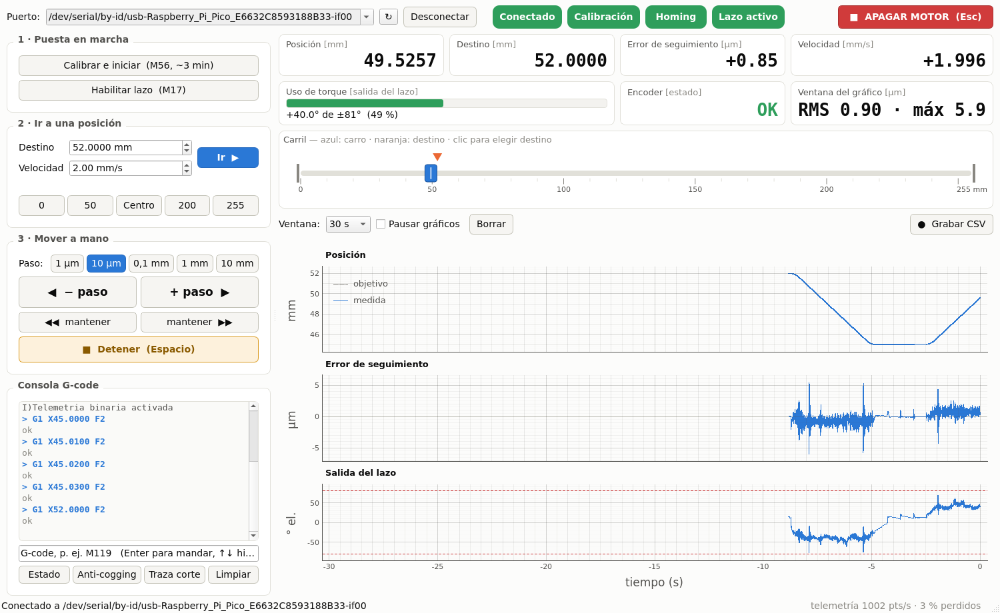
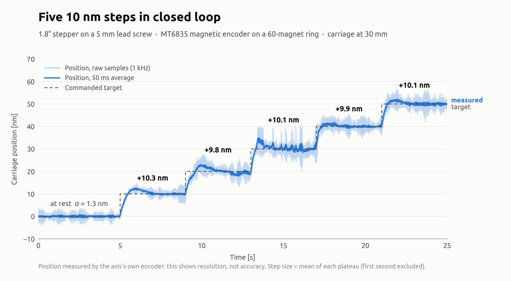
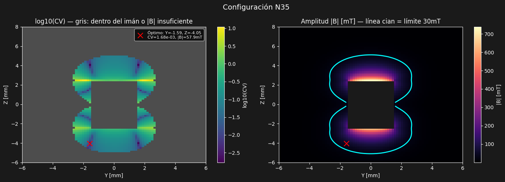
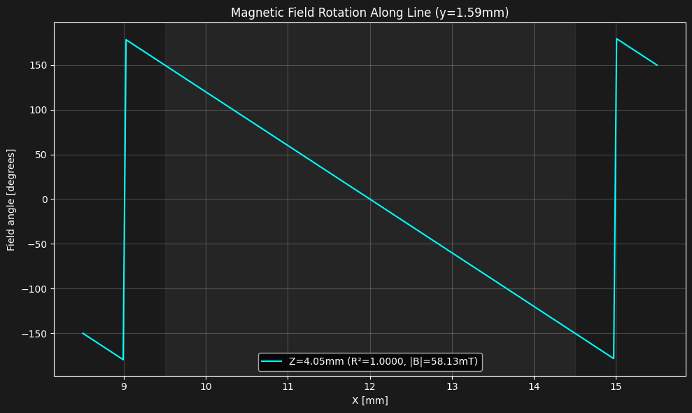

<div align="center">

# μMachining

**Control en lazo cerrado con resolución nanométrica para un eje lineal, sobre una Raspberry Pi Pico**

[](https://github.com/meilantiago/uMachining/actions/workflows/build.yml)


[](LICENSE)

[English](README.md) · **Español**

</div>

μMachining es el firmware de un eje lineal de micromaquinado: un motor paso a paso mueve un carro con un husillo de bolas, y un encoder magnético sobre el eje del motor cierra el lazo. El motor se controla por campo (FOC), no por pasos, así que el carro se puede posicionar en cualquier punto entre dos pasos.

Es una adaptación a un solo eje del firmware `MotionControllerRP` de [MicroManipulatorStepper](https://github.com/0x23/MicroManipulatorStepper), de 0x23, que controla un delta de 3 grados de libertad. Las extensiones principales son las que necesita un eje de muchas vueltas: calibración sobre una vuelta completa del motor, posición sin redondeo de float y anti-cogging.

<p align="center">
  
  <br><sub>La interfaz de PC durante un movimiento a 2 mm/s: 0,90 µm RMS de error de seguimiento.</sub>
</p>

## Contenido

- [Rendimiento](#rendimiento)
- [Características](#características)
- [Hardware](#hardware)
- [Diseño de los imanes del encoder](#diseño-de-los-imanes-del-encoder)
- [Puesta en marcha](#puesta-en-marcha)
- [Adaptarlo a otro eje](#adaptarlo-a-otro-eje)
- [Comandos](#comandos)
- [Telemetría](#telemetría)
- [Cómo funciona](#cómo-funciona)
- [Solución de problemas](#solución-de-problemas)
- [Limitaciones conocidas](#limitaciones-conocidas)
- [Contribuir](#contribuir)
- [Licencia y créditos](#licencia-y-créditos)

## Rendimiento

Medido en nuestro banco: error de seguimiento a 2 mm/s; ruido y pasos en reposo a 30 mm.

| Métrica | Valor |
|---|---|
| Error de seguimiento en movimiento | ~1,0 µm RMS |
| Ruido de posición en reposo | 1,3–1,6 nm (desvío estándar) |
| Paso más chico resuelto | 10 nm |
| Resolución del encoder en el carro | 0,08 nm por cuenta |
| Frecuencia del lazo servo | ~16 kHz |

<p align="center">
  <picture>
    <source media="(prefers-color-scheme: dark)" srcset="docs/steps_10nm_dark.png">
    
  </picture>
  <br><sub>Cinco pasos de 10 nm comandados con <code>G1</code>: telemetría cruda a 1 kHz y promedio de 50 ms.</sub>
</p>

> [!NOTE]
> **Estos valores describen resolución, no exactitud.** Los mide el propio encoder del motor, comparando la posición medida con la pedida. El error de paso del husillo, el juego y la elasticidad de la tuerca no se ven con este sensor. El carro todavía no se midió contra una referencia externa.

## Características

**Control**
- Lazo PI en cascada posición → velocidad → ángulo de campo, en un núcleo dedicado
- Realimentación anticipada de velocidad desde el perfil, que elimina el atraso constante
- Velocidad calculada con la pendiente de la tabla de calibración, para que la no linealidad del encoder no llegue al lazo de velocidad
- Tabla anti-cogging de adelanto del campo, reaprendida automáticamente después de cada calibración
- Posición sin redondeo de float: vueltas enteras en enteros de 64 bits, posición y error en `double`

**Calibración y seguridad**
- Homing y calibración con un solo comando (`M56`), con guardado en flash
- Tabla encoder → motor plegada sobre una vuelta completa, con los armónicos propios del motor filtrados
- Verificación automática de la conmutación después de cada homing, que además corrige un corrimiento de un período del encoder
- Corte cuando el error de seguimiento pasa de 1 mm durante 0,5 s, con la traza de los momentos anteriores

**Herramientas**
- Telemetría binaria de hasta 2 kHz
- Interfaz PyQt5 con gráficos en vivo, movimiento manual, consola G-code y grabación a CSV
- Script de línea de comandos para secuencias

## Hardware

| Componente | En este montaje |
|---|---|
| Controlador | Raspberry Pi Pico (RP2040) |
| Motor | Paso a paso de 1,8° (50 pares de polos) |
| Driver | Puente H doble TB6612FNG |
| Transmisión | Husillo de bolas de 5 mm por vuelta, sobre guía de rodillos cruzados |
| Encoder | MT6835 (21 bits) frente a una rueda de 60 imanes alternados (Ø3 × 5 mm, N35) |

La rueda de imanes da 30 períodos de campo por vuelta del motor, lo que lleva la resolución del encoder a 0,08 nm en el carro. La idea y el método de calibración vienen del proyecto original.

## Diseño de los imanes del encoder

El MT6835 mide la dirección del campo magnético, no la posición. La posición sale de cómo gira esa dirección cuando los imanes pasan frente al sensor, así que cualquier apartamiento del ángulo de campo respecto de una recta es alinealidad del encoder, que después tiene que absorber la tabla de calibración. Simular el campo antes de construir la rueda fue fundamental: derivó en un patrón de diseño que maximiza la linealidad del ángulo de campo.

El notebook [`simulations/magnet_wheel.ipynb`](simulations/magnet_wheel.ipynb) modela la rueda desenrollada como una fila recta de 30 imanes cilíndricos de polaridad alternada, con [magpylib](https://magpylib.readthedocs.io/). Para cada posición posible del sensor a lo ancho de la fila calcula qué tan rápido gira el ángulo de campo a lo largo de un período (dθ/dx) y cuánto varía esa velocidad (su coeficiente de variación, CV). En los mapas finales se descartan los puntos dentro de los imanes o con menos de 30 mT.

Para imanes de Ø3 × 5 mm N35 con paso de 3 mm, el mejor punto está **frente a las caras de los imanes, a 1,55 mm, desplazado hacia el borde de los imanes** (a 1,59 mm de su eje) y no sobre su eje. Ahí:

- la velocidad de giro varía apenas 0,17 % (CV) en el período, y el ángulo de campo sigue a la posición en línea recta (R² = 1,0000);
- las dos componentes del campo tienen la misma amplitud y están a 90°, así que el campo dibuja un círculo, que es la condición para que el ángulo gire parejo;
- el campo es de 58 mT.

<p align="center">
  
  <br><sub>Izquierda: uniformidad de la velocidad del ángulo de campo en el corte del imán (más oscuro es más lineal; gris es dentro del imán o por debajo de 30 mT). Derecha: amplitud del campo, con el límite de 30 mT en cian. La cruz marca el óptimo.</sub>
</p>

<p align="center">
  
  <br><sub>Ángulo de campo a lo largo de la fila en el óptimo: una rampa recta por cada período de 6 mm.</sub>
</p>

El mismo estudio completó el patrón:

- **La ubicación y la geometría fijan la linealidad; el grado del imán solo fija el campo.** N52 y N35 tienen el mismo óptimo y el mismo CV; el N52 solo sube el campo de 58 a 70 mT.
- **La geometría es un compromiso entre linealidad y campo.** Imanes más chatos, de Ø5 × 3 mm con paso de 5 mm, giran todavía más parejo (CV 0,035 %), pero dan solo unos 15 mT en su mejor punto. Los de Ø3 × 5 mm mantienen el ángulo casi igual de lineal con cuatro veces más campo.

### Conexiones

Los pines son los de la opción `SINGLE_AXIS_BOARD` del firmware original, definidos en [`src/hw_config.h`](src/hw_config.h).

| GPIO de la Pico | Va a | | GPIO de la Pico | Va a |
|---|---|---|---|---|
| 2 | TB6612 `AIN1` | | 17 | MT6835 `CS` |
| 3 | TB6612 `AIN2` | | 18 | MT6835 `SCK` |
| 4 | TB6612 `PWMA` | | 19 | MT6835 `MOSI` |
| 5 | TB6612 `BIN1` | | 20 | MT6835 `MISO` |
| 6 | TB6612 `BIN2` | | 24 | Botón de usuario |
| 7 | TB6612 `PWMB` | | 25 | LED de la placa |
| 8 | TB6612 `STBY` | | | |

Las entradas `PWMx` quedan en alto y el PWM se aplica en las entradas `INx` (modo de decaimiento lento).

## Puesta en marcha

### 1. Cargar el firmware

**Precompilado:** bajar el archivo `.uf2` de la página de [Releases](https://github.com/meilantiago/uMachining/releases). Conectar la Pico con BOOTSEL apretado y copiar el archivo a la unidad que aparece. Está compilado para el hardware de arriba: usarlo solo si la mecánica coincide; si no, compilar desde el código.

**Desde el código:** instalar [PlatformIO](https://platformio.org/), revisar [`src/hw_config.h`](src/hw_config.h) (ver [Adaptarlo a otro eje](#adaptarlo-a-otro-eje)), cerrar el monitor serie y correr:

```bash
pio run -t upload
```

> [!TIP]
> En Linux, instalar antes las [reglas udev de PlatformIO](https://docs.platformio.org/en/latest/core/installation/udev-rules.html); si no, la carga falla por permisos.

### 2. Calibrar y mover

Conectar por USB serie a **921 600 baudios** y mandar:

```gcode
M56 S      ; homing, calibración, anti-cogging y guardado en flash (~3 min)
M17        ; habilitar el lazo cerrado
G1 X10     ; ir a X = 10 mm
M114       ; informar la posición
```

Durante `M56` el eje busca el tope, barre el campo más de una vuelta en cada sentido, verifica la conmutación y hace dos idas y vueltas para aprender la tabla anti-cogging. **El carro necesita recorrido libre de 0 a 50 mm.**

> [!IMPORTANT]
> Correr `M56` en cada encendido. La calibración restaurada desde la flash puede quedar corrida un período del encoder; `M56` la vuelve a medir.

### 3. Herramientas de PC

```bash
pip install numpy pyserial PyQt5 pyqtgraph

python3 tools/interfaz.py                                         # interfaz gráfica
python3 tools/send_gcode.py "M56" "M17" "G1 X10" "M114" --timeout 600   # secuencia de comandos
```

La interfaz detecta la placa sola y `send_gcode.py` usa `/dev/ttyACM0` por defecto. Las dos aceptan `--port`. Las grabaciones se guardan en CSV en `mediciones/AAAA-MM-DD/`.

## Adaptarlo a otro eje

Todos los parámetros mecánicos y del control están en [`src/hw_config.h`](src/hw_config.h). Los marcados con `ADJUST` tienen que coincidir con el hardware:

| Parámetro | Qué es | Por defecto |
|---|---|---|
| `LEAD_SCREW_PITCH_MM` | Avance del carro por vuelta del motor | 5 mm |
| `AXIS_MIN_POSITION_MM` / `AXIS_MAX_POSITION_MM` | Límites blandos del recorrido | 0 / 255 mm |
| `MOTOR_POLE_PAIRS` | 50 para motores de 1,8°, 100 para motores de 0,9° | 50 |
| `ENCODER_MAGNET_COUNT` | Imanes de la rueda del encoder | 60 |
| `MOTOR_MAX_CURRENT_FACTOR` | Corriente máxima, de 0 a 1 (no bajar de 0,4) | 0,6 |
| `DEFAULT_MAX_VELOCITY_MM_S` | Velocidad por defecto | 2 mm/s |

**Ajuste de ganancias.** Las ganancias por defecto (`POS_KP` 60, `POS_KI` 100, `VEL_KP` 0,12, `VEL_KI` 54) están ajustadas para nuestro carro. Probar valores nuevos en caliente con `M55 A<pos_kp> B<pos_ki> C<vel_kp> D<vel_ki> F<tc>` antes de cambiar los de `hw_config.h`. La más delicada es `POS_KI`: si es muy alta, la integral de posición oscila contra la fricción estática en reposo. Subirla con el eje quieto hasta que empiece a oscilar y quedarse con la mitad. `VEL_KP` fija la rigidez: si es muy alta, el lazo de velocidad oscila en reposo a unos cientos de hertz (con nuestro carro, desde 0,16).

## Comandos

| Comando | Descripción |
|---|---|
| `G0` / `G1 X<mm> [F<mm/s>]` | Mover. Se rechazan destinos fuera de los límites |
| `G90` / `G91` | Modo absoluto (por defecto) / relativo |
| `G28 [H]` | Homing contra el tope negativo y verificación de la conmutación. `H` toma la posición actual como home (solo con el motor desacoplado) |
| `M17` | Habilitar el lazo cerrado en la posición actual. Exige el eje calibrado y homeado |
| `M18` | Apagar el motor |
| `M56 [S] [P] [H] [F<0\|1>] [A<0\|1>]` | Homing y calibración. `S` guardar en flash · `P` imprimir mediciones · `H` calibrar en el lugar · `F` filtro de armónicos del motor · `A` reaprender anti-cogging |
| `M114` | Informar la posición |
| `M119` | Estado completo, con el último corte por falla |
| `M203 [X<mm/s>]` | Fijar o informar la velocidad máxima de `G0`/`G1` (hasta 5 mm/s) |
| `M55 A B C D F` | Ganancias en caliente: `POS_KP`, `POS_KI`, `VEL_KP`, `VEL_KI`, constante de tiempo del filtro de velocidad |
| `M58 V<0\|1> F<0\|1>` | Velocidad desde la tabla de calibración / realimentación anticipada |
| `M59 [S<0\|1>] [G<ganancia>] [C] [P] [W] [L]` | Anti-cogging: activar, ganancia, borrar, imprimir, guardar en / cargar de la flash. Sin argumentos: estado |
| `M120 S<0\|1> [P<n>]` | Telemetría binaria, un punto cada `n` ticks del timer de 2 kHz |
| `M121` | Imprimir la traza grabada antes del último corte (CSV) |
| `M57 X<mm> [F<mm/s>] [P<n>]` | Diagnóstico de conmutación: barrido a lazo abierto que imprime el desfase |

## Telemetría

`M120 S1 P2` manda paquetes binarios a 1 kHz por el mismo puerto serie, intercalados con las respuestas de texto. Cada paquete es el encabezado `0xAA 0x56` seguido de 28 bytes en little endian (`TelemetryPoint` en [`src/shared_data.h`](src/shared_data.h), formato `struct` de Python `<IiiffiBBH`):

| Campo | Tipo | Unidad |
|---|---|---|
| `timestamp_us` | `uint32` | µs (da la vuelta cada ~71 min) |
| `target_q` | `int32` | posición pedida, 0,25 nm |
| `motor_pos_q` | `int32` | posición medida, 0,25 nm |
| `vel` | `float` | velocidad del motor, rad/s |
| `out` | `float` | salida del lazo de velocidad, rad eléctricos |
| `chip_raw` | `int32` | ángulo crudo del MT6835 (0 … 2²¹ − 1) |
| `status` | `uint8` | bits de estado del encoder |
| `flags` | `uint8` | bit 0: lazo activo · bit 1: corte por falla |
| `seq` | `uint16` | contador de paquetes (los huecos son paquetes perdidos) |

## Cómo funciona

```
 Núcleo 0                                     Núcleo 1
 ────────                                     ────────
 USB serie ─► parser G-code ─► comandos       encoder (SPI) ─► tabla de calibración ─► posición
 timer 2 kHz ─► perfil trapezoidal ───────►   PI de posición ─► PI de velocidad ─► ángulo de campo
                objetivo en int32 (0,25 nm)   conmutación FOC en el TB6612
 serie ◄─ buffer de telemetría ◄──────────────  estado del lazo
```

El núcleo 0 maneja la comunicación y genera el perfil de movimiento; el núcleo 1 corre el lazo servo lo más rápido que puede. La posición objetivo pasa entre núcleos como un único entero de 32 bits en unidades de 0,25 nm, que en el RP2040 se escribe de forma atómica.

**Calibración.** El campo gira a lazo abierto 400° en cada sentido mientras se muestrea el encoder. Se descartan las muestras cerca de las puntas de cada barrido, donde el atraso del rotor todavía no se estableció. El resto se pliega sobre una vuelta y se ajusta a una tabla periódica, válida en todo el recorrido. Las componentes que se repiten 50·m veces por vuelta son del motor, no del encoder (cuya rueda se repite 30·m veces), y se sacan. Después el homing fija el cero y un barrido corto verifica que la conmutación coincida con la tabla.

**Precisión numérica.** A 255 mm, un ángulo de motor en `float` solo resuelve unos 24 nm. Por eso las vueltas enteras se sacan con aritmética entera de 64 bits antes de consultar la tabla, y la posición, el objetivo y el error van en `double`. La conmutación sigue en `float`, donde la precisión alcanza. El lazo corre a la misma velocidad que con todo en `float`.

### Estructura del código

```
src/
├── main.cpp                arranque de los núcleos, lazo serie, salida de telemetría
├── hw_config.h             mecánica, pines y parámetros del lazo
├── axis_controller.*       homing, calibración, verificación de conmutación, mm ↔ rad
├── command_processor.*     comandos G/M
├── shared_data.h           datos compartidos entre núcleos, buffer de telemetría
├── motion_profile/         perfil trapezoidal punto a punto
├── servo_control/          lazo servo, PID, calibración, homing, anti-cogging
├── hardware/               encoder MT6835 y driver TB6612
├── command_parser/         parser de G-code
└── utilities/              tabla de búsqueda, matemática de punto fijo, logs
tools/
├── interfaz.py             interfaz PyQt5
└── send_gcode.py           envío de comandos por línea de comandos
simulations/
└── magnet_wheel.ipynb      campo magnético de la rueda del encoder (magpylib)
```

**Relación con el original.** Los drivers del MT6835 y del TB6612, el PID, el controlador de homing, el parser de G-code y los logs se reusan o están apenas adaptados. El controlador servo, la calibración y la tabla de búsqueda están extendidos. El perfil de movimiento (que reemplaza al planificador y la cinemática del delta), el controlador del eje, el procesador de comandos, los datos compartidos, el aprendizaje anti-cogging y `main.cpp` son nuevos.

## Solución de problemas

| Mensaje | Qué significa | Qué hacer |
|---|---|---|
| `axis not calibrated, run M56 first` | No hay calibración cargada | Correr `M56` |
| `axis not homed, run G28 (or M56) first` | Se mandó `M17` antes del homing | Correr `M56` (o `G28`) |
| `homing failed (hard stop not detected)` | No encontró el tope | Verificar que el carro llegue al tope negativo y que el motor esté acoplado |
| `Homing aborted: the encoder does not follow the motor` | El encoder no acompaña al motor | Verificar que la rueda de imanes esté firme en el eje |
| `Magnetic field too weak` | Campo en el sensor por debajo del mínimo del MT6835 | Acercar el sensor a los imanes |
| `Non-integer periods per revolution` | Cantidad de períodos por vuelta incorrecta | Revisar `ENCODER_MAGNET_COUNT` y la rueda |
| `commutation does not match the stored calibration` | La calibración guardada ya no sirve | Correr `M56` |
| `position out of range` | Destino de `G1` fuera de los límites | Revisar `AXIS_MIN/MAX_POSITION_MM` |
| `M119` informa `last fault` | El lazo cortó por error de seguimiento | Ver la traza con `M121`. Suele ser demasiada velocidad o carga para el factor de corriente |
| El carro se clava con la salida del lazo saturada, o `M57` da desfases distintos de los habituales | La calibración guardada en flash ya no corresponde a la mecánica (por ejemplo, después de desmontar el motor) | Correr `M56 S` |
| Decenas de nanómetros de ruido en reposo, concentrados cerca de 200 Hz | El lazo de velocidad está al borde de la inestabilidad | Bajar `VEL_KP` con `M55` hasta que desaparezca |

## Limitaciones conocidas

- **Stick-slip después de pasos chicos.** Después de un paso de unas decenas de nanómetros el carro puede quedarse quieto ~2 s, saltar 40–80 nm cuando se rompe la fricción estática, y asentarse en ~1 nm en ~8 s.
- **Velocidad.** Validado a 2 mm/s. Cerca de 4 mm/s el motor se queda sin margen de torque con el factor de corriente por defecto.
- **El homing** solo está implementado contra el tope negativo.
- **Probado solo en el RP2040.** La opción para RP2350 (Pico 2) está en `platformio.ini`, pero no se probó.

**Próximos pasos:** medir el carro contra un interferómetro, y un soporte de encoder más rígido con una rueda de imanes rediseñada.

## Contribuir

Issues y pull requests son bienvenidos, sobre todo de quien use el firmware con otra mecánica. Para cambios grandes, conviene abrir primero un issue y charlar el enfoque. `master` siempre tiene una versión probada en hardware.

## Licencia y créditos

Licencia MIT, igual que el proyecto original. Ver [LICENSE](LICENSE).

**Autores:** Francisco Maresca · Tiago Meilan

Basado en [MicroManipulatorStepper](https://github.com/0x23/MicroManipulatorStepper), de 0x23. Su método de calibración y el encoder con engranaje magnético hicieron posible este proyecto.
