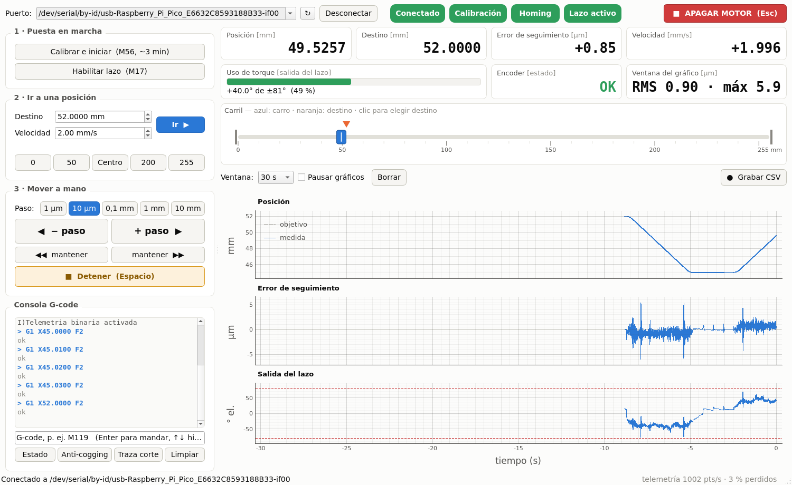
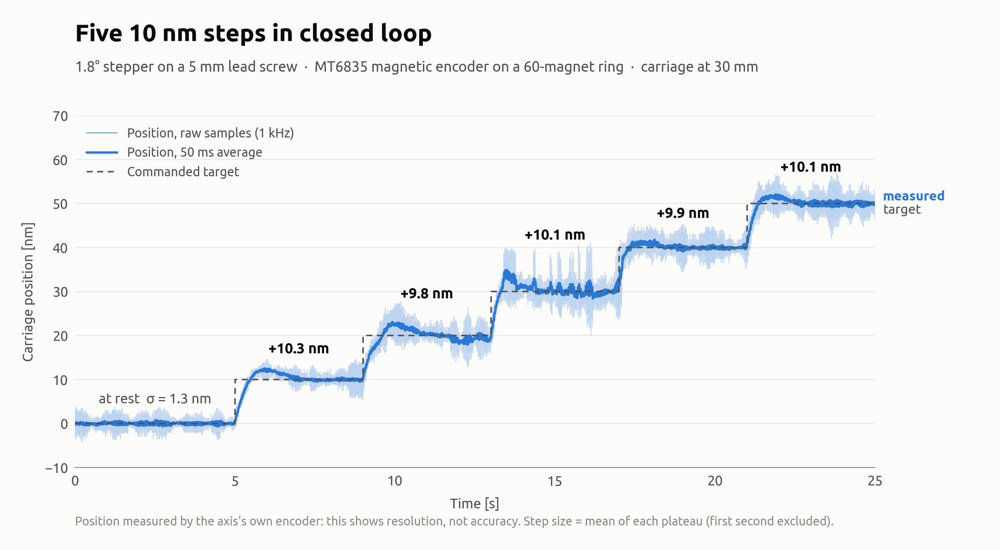

<div align="center">

# μMachining

**Nanometre-resolution closed-loop control for a single linear axis, on a Raspberry Pi Pico**

[](https://github.com/meilantiago/uMachining/actions/workflows/build.yml)


[](LICENSE)

**English** · [Español](README.es.md)

</div>

μMachining is the firmware for a linear micromachining axis: a stepper motor drives a carriage through a ball screw, and a magnetic encoder on the motor shaft closes the loop. The motor is driven with field-oriented control (FOC), not by steps, so the carriage can be positioned anywhere between two steps.

It is a single-axis adaptation of the `MotionControllerRP` firmware from [MicroManipulatorStepper](https://github.com/0x23/MicroManipulatorStepper) by 0x23, which drives a 3-DOF delta. The main extensions are what a multi-turn axis needs: calibration over a full motor revolution, a position path free of float rounding, and anti-cogging.

<p align="center">
  
  <br><sub>The PC interface during a move at 2 mm/s: 0.90 µm RMS following error.</sub>
</p>

## Contents

- [Performance](#performance)
- [Features](#features)
- [Hardware](#hardware)
- [Getting started](#getting-started)
- [Adapting it to your axis](#adapting-it-to-your-axis)
- [Command reference](#command-reference)
- [Telemetry](#telemetry)
- [How it works](#how-it-works)
- [Troubleshooting](#troubleshooting)
- [Known limitations](#known-limitations)
- [Contributing](#contributing)
- [License and credits](#license-and-credits)

## Performance

Measured on our bench: following error at 2 mm/s, noise and steps at rest at 30 mm.

| Metric | Value |
|---|---|
| Following error while moving | ~1.0 µm RMS |
| Position noise at rest | 1.3–1.6 nm (standard deviation) |
| Smallest step resolved | 10 nm |
| Encoder resolution at the carriage | 0.08 nm per count |
| Servo loop rate | ~16 kHz |

<p align="center">
  <picture>
    <source media="(prefers-color-scheme: dark)" srcset="docs/steps_10nm_dark.png">
    
  </picture>
  <br><sub>Five 10 nm steps commanded with <code>G1</code>, raw 1 kHz telemetry and a 50 ms average.</sub>
</p>

> [!NOTE]
> **These figures describe resolution, not accuracy.** They are measured by the motor-side encoder itself, comparing the measured position with the commanded one. Screw lead error, backlash and nut compliance are invisible to this sensor. The carriage has not yet been checked against an external reference.

## Features

**Control**
- Cascaded position → velocity → field-angle PI loop on a dedicated core
- Velocity feed-forward from the motion profile, which removes the constant following lag
- Velocity computed from the slope of the calibration table, so the encoder's nonlinearity never reaches the velocity loop
- Anti-cogging field-lead table, relearned automatically after every calibration
- Position path with no float rounding: whole turns in 64-bit integers, position and error in `double`

**Calibration and safety**
- One-command homing and calibration (`M56`), stored in flash
- Encoder → motor table folded over a full revolution, with the motor's own harmonics filtered out
- Automatic commutation check after every homing, which also corrects a one-period encoder offset
- Cut-off when the following error exceeds 1 mm for 0.5 s, with a trace of the moments before it

**Tooling**
- Binary telemetry at up to 2 kHz
- PyQt5 interface with live plots, jogging, a G-code console and CSV recording
- Command-line sender for scripted sequences

## Hardware

| Component | Used in this build |
|---|---|
| Controller | Raspberry Pi Pico (RP2040) |
| Motor | 1.8° stepper (50 pole pairs) |
| Driver | TB6612FNG dual H-bridge |
| Transmission | Ball screw, 5 mm per revolution, on a crossed-roller rail |
| Encoder | MT6835 (21-bit) facing a wheel of 60 alternating magnets (Ø3 × 5 mm, N35) |

The magnet wheel gives 30 field periods per motor revolution, which brings the encoder resolution down to 0.08 nm at the carriage. The idea and the calibration method come from the upstream project.

### Wiring

The pinout is the `SINGLE_AXIS_BOARD` option of the upstream firmware. It is defined in [`src/hw_config.h`](src/hw_config.h).

| Pico GPIO | Connects to | | Pico GPIO | Connects to |
|---|---|---|---|---|
| 2 | TB6612 `AIN1` | | 17 | MT6835 `CS` |
| 3 | TB6612 `AIN2` | | 18 | MT6835 `SCK` |
| 4 | TB6612 `PWMA` | | 19 | MT6835 `MOSI` |
| 5 | TB6612 `BIN1` | | 20 | MT6835 `MISO` |
| 6 | TB6612 `BIN2` | | 24 | User button |
| 7 | TB6612 `PWMB` | | 25 | Built-in LED |
| 8 | TB6612 `STBY` | | | |

The `PWMx` inputs are held high and the PWM is applied to the `INx` inputs (slow-decay mode).

## Getting started

### 1. Flash the firmware

**Prebuilt:** download the `.uf2` file from the [Releases](https://github.com/meilantiago/uMachining/releases) page. Hold BOOTSEL while plugging in the Pico, then copy the file to the drive that appears. It is built for the hardware above, so use it only if your mechanics match. Otherwise, build from source.

**From source:** install [PlatformIO](https://platformio.org/), review [`src/hw_config.h`](src/hw_config.h) (see [Adapting it to your axis](#adapting-it-to-your-axis)), close any serial monitor and run:

```bash
pio run -t upload
```

> [!TIP]
> On Linux, install the [PlatformIO udev rules](https://docs.platformio.org/en/latest/core/installation/udev-rules.html) first, or the upload will fail with a permission error.

### 2. Calibrate and move

Connect over USB serial at **921 600 baud** and send:

```gcode
M56 S      ; home, calibrate, learn anti-cogging, save to flash (~3 min)
M17        ; enable the closed loop
G1 X10     ; move to X = 10 mm
M114       ; report the position
```

During `M56` the axis searches for the hard stop, sweeps the field over more than a revolution in each direction, checks the commutation and makes two back-and-forth passes to learn the anti-cogging table. **The carriage needs free travel from 0 to 50 mm.**

> [!IMPORTANT]
> Run `M56` after every power-up. A calibration restored from flash can be one encoder period off; `M56` measures it again.

### 3. Use the PC tools

```bash
pip install numpy pyserial PyQt5 pyqtgraph

python3 tools/interfaz.py                                         # graphical interface
python3 tools/send_gcode.py "M56" "M17" "G1 X10" "M114" --timeout 600   # scripted sequence
```

The interface finds the board on its own, and `send_gcode.py` defaults to `/dev/ttyACM0`. Both accept `--port`. Recordings are saved as CSV under `mediciones/YYYY-MM-DD/`.

> [!NOTE]
> The PC interface is in Spanish; the firmware messages are in English. Commands and replies follow the usual G-code conventions: every command is answered with `ok` or `error: ...`.

## Adapting it to your axis

All mechanical and control parameters are in [`src/hw_config.h`](src/hw_config.h). The values marked `ADJUST` must match your hardware:

| Parameter | Meaning | Default |
|---|---|---|
| `LEAD_SCREW_PITCH_MM` | Carriage travel per motor revolution | 5 mm |
| `AXIS_MIN_POSITION_MM` / `AXIS_MAX_POSITION_MM` | Soft travel limits | 0 / 255 mm |
| `MOTOR_POLE_PAIRS` | 50 for 1.8° motors, 100 for 0.9° motors | 50 |
| `ENCODER_MAGNET_COUNT` | Magnets on the encoder wheel | 60 |
| `MOTOR_MAX_CURRENT_FACTOR` | Maximum current, 0 to 1 (keep it at 0.4 or above) | 0.6 |
| `DEFAULT_MAX_VELOCITY_MM_S` | Default velocity | 2 mm/s |

**Tuning.** The default gains (`POS_KP` 60, `POS_KI` 100, `VEL_KP` 0.12, `VEL_KI` 54) are tuned for our carriage. Try new values live with `M55 A<pos_kp> B<pos_ki> C<vel_kp> D<vel_ki> F<tc>` before changing the defaults. The most sensitive one is `POS_KI`: too high and the position integral hunts against static friction at rest. Raise it with the axis at rest until hunting starts, then use about half of that value. `VEL_KP` sets the stiffness: too high and the velocity loop oscillates at rest at a few hundred hertz (with our carriage, from 0.16 upwards).

## Command reference

| Command | Description |
|---|---|
| `G0` / `G1 X<mm> [F<mm/s>]` | Move. Targets outside the soft limits are rejected |
| `G90` / `G91` | Absolute (default) / relative positioning |
| `G28 [H]` | Home against the negative hard stop and check the commutation. `H` takes the current position as home (motor uncoupled only) |
| `M17` | Enable the closed loop, holding the current position. Requires a calibrated and homed axis |
| `M18` | Disable the motor |
| `M56 [S] [P] [H] [F<0\|1>] [A<0\|1>]` | Home and calibrate. `S` save to flash · `P` print measurements · `H` calibrate in place · `F` motor-harmonic filter · `A` relearn anti-cogging |
| `M114` | Report the position |
| `M119` | Report the full status, including the last fault cut-off |
| `M203 [X<mm/s>]` | Set or report the maximum `G0`/`G1` velocity (up to 5 mm/s) |
| `M55 A B C D F` | Set loop gains live: `POS_KP`, `POS_KI`, `VEL_KP`, `VEL_KI`, velocity low-pass time constant |
| `M58 V<0\|1> F<0\|1>` | Velocity from the calibration table / velocity feed-forward |
| `M59 [S<0\|1>] [G<gain>] [C] [P] [W] [L]` | Anti-cogging: enable, gain, clear, print, save to / load from flash. No arguments: status |
| `M120 S<0\|1> [P<n>]` | Binary telemetry on/off, one point every `n` ticks of the 2 kHz timer |
| `M121` | Print the trace recorded before the last fault cut-off (CSV) |
| `M57 X<mm> [F<mm/s>] [P<n>]` | Commutation diagnostic: open-loop sweep that prints the commutation offset |

## Telemetry

`M120 S1 P2` streams 1 kHz binary packets on the same serial port, interleaved with the text replies. Each packet is the header `0xAA 0x56` followed by 28 bytes, little endian (`TelemetryPoint` in [`src/shared_data.h`](src/shared_data.h), Python `struct` format `<IiiffiBBH`):

| Field | Type | Unit |
|---|---|---|
| `timestamp_us` | `uint32` | µs (wraps every ~71 min) |
| `target_q` | `int32` | commanded position, 0.25 nm |
| `motor_pos_q` | `int32` | measured position, 0.25 nm |
| `vel` | `float` | motor velocity, rad/s |
| `out` | `float` | velocity-loop output, electrical rad |
| `chip_raw` | `int32` | raw MT6835 angle (0 … 2²¹ − 1) |
| `status` | `uint8` | encoder status bits |
| `flags` | `uint8` | bit 0: loop active · bit 1: fault cut-off |
| `seq` | `uint16` | packet counter (gaps mean dropped packets) |

## How it works

```
 Core 0                                       Core 1
 ──────                                       ──────
 USB serial ─► G-code parser ─► commands      encoder (SPI) ─► calibration LUT ─► position
 2 kHz timer ─► trapezoidal profile ──────►   position PI ─► velocity PI ─► field angle
                target as int32 (0.25 nm)     TB6612 FOC commutation
 serial ◄─ telemetry ring buffer ◄───────────  loop state
```

Core 0 handles communication and generates the motion profile; core 1 runs the servo loop as fast as it can. The target position crosses cores as a single 32-bit integer in 0.25 nm units, which is atomic on the RP2040.

**Calibration.** The field is turned open loop over 400° in each direction while the encoder is sampled. Samples near the ends of each sweep are discarded because the rotor lag has not settled there. The rest are folded onto one revolution and fitted into a periodic lookup table, which is valid over the whole multi-turn travel. Components that repeat 50·m times per revolution belong to the motor, not to the encoder (whose wheel repeats 30·m times), and are removed. Homing then fixes the zero, and a short sweep checks that the commutation matches the table.

**Numeric precision.** At 255 mm a `float` motor angle only resolves about 24 nm. Whole revolutions are therefore removed in 64-bit integer arithmetic before the table lookup, and position, target and error are kept in `double`. Commutation stays in `float`, where the precision is sufficient. The loop speed is the same as with `float` throughout.

### Source layout

```
src/
├── main.cpp                core start-up, serial loop, telemetry output
├── hw_config.h             mechanics, pins and loop parameters
├── axis_controller.*       homing, calibration, commutation check, mm ↔ rad
├── command_processor.*     G/M-code commands
├── shared_data.h           data shared between cores, telemetry buffer
├── motion_profile/         trapezoidal point-to-point profile
├── servo_control/          servo loop, PID, calibration, homing, anti-cogging
├── hardware/               MT6835 encoder and TB6612 driver
├── command_parser/         G-code parser
└── utilities/              lookup table, fixed-point math, logging
tools/
├── interfaz.py             PyQt5 interface
└── send_gcode.py           command-line sender
```

**Relation to upstream.** The MT6835 and TB6612 drivers, the PID controller, the homing controller, the G-code parser and the logging utilities are reused or lightly adapted. The servo controller, the actuator calibration and the lookup table are extended. The motion profile (replacing the delta's planner and kinematics), axis controller, command processor, shared data, anti-cogging learner and `main.cpp` are new.

## Troubleshooting

The most common messages and symptoms:

| Message | Meaning | What to do |
|---|---|---|
| `axis not calibrated, run M56 first` | No calibration loaded | Run `M56` |
| `axis not homed, run G28 (or M56) first` | `M17` sent before homing | Run `M56` (or `G28`) |
| `homing failed (hard stop not detected)` | The hard stop was not found | Check that the carriage can reach the negative stop and that the motor is coupled |
| `Homing aborted: the encoder does not follow the motor` | The encoder does not follow the motor | Check that the magnet wheel is tight on the shaft |
| `Magnetic field too weak` | Field at the sensor below the MT6835 minimum | Reduce the sensor-to-magnet gap |
| `Non-integer periods per revolution` | Wrong number of periods per revolution | Check `ENCODER_MAGNET_COUNT` and the wheel |
| `commutation does not match the stored calibration` | Stored calibration no longer valid | Run `M56` |
| `position out of range` | `G1` target outside the soft limits | Check `AXIS_MIN/MAX_POSITION_MM` |
| `M119` reports `last fault` | The loop tripped on following error | Use `M121` to see the trace. Usually too much velocity or load for the current factor |
| The carriage stalls with the loop output saturated, or `M57` offsets differ from usual | The calibration stored in flash no longer matches the mechanics (e.g. after remounting the motor) | Run `M56 S` |
| Tens of nanometres of noise at rest, concentrated around 200 Hz | The velocity loop is close to instability | Lower `VEL_KP` with `M55` until it disappears |

## Known limitations

- **Stick-slip after small steps.** After a step of a few tens of nanometres the carriage can stay still for ~2 s, jump 40–80 nm when static friction breaks, and settle to ~1 nm within ~8 s.
- **Speed.** Validated at 2 mm/s. Around 4 mm/s the motor runs out of torque margin at the default current factor.
- **Homing** is only implemented against the negative hard stop.
- **Tested on the RP2040 only.** The RP2350 (Pico 2) board option is in `platformio.ini` but has not been tried.

**Next steps:** measuring the carriage against an interferometer, and a stiffer encoder mount with a redesigned magnet wheel.

## Contributing

Issues and pull requests are welcome, especially from anyone running the firmware on other mechanics. For larger changes, please open an issue first to discuss the approach. `master` always holds a version that has been tested on hardware.

## License and credits

Released under the MIT license, the same as the upstream project. See [LICENSE](LICENSE).

**Authors:** Francisco Maresca · Tiago Meilan

Built on [MicroManipulatorStepper](https://github.com/0x23/MicroManipulatorStepper) by 0x23. Its calibration approach and magnetic-gearing encoder made this project possible.
