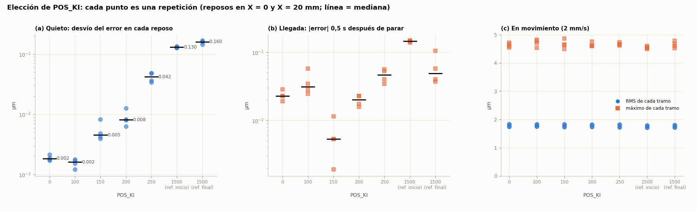
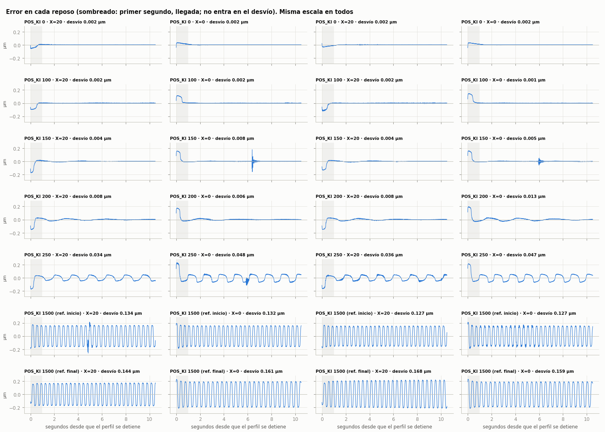

# Elección de `POS_KI` (20/10/2026)

**Decisión: `POS_KI = 100`** (antes 1500), verificada en el carril completo (sección 6), con `POS_KP = 60` y el lazo de velocidad sin cambios (`VEL_KP 0.2`, `VEL_KI 90`, `VEL_LOWPASS_TC 4 ms`). La velocidad con la tabla y la realimentación anticipada siguen activas (`M58 V1 F1`).

| | `POS_KI = 1500` (antes) | **`POS_KI = 100`** |
|---|---|---|
| Error quieto (desvío) | 0,13–0,17 µm, oscilando sin parar a 2,7 Hz | **0,001–0,002 µm**, sin oscilación |
| Error en movimiento a 2 mm/s (RMS / máximo, 0–20 mm) | 1,76 / 4,6–4,8 µm | 1,79 / 4,8 µm (igual) |
| Tiempo hasta quedar dentro de 0,05 µm al parar | nunca (oscila) | ~0,5 s |
| Corrige errores lentos y sostenidos en movimiento | sí | sí (constante de tiempo ~0,6 s) |

---

## 1. Qué hace `POS_KI` y por qué hay que elegirlo

El lazo es una cascada (ver [el reporte del 16/10](REPORTE_PRUEBA_LAZO_CERRADO_2026-10-16.md), sección 2):

```
error de posición ──► PI de posición (POS_KP, POS_KI) ──► velocidad pedida (+ velocidad del perfil)
                                                                │
                      velocidad medida ──► PI de velocidad (VEL_KP, VEL_KI) ──► torque
```

Hay **dos integrales**, y cada una corrige cosas distintas.

**La integral del lazo de velocidad (`VEL_KI`) ya anula el error final contra una carga constante.** Si una fuerza empuja el carro quieto, el carro se corre y el lazo de posición pide una velocidad (60 × el error). Mientras esa velocidad pedida no sea cero, la integral de velocidad sigue sumando torque hasta que el carro vuelve. El único equilibrio posible es error cero, **aun con `POS_KI = 0`**. Se ve en los datos: con `POS_KI = 0`, en reposo, la media del error fue de 0,0000–0,0008 µm (sección 4).

**La integral de posición (`POS_KI`) agrega la corrección de errores que aparecen en movimiento y son proporcionales a la velocidad.** El ejemplo típico es un pequeño desajuste entre la velocidad del perfil (anticipada) y la que realmente mide el lazo: una diferencia de escala, más fricción en un tramo. Sin integral de posición, ese desajuste deja un error de seguimiento que nadie corrige. Evidencia: en el carril completo (barrido del 16/10, `barrido_pid_140929`), con `POS_KI = 0` el atraso medio de la ida pasó de 0,68 µm a 0,90 µm después de los ~130 mm y no volvió. Con 250, 500 y 1500 se mantuvo plano en 0,68–0,69 µm.

**El precio de la integral de posición es la "caza" en reposo.** Con el carro quieto actúa la fricción estática: hace falta un torque mínimo para mover el carro. Con integral de posición pasa esto:

1. queda un error chico que la fricción no deja corregir;
2. la integral lo va acumulando y sube la velocidad pedida;
3. en algún momento el torque vence la fricción y el carro salta, pero la integral está cargada y se pasa al otro lado;
4. el ciclo vuelve a empezar al revés.

Es un ciclo límite clásico de un control PI con fricción estática. Cuanto más grande `POS_KI`, más rápido se carga la integral y más grande y frecuente es el ciclo. Se midió de 1,4 Hz y ±0,1 µm con `POS_KI = 500` a 4,6 Hz y ±0,45 µm con 3000 (`barrido_ki_123236`).

**La escala de tiempo.** La integral de posición actúa sobre lo que dura más que KP/KI segundos. Con 1500 son 0,04 s, una integral muy agresiva. Con 100 son 0,6 s: corrige desajustes que duran segundos (como la deriva del carril) y deja tranquilo el reposo.

**En resumen:** hay que buscar el `POS_KI` más alto que no produzca caza en reposo, con margen, porque el umbral depende de la fricción. Por debajo de ese umbral, más integral no cambia nada en movimiento. Por encima, el reposo empeora.

## 2. Criterios

1. **No empeorar el movimiento:** RMS y máximo del error de seguimiento a 2 mm/s.
2. **Reposo sin caza**, en todas las repeticiones, con margen frente al umbral. El umbral cambia con la fricción, así que hay que dejar lugar para que varíe.
3. **Conservar acción integral de posición**, para los desajustes lentos en movimiento (sección 1).
4. **Llegada rápida:** cuánto tarda en quedar quieto en el lugar después de un movimiento.

## 3. Toda la evidencia

| Barrido | Lazo | Dónde | `POS_KI` probados | Qué mostró |
|---|---|---|---|---|
| `2026-10-16/barrido_ki_123236` | V1F1 | reposo, X20 y X100, 10 s | 500–3000 | Caza en todos; crece con `POS_KI` (desvío 0,08–0,11 µm con 500, 0,30–0,38 µm con 3000) |
| `2026-10-16/barrido_ki_131928` | V1F1 | reposo, X20 y X100, 10 s | 0, 100, 250, 400 | 0: 0,003–0,005 µm · 100: 0,011–0,013 · **250: 0,054–0,056 (caza)** · 400: 0,13 |
| `2026-10-16/barrido_ki_135123` | V0F0 | reposo, X10, 10 s | 0–1000 | Quieto hasta 750 en esa corrida; 500 empezó a cazar a los 4 s; 1000 caza ±0,23 µm |
| `2026-10-16/barrido_pid_140929` | V1F1 | movimiento, 0–255 mm | 0, 250, 500, 1500 | Movimiento igual en todos (RMS 1,78–1,83 µm); **con 0 el atraso deriva +0,2 µm** después de 130 mm |
| `2026-10-16/barrido_pid_142713` | V1F1 | movimiento, 0–20 mm | 750, 1500 | Movimiento igual |
| **`2026-10-20/barrido_pid_144225`** | V1F1 | movimiento 0–20 mm + 4 reposos de 10 s | 0, 100, 150, 200, 250, 1500 | Este ensayo (sección 4) |

Lo que coincide entre días y posiciones: **el movimiento no depende de `POS_KI`**, y **el umbral de caza está entre 200 y 500** según el día y el lugar. Con 250 hubo caza en dos de los tres barridos que lo probaron.

## 4. Ensayo del 20/10: `POS_KI` entre 0 y 250

**Método** (`tools/pid_sweep.py` + `tools/ki_eleccion.py`):
- una sola calibración (`M56`: RMS 0,088°, conmutación +0,4°), con los valores cambiados en caliente con `M55`;
- para cada valor, dos idas y vueltas de 0 a 20 mm a 2 mm/s y **10 s de reposo después de cada tramo**: 4 reposos por valor, dos en X0 y dos en X20;
- `POS_KI = 1500` medido al principio y al final como referencia;
- en cada reposo se descarta el primer segundo, que es la llegada, y se miden el desvío y la oscilación; aparte se miden la llegada y el error en movimiento.

| `POS_KI` | Desvío quieto en cada reposo [µm] | Qué se ve en reposo | \|error\| 0,5 s después de parar | Hasta quedar en ±0,05 µm | RMS / máx en movimiento |
|---|---|---|---|---|---|
| 0 | 0,002 · 0,002 · 0,002 · 0,002 | Quieto | 0,023 µm | 0–0,15 s | 1,79 / 4,7 µm |
| **100** | **0,002 · 0,002 · 0,002 · 0,001** | **Quieto.** Al llegar queda ±0,1 µm, y a los ~0,5 s la integral lo lleva a 0 de un solo paso | 0,031 µm | ~0,5 s | **1,79 / 4,8 µm** |
| 150 | 0,004 · 0,008 · 0,004 · 0,005 | Quieto, pero en 2 de 4 reposos hubo un "chasquido" aislado de ±0,15 µm a los ~6 s | 0,005 µm | 0,3 s (2 de 4: 6 s) | 1,78 / 4,9 µm |
| 200 | 0,008 · 0,006 · 0,008 · 0,013 | Oscilación lenta y amortiguada de ±0,03 µm que tarda varios segundos en apagarse | 0,020 µm | 0,33 s | 1,78 / 4,8 µm |
| 250 | 0,034 · 0,048 · 0,036 · 0,047 | **Caza permanente**, ±0,05 µm a 1–2 Hz | 0,046 µm | nunca | 1,78 / 4,7 µm |
| 1500 (inicio / final) | 0,13 · 0,13 · 0,13 · 0,13 / 0,14 · 0,16 · 0,17 · 0,16 | Caza permanente, ±0,17 µm a 2,7 Hz | 0,05–0,15 µm | nunca | 1,76 / 4,6–4,8 µm |



*(a) Desvío del error en cada reposo (escala logarítmica): plano hasta 100, sube de a poco con 150 y 200, salta con 250 (caza) y más con 1500. (b) Error 0,5 s después de parar. (c) Error en movimiento: igual en todos los valores.*



*Cada reposo, con la misma escala: una fila por `POS_KI` y una columna por repetición. El sombreado es el primer segundo (llegada).*

**Cómo se lee la progresión.** La fricción estática deja una franja de unas décimas de µm donde el carro no se mueve.
- **Con 0:** la integral de velocidad acomoda el error dentro de esa franja y el carro queda quieto.
- **Con 100:** la integral de posición termina de llevar el error a cero con un solo deslizamiento, y como la integral es lenta, no se pasa.
- **Con 150 y 200:** el deslizamiento se empieza a pasar un poco: chasquidos aislados, oscilación amortiguada.
- **Desde 250:** cada deslizamiento se pasa lo suficiente para provocar el siguiente, y el ciclo ya no se apaga (caza).

## 5. Por qué 100

**Contra 1500 (el valor anterior).** El movimiento es el mismo, y el reposo pasa de una oscilación permanente de ±0,17 µm a 0,002 µm: 80 veces menos.

**Contra 0.** El reposo es igual de bueno, pero 0 deja al eje sin integral de posición. Con 0 se midió una deriva de +0,2 µm del atraso a lo largo del carril que con integral no aparece (sección 1). Con 100, esa corrección se mantiene, con una constante de tiempo de 0,6 s. El costo es mínimo: al llegar a una posición, el carro queda ±0,1 µm del destino durante ~0,5 s antes de que la integral lo lleve a cero. Con 0 llega a ±0,05 µm en menos de 0,15 s, pero no tiene con qué corregir un desajuste sostenido.

**Contra 150 y 200.** No mejoran nada en movimiento, y en reposo ya muestran los primeros síntomas del umbral: chasquidos aislados (150) y oscilación amortiguada (200).

**Contra 250.** Hoy cazó en las 4 repeticiones, y también en el barrido del 16/10 a las 13:19. Está en el umbral.

**Margen.** El umbral de caza más bajo que se vio fue de 200–250. 100 está entre 2 y 2,5 veces por debajo. El umbral depende de la fricción, que cambia con la temperatura, la lubricación, la posición en el carril y la carga, así que un margen ×2 es razonable. Con 150 o 200 quedaríamos a menos de ×1,7 de un umbral que se movió entre días.

## 6. Verificación en el carril completo (20/10)

Se corrió 0 → 255 → 0 mm a 2 mm/s con `POS_KI` = 1500 → 100 → 1500, todo con la misma calibración del ensayo de la sección 4 (`mediciones/2026-10-20/barrido_pid_145957/`). Los criterios se fijaron antes de medir: sin cortes, RMS y máximo dentro de ±5% de la referencia, y una deriva del atraso a lo largo del eje de no más de 0,05 µm.

| | 1500 (inicio) | **100** | 1500 (final) |
|---|---|---|---|
| Cortes | no | **no** | no |
| RMS en movimiento | 1,77 µm | **1,78 µm** | 1,76 µm |
| Máximo en movimiento | 4,9 µm | **5,2 µm** | 5,1 µm |
| Atraso medio cada 50 mm, ida | +0,679 … +0,691 µm | **+0,680 … +0,692 µm** | +0,680 … +0,689 µm |
| Atraso medio cada 50 mm, vuelta | −0,685 … −0,691 µm | **−0,680 … −0,692 µm** | −0,681 … −0,685 µm |
| Rango del atraso a lo largo del eje | 0,012 / 0,006 µm | **0,012 / 0,012 µm** | 0,009 / 0,004 µm |
| Quieto después de llegar (sin el primer segundo) | 0,12–0,18 µm, oscilando | **0,006–0,017 µm** | 0,13–0,15 µm, oscilando |

**Se cumplen los tres criterios.** El movimiento es el mismo (+1% de RMS, +4% de máximo, dentro de la variación entre las dos referencias), y **no aparece la deriva del atraso que se vio con `POS_KI = 0`**: el atraso queda plano en todo el carril, igual que con 1500. En el reposo de las puntas, que en esta prueba dura solo ~1,5 s, el carro queda quieto en vez de oscilar. **`POS_KI = 100` queda adoptado** en `src/hw_config.h`.

## 7. Límites y cómo revisarlo

- **No se probó con carga** (fuerza de corte). Según la sección 1, contra una carga constante la integral de velocidad ya asegura error final cero, pero conviene confirmarlo cuando haya un ensayo con carga.
- **El umbral depende de la fricción.** Después de cambios mecánicos (lubricar, arreglar el roce de la rueda, cambiar el acople), repetir el ensayo:
  ```bash
  python3 tools/pid_sweep.py --end 20 --cycles 2 --dwell 10 --config "ki0:pos_ki=0" --config "ki100:pos_ki=100" --config "ki150:pos_ki=150" --config "ki200:pos_ki=200" --config "ki250:pos_ki=250"
  python3 tools/ki_eleccion.py mediciones/<fecha>/barrido_pid_<hora>
  ```
- **El error que queda en movimiento (~1,8 µm RMS) no depende del PID:** viene de la huella de los pasos del motor en la calibración.

## 8. Archivos

- `mediciones/2026-10-20/barrido_pid_145957/`: verificación en el carril completo (sección 6).
- `mediciones/2026-10-20/barrido_pid_144225/`: datos y gráficos del ensayo. `eleccion_pos_ki.png`, `reposo_trazas.png` y `eleccion_pos_ki.csv` salen de `tools/ki_eleccion.py`; el resto, de `tools/pid_sweep.py`.
- Barridos anteriores: tabla de la sección 3.
