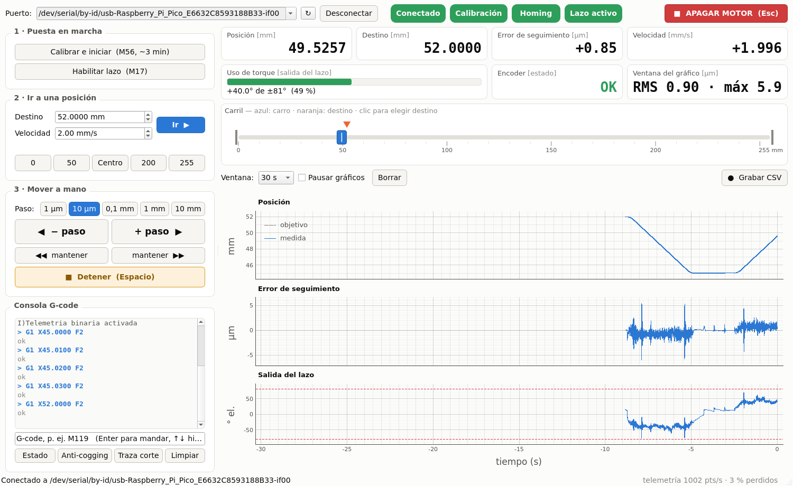

# Guía de uso de la interfaz

La interfaz (`tools/interfaz.py`) maneja el eje desde la PC sin escribir G-code: tiene un **control remoto** a la izquierda y la **telemetría en vivo** a la derecha.



## 1. Abrirla

```bash
python3 tools/interfaz.py
```

Busca la placa y se conecta sola. Si no la encuentra, elegir el puerto arriba a la izquierda y apretar **Conectar** (↻ vuelve a buscar).

> Antes de abrirla, cerrar el monitor serie de PlatformIO y cualquier otro script que use el puerto. Si no, no se puede conectar.

Hace falta tener instalados `PyQt5`, `pyqtgraph`, `numpy` y `pyserial` (`pip install PyQt5 pyqtgraph numpy pyserial`).

## 2. Cada vez que se enciende la placa

1. Apretar **Calibrar e iniciar (M56)** y confirmar.
2. Esperar unos 3 minutos. El carro va contra el tope de 0 mm, se calibra el encoder y después va y vuelve dos veces entre 0 y 50 mm. Arriba se ve el avance.
3. Cuando termina, los cuatro indicadores de arriba quedan en verde (**Conectado · Calibración · Homing · Lazo activo**) y ya se puede mover.

> El recorrido tiene que estar libre. Mientras calibra, la placa no atiende otros comandos, ni siquiera **Apagar motor**.

## 3. Mover el carro

| Qué | Cómo |
|---|---|
| Ir a una posición | Escribir el **Destino** (0 a 255 mm) y apretar **Ir** o Enter. También se puede hacer clic en el carril para elegir el punto. |
| Posiciones fijas | Botones **0 · 50 · Centro · 200 · 255** |
| Un paso | Elegir el **Paso** (1 µm a 10 mm) y apretar **− paso** / **+ paso**, o las flechas ← → del teclado |
| Mover de corrido | Mantener apretado **◀◀ mantener** o **mantener ▶▶**: el carro se mueve mientras el botón está apretado y frena al soltarlo |
| Frenar | **Detener** o la barra espaciadora. El carro queda quieto con el lazo activo. |
| Cortar el motor | **APAGAR MOTOR** (rojo, arriba a la derecha) o Esc. Para volver a mover: **Habilitar lazo**. |

La **Velocidad** vale para todo lo anterior. Conviene dejarla en **2 mm/s**: el anti-cogging se aprende a esa velocidad. Más rápido el error crece, y a 4 mm/s el motor se queda sin torque. Si se pasa de 2 mm/s, aparece un aviso.

Los pasos se cuentan desde el **destino**, no desde donde está el carro. Así, diez pasos de 1 µm dan exactamente 10 µm. En la prueba, después de cada paso (de 1 µm a 1 mm) el carro quedó a menos de 0,03 µm del destino.

## 4. Qué se ve en vivo

| Valor | Qué es | Normal |
|---|---|---|
| **Posición** | Lo que mide el encoder | — |
| **Destino** | A dónde va el carro (también es el triángulo naranja del carril) | — |
| **Error de seguimiento** | Posición pedida menos posición medida (promedio de 0,1 s) | Quieto: 0,0 µm. A 2 mm/s oscila unos ±2 µm. |
| **Velocidad** | Velocidad medida | 2,000 mm/s en crucero |
| **Uso de torque** | Cuánto empuja el lazo, contra su máximo (81°). Verde hasta 60 %, ámbar hasta 85 %, rojo arriba. | Quieto: casi 0. A 2 mm/s: 40–60 %, con picos al arrancar |
| **Encoder** | Estado del sensor magnético | OK |
| **Ventana del gráfico** | Error RMS y máximo de lo que se ve en los gráficos | A 2 mm/s: RMS ~1 µm, máximo 5–7 µm |

Los tres gráficos muestran los últimos segundos (de 5 a 120, se elige en **Ventana**): la posición pedida y la medida, el error de seguimiento y la salida del lazo con su límite en rojo. Llegan 1000 puntos por segundo. **Pausar gráficos** congela la imagen para mirarla; los datos se siguen recibiendo. Con la rueda del mouse se hace zoom en el eje vertical.

## 5. Grabar una medición

**● Grabar CSV** guarda todo lo que llega (1000 filas por segundo) hasta que se vuelva a apretar. El archivo queda en `mediciones/AAAA-MM-DD/interfaz_<fecha>_<hora>.csv`, con estas columnas:

```
t_s, objetivo_mm, posicion_mm, error_um, velocidad_mm_s, salida_deg, estado_encoder, flags
```

Los comandos que se mandaron quedan anotados en el mismo archivo, en líneas que empiezan con `#` y con el mismo reloj. Para abrirlo:

```python
import numpy as np
d = np.genfromtxt("mediciones/.../interfaz_....csv", delimiter=",", comments="#", names=True)
d["error_um"]          # cada columna por su nombre

import pandas as pd    # o con pandas
d = pd.read_csv("mediciones/.../interfaz_....csv", comment="#")
```

## 6. Consola

Abajo a la izquierda se puede escribir cualquier comando del firmware (ver la tabla del [README](../README.md#comandos)) y apretar Enter. Las flechas ↑ ↓ recorren los comandos anteriores. Ahí también aparecen los mensajes de la placa. Los botones **Estado** (M119), **Anti-cogging** (M59) y **Traza corte** (M121) son atajos.

## 7. Si algo sale mal

| Qué se ve | Qué hacer |
|---|---|
| Aviso rojo **Corte por falla** | El error pasó de 1 mm durante 0,5 s y el firmware apagó el motor. Revisar que nada trabe el carro y apretar **Habilitar lazo**. **Traza corte** muestra los 2 s previos al corte. |
| **No se pudo abrir el puerto** | Hay otro programa con el puerto abierto (monitor serie, otro script). Cerrarlo y apretar **Conectar**. |
| **Se perdió la conexión** | La placa se desenchufó o se reinició. Apretar ↻ y **Conectar**. Si se reinició, hay que volver a **Calibrar e iniciar**. |
| Aviso **El eje no está calibrado** | Pasa en cada encendido: **Calibrar e iniciar**. |
| Aviso **El lazo está apagado** | Se apagó el motor: **Habilitar lazo**. |
| Los botones de mover están grises | Falta alguno de los pasos de arriba: la barra de abajo dice cuál. |
| **sin telemetría** abajo a la derecha | Es normal mientras calibra. Si sigue después, desconectar y volver a conectar. |
| **3 % perdidos** abajo a la derecha | Es normal: el firmware descarta un punto suelto cuando el otro núcleo está ocupado. No afecta el control. |

## Teclado

| Tecla | Acción |
|---|---|
| ← → | Un paso para atrás o para adelante |
| Espacio | Detener |
| Esc | Apagar el motor |
| Enter (en Destino) | Ir |

Las flechas y el espacio no actúan mientras se está escribiendo en un campo. Esc actúa siempre.

## Bueno saber

- Al cerrar la ventana, el motor queda como estaba: si el lazo estaba activo, sigue sosteniendo el carro. Para soltarlo, **Apagar motor** antes de cerrar.
- **Detener** frena en seco, porque cada movimiento nuevo del firmware arranca desde velocidad cero. A 2 mm/s el error llega a unos ±5 µm durante un instante, lo mismo que al arrancar, y el carro queda quieto en el punto donde iba.
- Si se manda un movimiento nuevo mientras el carro está en marcha (otro paso, otro **Ir**), el carro también frena y vuelve a arrancar hacia el nuevo destino.
- La interfaz siempre manda posiciones absolutas. Si en la consola se escribe `G91` (modo relativo), lo que se escriba después en la consola sigue siendo relativo, y los botones siguen funcionando igual.
