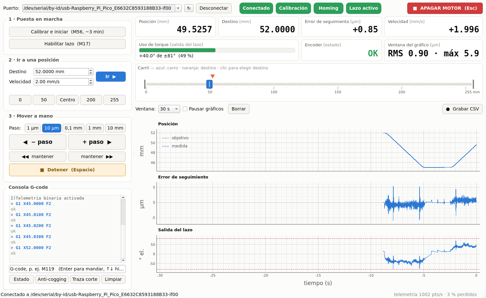

# Guía de uso de la interfaz

La interfaz (comando `umachining`) maneja el eje desde la PC sin escribir G-code: tiene un **control remoto** a la izquierda y la **telemetría en vivo** a la derecha.



## 1. Abrirla

```bash
umachining
```

Busca la placa y se conecta sola. Si no la encuentra, elegir el puerto arriba a la izquierda y apretar **Conectar** (↻ vuelve a buscar).

**Modo oscuro** (arriba a la derecha) cambia a fondo oscuro y vuelve con **Modo claro**. La elección se recuerda para la próxima vez.

> Antes de abrirla, cerrar el monitor serie de PlatformIO y cualquier otro script que use el puerto. Si no, no se puede conectar.

La instalación está en el [README](../README.md). Para elegir el puerto desde la terminal: `umachining --port COM3` (Windows), `umachining --port /dev/ttyACM0` (Linux) o `umachining --port /dev/cu.usbmodem…` (macOS).

## 2. Cada vez que se enciende la placa

El panel de la izquierda está ordenado en tres pasos: **1 Puesta en marcha**, **2 Ir a una posición** y **3 Mover a mano**. El paso que hay que hacer ahora tiene borde azul; un paso hecho muestra ✓; los números en gris indican que todavía no se puede usar.

1. En **1 Puesta en marcha**, apretar **Calibrar e iniciar (M56)** (en azul) y confirmar.
2. Esperar unos 3 minutos. El carro va contra el tope de 0 mm, se calibra el encoder y después va y vuelve dos veces entre 0 y 50 mm. Arriba se ve el avance.
3. Cuando termina, el paso 1 muestra ✓ («Listo: calibrado, homing hecho, lazo activo», con la hora de la calibración), los cuatro indicadores de arriba quedan en verde (**Conectado · Calibrado · Homing hecho · Lazo activo**) y los pasos 2 y 3 se habilitan. Los botones del paso 1 pasan a segundo plano (**Recalibrar** y **Habilitar lazo**).

Los indicadores de arriba no son botones: gris es desconocido (sin conexión), verde bien, ámbar lazo apagado u ocupado, rojo lo que falta o una falla.

> El recorrido tiene que estar libre. Mientras calibra, la placa no atiende otros comandos, ni siquiera **Apagar motor**.

## 3. Mover el carro

| Qué | Cómo |
|---|---|
| Ir a una posición | Escribir el **Destino** (0 a 255 mm) y apretar **Ir a … mm** o Enter. El botón repite el destino para confirmar a dónde va. También se puede hacer clic en el carril para elegir el punto. |
| Posiciones fijas | Botones **0 · 50 · Centro · 200 · 255** |
| Un paso | Elegir el **Paso** (de 1 nm a 10 mm, o con ↑ ↓) y apretar **− 10 µm** / **+ 10 µm** (el botón dice el paso elegido), o las flechas ← → del teclado |
| Mover de corrido | Mantener apretado **◀◀ mantener** o **mantener ▶▶**: el carro se mueve mientras el botón está apretado y frena al soltarlo |
| Frenar | **Detener** (el botón oscuro) o la barra espaciadora. El carro queda quieto con el lazo activo. |
| Cortar el motor | **APAGAR MOTOR** (rojo, arriba a la derecha) o Esc. Para volver a mover: **Habilitar lazo**. |

La **Velocidad** vale para todo lo anterior. Conviene dejarla en **2 mm/s**: el anti-cogging se aprende a esa velocidad. Más rápido el error crece, y a 4 mm/s el motor se queda sin torque. Debajo de la velocidad se ve «✓ Hasta 2 mm/s: anti-cogging completo»; si se pasa de 2 mm/s, cambia por un aviso en ámbar.

Los números se muestran con coma decimal y los decimales agrupados de a tres (`52,000 000 mm`). Al escribir se puede usar coma o punto y no hace falta poner los espacios. El G-code de la consola y los CSV siguen con punto.

Los pasos se cuentan desde el **destino**, no desde donde está el carro. Así, diez pasos de 1 µm dan exactamente 10 µm. En la prueba, después de cada paso (de 1 µm a 1 mm) el carro quedó a menos de 0,03 µm del destino.

## 4. Qué se ve en vivo

Arriba, en grande, lo que más se mira: la posición y el error de seguimiento. Al costado, en chico, velocidad, torque y encoder.

| Valor | Qué es | Normal |
|---|---|---|
| **Posición** x [mm] | Lo que mide el encoder. Debajo: el **destino** (también es el triángulo naranja del carril), cuánto falta y, en movimiento, en cuánto llega. | — |
| **Error de seguimiento** e [µm] | Posición pedida menos posición medida (promedio de 0,1 s). Debajo: RMS y máximo en la ventana de los gráficos. | Quieto: 0,0 µm. A 2 mm/s oscila unos ±2 µm; RMS ~1 µm, máximo 5–7 µm. |
| **Velocidad** v [mm/s] | Velocidad medida | 2,000 mm/s en crucero |
| **Torque** u [° el.] | Cuánto empuja el lazo y qué porcentaje es de su máximo (81°). La barra es verde hasta 60 %, ámbar hasta 85 %, roja arriba. | Quieto: casi 0. A 2 mm/s: 40–60 %, con picos al arrancar |
| **Encoder** | Estado del sensor magnético | OK |

Los tres gráficos muestran los últimos segundos (5, 10, 30, 60 o 120 s, se elige en **Ventana**): la posición pedida (naranja, a trazos) y la medida (azul), el error de seguimiento con una banda celeste de ±RMS, y la salida del lazo con su límite en rojo. Cada título dice la magnitud y la unidad. Llegan 1000 puntos por segundo. **Pausar** congela la imagen para mirarla; los datos se siguen recibiendo. Con la rueda del mouse se hace zoom en el eje vertical; con zoom de µm sobre la posición, el título pasa a «x [µm] respecto de … mm».

## 5. Grabar una medición

**● Grabar CSV** guarda todo lo que llega (1000 filas por segundo) hasta que se vuelva a apretar. El archivo queda en `~/uMachining/mediciones/AAAA-MM-DD/interfaz_<fecha>_<hora>.csv` (otra carpeta: `umachining --datos <carpeta>`), con estas columnas:

```
t_s, objetivo_mm, posicion_mm, error_um, velocidad_mm_s, salida_deg, estado_encoder, flags
```

Los comandos que se mandaron quedan anotados en el mismo archivo, en líneas que empiezan con `#` y con el mismo reloj. Para abrirlo:

```python
import numpy as np
d = np.genfromtxt("interfaz_....csv", delimiter=",", comments="#", names=True)
d["error_um"]          # cada columna por su nombre

import pandas as pd    # o con pandas
d = pd.read_csv("interfaz_....csv", comment="#")
```

## 6. Consola

Abajo a la izquierda, plegada. Cerrada muestra el último comando con ✓ (ok) o ✗ (error), y los avisos de la placa (`W)` en ámbar, `E)` en rojo). **▸ Consola G-code** la abre: ahí se puede escribir cualquier comando del firmware (ver la tabla del [README](../README.md#4-primer-uso)) y apretar Enter. Las flechas ↑ ↓ recorren los comandos anteriores. Los botones **Estado** (M119), **Anti-cogging** (M59) y **Traza corte** (M121) son atajos.

## 7. Pestaña Encoder: barrido de 2 vueltas

Sirve para ver si la rueda de imanes y el sensor están bien puestos y si la lectura del encoder es pareja a lo largo de las vueltas. Usa el **firmware normal** del eje (`M57 … R1`): no hace falta grabar otro firmware.

**Correr un barrido**

1. El eje tiene que estar calibrado (**Calibrar e iniciar**). El barrido usa la posición para no salirse del recorrido.
2. En la pestaña **Encoder**, elegir el **Recorrido** y la **Velocidad**. Por defecto son 2 vueltas a 1,25 mm/s (0,25 vueltas/s), así las mediciones se pueden comparar entre sí.
3. Apretar **Correr barrido** y confirmar. El motor gira en **lazo abierto** (`M57 X10 F1.25 P2 R1`) y vuelve (`M57 X-10 …`). Si no hay lugar hacia adelante, va primero hacia atrás. Tarda unos 20 s y los gráficos se van llenando mientras corre.
4. Al terminar, la interfaz rehabilita el lazo (`M17`) donde quedó el carro y guarda `~/uMachining/mediciones/AAAA-MM-DD/encoder_sweep_<fecha>_<hora>.csv`.

> Mientras barre, la placa no atiende otros comandos, ni siquiera **Apagar motor** (igual que al calibrar).

**Qué se ve**

- **Resultado** (a la izquierda) resume si la lectura está bien:
  - **Períodos por vuelta**: tiene que dar 30,00. Si no da, se perdieron períodos o el motor patinó.
  - **Saltos**: tiene que dar 0. Cuenta las muestras seguidas cuyo paso difiere en más de 45° del esperado.
  - **Campo débil** y los bits del chip.
  - **Error contra la recta ideal**, en ida y en vuelta.
- **A lo largo del barrido**: el ángulo crudo y el error a lo largo de las vueltas. Las líneas punteadas marcan cada vuelta del motor. Los saltos se marcan con ✕.
- **Ventanas de 2 períodos**: arriba, el error RMS y el % de campo débil de cada ventana de 4 imanes. Abajo, la ventana elegida, ida y vuelta, con las pasadas superpuestas. Si una deformación aparece igual en las dos pasadas, es propia de esa zona de la rueda. Para cambiar de ventana: ← →, ◀ ▶ o un clic en las barras.
- **Por fase e imán** y **Saltos y estado**: la lectura agrupada por fase del motor y por imán, y los bits de estado del chip.

**Mediciones guardadas** lista los barridos de la carpeta de mediciones, para abrirlos sin placa. **Exportar PNG** guarda los gráficos de la medición elegida como PNG, junto al CSV.

En los barridos de la interfaz, los imanes se cuentan **desde el home** (0 mm). Eso permite comparar corridas entre sí. En barridos hechos con el firmware de barrido aparte (`G56`), el imán 0 es el que estaba frente al sensor al empezar.

El error incluye el atraso del rotor en lazo abierto. En un punto duro del cople, el motor puede patinar y aparecer como salto. Para distinguirlo de un problema del encoder, ver si el salto cae en el mismo lugar en ida y en vuelta.

## 8. Pestaña HP 8153A: medidor de potencia óptica por GPIB

Lee el **HP 8153A Lightwave Multimeter** por la placa **NI GPIB-USB-HS**, muestra cada lectura en vivo y la graba en un CSV aparte. La telemetría del encoder no cambia. Esta versión todavía no sincroniza los dos registros: se alinean después con la hora de la PC (ver más abajo).

**Qué hace falta en la PC** (una sola vez):

- pyvisa y pyvisa-py, que el instalador del paquete ya instala.
- El driver de la GPIB-USB-HS:
  - **Windows:** NI-488.2 y NI-VISA, de ni.com.
  - **Linux:** los "NI Linux Device Drivers" de ni.com, con los paquetes `ni-488.2` y `ni-visa`. La otra opción es linux-gpib (driver `ni_usb_gpib`) más `pip install gpib-ctypes`.
- Sin nada de esto, la pestaña funciona igual con **SIMULADO (sin equipo)**, que contesta como un 8153A con un módulo HP 81531A. Sirve para probar la interfaz.

**Usarla**

1. Elegir el recurso y apretar **Conectar**. De fábrica el 8153A está en la dirección 22 (`GPIB0::22::INSTR`); ↻ busca los equipos conectados. Se puede escribir otro recurso a mano.
2. Al conectar se muestran la identificación del equipo (`*IDN?`), los módulos de cada canal (`*OPT?`) y la configuración que tiene puesta. **Canal** elige A o B: tiene que ser el del módulo sensor.
3. **Configuración del equipo:** promediación, longitud de onda, unidad (W o dBm) y rango (automático o fijo). No se cambia nada en el equipo hasta apretar **Aplicar al equipo**. Con la promediación mínima de 20 ms salen unas 40 lecturas por segundo con el simulado; con el equipo real hay que ver cuántas salen.
4. **Leer en continuo** pide una lectura detrás de otra (`READ:POW?`). Cada lectura es el **promedio** que hizo el equipo durante el tiempo de promediación.
5. **● Grabar CSV del HP** guarda `~/uMachining/mediciones/AAAA-MM-DD/hp8153a_<fecha>_<hora>.csv`, en la misma carpeta que **Grabar CSV**. Si está marcado **Junto con «Grabar CSV» de Control**, el botón de la pestaña Control arranca y detiene las dos grabaciones a la vez. Siguen siendo dos archivos, y los nombres llevan la misma hora.

Mientras se graba no se puede cambiar la configuración, para que todo el archivo quede en la misma unidad y con el mismo rango. Abajo a la derecha se ve la última lectura del HP desde cualquier pestaña.

**El CSV del HP**

```
t_s, t_pedido_s, hora_unix, potencia_W      (o potencia_dBm)
```

- `t_s`: cuándo llegó la lectura, en segundos desde el inicio de la grabación. Usa el reloj de la PC, no el de la placa.
- `t_pedido_s`: cuándo se pidió. La potencia es el promedio de un tramo de la duración de la promediación, entre `t_pedido_s` y `t_s`.
- `hora_unix`: la hora de la PC al llegar la lectura.

En el encabezado (líneas con `#`) quedan el equipo, el módulo, el canal y la configuración.

**Alinear con la telemetría del encoder:** el encabezado de `interfaz_*.csv` tiene una línea `# inicio de la grabación: hora_unix=… t_s del último paquete recibido=…`. Esa línea da la hora de la PC que corresponde a un `t_s` de la placa. Para pasar una lectura del HP al reloj de la placa:

`t_placa ≈ hora_unix_HP − hora_unix_inicio + t_s_inicio`.

El error de esta cuenta es de algunos milisegundos más la deriva entre los dos relojes (hasta unos 18 ms cada 10 minutos). Alcanza para mediciones con el carro quieto.

## 9. Si algo sale mal

| Qué se ve | Qué hacer |
|---|---|
| Aviso rojo **Corte por falla** | El error pasó de 1 mm durante 0,5 s y el firmware apagó el motor. Revisar que nada trabe el carro y apretar **Habilitar lazo**. **Traza corte** muestra los 2 s previos al corte. |
| **No se pudo abrir el puerto** | Hay otro programa con el puerto abierto (monitor serie, otro script). Cerrarlo y apretar **Conectar**. |
| **Se perdió la conexión** | La placa se desenchufó o se reinició. Apretar ↻ y **Conectar**. Si se reinició, hay que volver a **Calibrar e iniciar**. |
| Aviso **El eje no está calibrado** | Pasa en cada encendido: **Calibrar e iniciar**. |
| Aviso **El lazo está apagado** | Se apagó el motor: **Habilitar lazo**. |
| Los botones de mover están grises | Falta la puesta en marcha: el texto del paso 1 (con borde azul) dice qué hacer. |
| **sin telemetría** abajo a la derecha | Es normal mientras calibra. Si sigue después, desconectar y volver a conectar. |
| **Barrido del encoder: la placa respondió ok pero sin muestras** | El firmware grabado es anterior al 17/11/2026 y no tiene `M57 … R1`. Grabar el firmware del paquete (`umachining-flashear`). |
| **3 % perdidos** abajo a la derecha | Es normal: el firmware descarta un punto suelto cuando el otro núcleo está ocupado. No afecta el control. |

## Teclado

| Tecla | Acción |
|---|---|
| ← → | Un paso para atrás o para adelante (en la pestaña Encoder: ventana anterior o siguiente) |
| ↑ ↓ | Paso ×10 / ÷10 |
| Espacio | Detener |
| Esc | Apagar el motor |
| Enter (en Destino) | Ir |

Las flechas y el espacio no actúan mientras se está escribiendo en un campo. Esc actúa siempre.

## Bueno saber

- Al cerrar la ventana, el motor queda como estaba: si el lazo estaba activo, sigue sosteniendo el carro. Para soltarlo, **Apagar motor** antes de cerrar.
- **Detener** frena en seco, porque cada movimiento nuevo del firmware arranca desde velocidad cero. A 2 mm/s el error llega a unos ±5 µm durante un instante, lo mismo que al arrancar, y el carro queda quieto en el punto donde iba.
- Si se manda un movimiento nuevo mientras el carro está en marcha (otro paso, otro **Ir**), el carro también frena y vuelve a arrancar hacia el nuevo destino.
- La interfaz siempre manda posiciones absolutas. Si en la consola se escribe `G91` (modo relativo), lo que se escriba después en la consola sigue siendo relativo, y los botones siguen funcionando igual.
