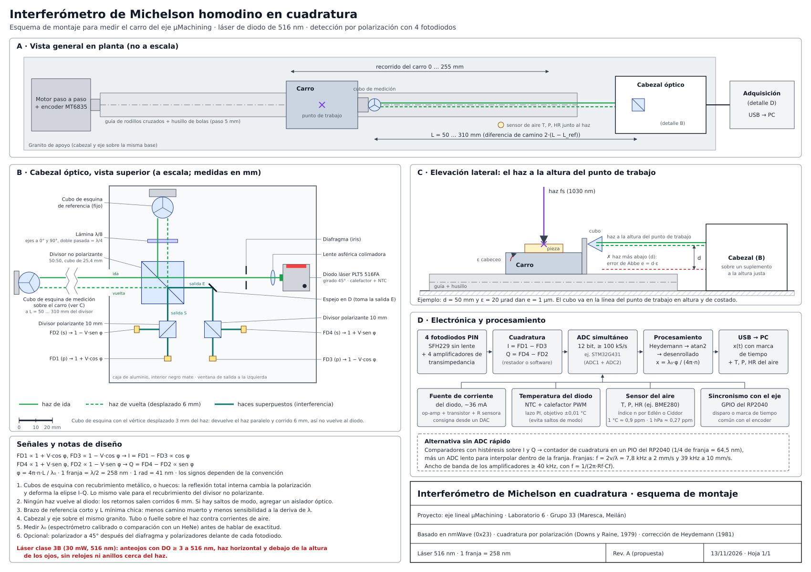

# Interferómetro de Michelson en cuadratura: plano, partes y bibliografía

**Versión:** 13/11/2026, Rev. A (propuesta, no construido).
**Plano:** [img/interferometro_plano.svg](img/interferometro_plano.svg)

---

## 1. Qué muestra el plano

- **A, vista general.** El cabezal óptico va en el extremo opuesto al motor, sobre el mismo granito que el eje. El haz corre paralelo a la guía hasta un cubo de esquina montado en el carro. La distancia L del divisor al cubo va de 50 a 310 mm según la posición del carro.
- **B, cabezal (a escala).** Recorrido de la luz:
  1. El diodo, girado 45°, emite luz con partes iguales en s y p. La lente la colima y el diafragma limpia el haz.
  2. El divisor no polarizante manda la mitad al brazo de referencia y la otra mitad al carro.
  3. En el brazo de referencia, la lámina λ/8 se atraviesa dos veces. Eso equivale a λ/4: desfasa 90° la componente s respecto de la p.
  4. Los dos cubos de esquina tienen el vértice corrido 3 mm del haz. Devuelven el haz paralelo y desplazado 6 mm, así que **nada vuelve al diodo**.
  5. Los haces de vuelta se superponen en las dos salidas del divisor: la salida S y la salida E. Un espejo en D toma la salida E sin tapar el haz de ida.
  6. En cada salida, un divisor polarizante separa s y p hacia dos fotodiodos. Resultado: `I = FD1 − FD3 ∝ cos φ` y `Q = FD4 − FD2 ∝ sen φ`. La resta elimina la continua y el ruido de intensidad del láser.
- **C, elevación.** El haz va a la altura del punto de trabajo, para que el cabeceo del carro no meta error de Abbe.
- **D, electrónica.** Cuatro amplificadores de transimpedancia, ADC simultáneo, corrección de Heydemann, `atan2` y desenrollado. Además: corriente y temperatura del diodo estabilizadas, sensor de aire para el índice de refracción y sincronismo con el RP2040 del eje.

Diferencias con nmWave: nmWave usa un divisor de vidrio float sin recubrimiento y no documenta cómo obtiene la cuadratura. Este plano usa el método por polarización de Downs y Raine (1979), que está publicado y es fácil de alinear. Toma de nmWave el láser, los fotodiodos, el control del diodo y la idea de usar ADC simultáneos.

## 2. Lista de partes

| # | Parte | Especificación | Nota |
|---|---|---|---|
| 1 | Diodo láser | Osram PLT5 516FA, 516 nm, 30 mW | El mismo que nmWave; operarlo a ~36 mA |
| 2 | Lente colimadora | Asférica, f ≈ 4–8 mm, AR visible | Kit colimador para encapsulado TO de 5,6 mm |
| 3 | Montura del diodo | Aluminio, calefactor resistivo + NTC de 100 kΩ | Control PI de temperatura |
| 4 | Diafragma | Iris de 1–5 mm | |
| 5 | Divisor no polarizante | Cubo de 25,4 mm, 50:50, visible | |
| 6 | Lámina λ/8 | De orden cero; sirve una de 532 nm | A 516 nm da ~93° en doble pasada; Heydemann corrige la diferencia |
| 7 | 2 cubos de esquina | Ø 12,7 mm, **metalizados o huecos** | Los de reflexión total interna alteran la polarización |
| 8 | Espejo en D | O espejo de 6 mm | Toma la salida E sin tapar el haz de ida |
| 9 | 2 divisores polarizantes | Cubo de 10 mm, 420–680 nm | |
| 10 | 4 fotodiodos | SFH229 sin lente (como nmWave) | |
| 11 | Amplificadores de transimpedancia | 2 × OPA2375 o similar | Ancho de banda ≥ 40 kHz |
| 12 | Microcontrolador | STM32G431 (ADC simultáneos) o RP2040 con comparadores | |
| 13 | Sensor de aire | BME280 (T, P, HR) | Junto al haz |
| 14 | Mecánica | Caja de aluminio, suplemento, soporte del cubo en el carro | |
| 15 | Seguridad | Anteojos con DO ≥ 3 a 516 nm | Láser clase 3B |

## 3. Bibliografía

Las marcadas con ★ son las que conviene leer primero.

### Fundamentos

- ★ Leach, R. *Fundamental Principles of Engineering Nanometrology*, 2.ª ed. Elsevier, 2014. **Cap. 5, §5.3 "Displacement interferometry"**: homodino y heterodino, doble pasada, errores de coseno, camino muerto, térmicos y periódicos. Es lo más cercano a lo que hay que hacer.
- Hecht, E. *Optics*, 5.ª ed. Pearson, 2017 (hay edición en castellano, *Óptica*). Cap. 9: interferencia y Michelson.
- Hariharan, P. *Basics of Interferometry*, 2.ª ed. Academic Press, 2007. Coherencia, visibilidad e interferómetros de medición de longitud.
- University of Minnesota, Advanced Lab: [Quadrature Michelson interferometer](https://sites.google.com/a/umn.edu/mxp/advanced-labs/quadrature-michelson-interferometer). Una práctica de laboratorio de grado con este mismo esquema.

### Cuadratura y errores periódicos

- ★ Downs, M. J. y Raine, K. W. "An unmodulated bi-directional fringe-counting interferometer system for measuring displacement". *Precision Engineering* 1(2), 85–88 (1979). doi:10.1016/0141-6359(79)90138-7. Es el método de la lámina λ/8 que usa el plano.
- ★ Heydemann, P. L. M. "Determination and correction of quadrature fringe measurement errors in interferometers". *Applied Optics* 20(19), 3382–3384 (1981). doi:10.1364/AO.20.003382.
- Wu, C.-M. y Su, C.-S. "Nonlinearity in measurements of length by optical interferometry". *Measurement Science and Technology* 7(1), 62–68 (1996). doi:10.1088/0957-0233/7/1/009.
- Bobroff, N. "Recent advances in displacement measuring interferometry". *Measurement Science and Technology* 4(9), 907–926 (1993). doi:10.1088/0957-0233/4/9/001. Revisión de todas las fuentes de error.

### Índice de refracción del aire

- Edlén, B. "The refractive index of air". *Metrologia* 2(2), 71–80 (1966). doi:10.1088/0026-1394/2/2/002.
- Birch, K. P. y Downs, M. J. "An updated Edlén equation for the refractive index of air". *Metrologia* 30(3), 155–162 (1993). doi:10.1088/0026-1394/30/3/004. Tiene una corrección publicada en *Metrologia* 31, 315 (1994).
- Ciddor, P. E. "Refractive index of air: new equations for the visible and near infrared". *Applied Optics* 35(9), 1566–1573 (1996). doi:10.1364/AO.35.001566.

### Diodos láser: sintonía, saltos de modo y realimentación óptica

- ★ Wieman, C. E. y Hollberg, L. "Using diode lasers for atomic physics". *Review of Scientific Instruments* 62(1), 1–20 (1991). doi:10.1063/1.1142305. Es la referencia clásica sobre cómo cambia λ con la temperatura y la corriente, y sobre los saltos de modo.
- Lang, R. y Kobayashi, K. "External optical feedback effects on semiconductor injection laser properties". *IEEE Journal of Quantum Electronics* 16(3), 347–355 (1980). doi:10.1109/JQE.1980.1070479.

### Detección y electrónica

- ★ Hobbs, P. C. D. *Building Electro-Optical Systems: Making It All Work*, 2.ª ed. Wiley, 2009. Fotodiodos, amplificadores de transimpedancia, ruido y detección balanceada.
- Graeme, J. *Photodiode Amplifiers: Op Amp Solutions*. McGraw-Hill, 1996.

### Metrología de ejes y seguridad

- ISO 230-2:2014. *Test code for machine tools, Part 2: Determination of accuracy and repeatability of positioning of numerically controlled axes.*
- Slocum, A. H. *Precision Machine Design*. Prentice Hall, 1992. Principio de Abbe y presupuesto de errores.
- IEC 60825-1:2014. *Safety of laser products, Part 1.*

### Proyectos abiertos

- [nmWave-Interferometer](https://github.com/0x23/nmWave-Interferometer): CAD en FreeCAD, placas en KiCad y firmware para STM32G431.
- [MicroManipulatorStepper](https://github.com/0x23/MicroManipulatorStepper) y su [video](https://www.youtube.com/watch?v=MgQbPdiuUTw). La medición externa del video usa un microscopio con seguimiento subpíxel, a partir del minuto 22:28.

Para material de la región, conviene preguntar a los colaboradores del plan: Jorge Torga (UTN-FRD, interferometría) y Liliana Álvarez (INTI, metrología dimensional).
