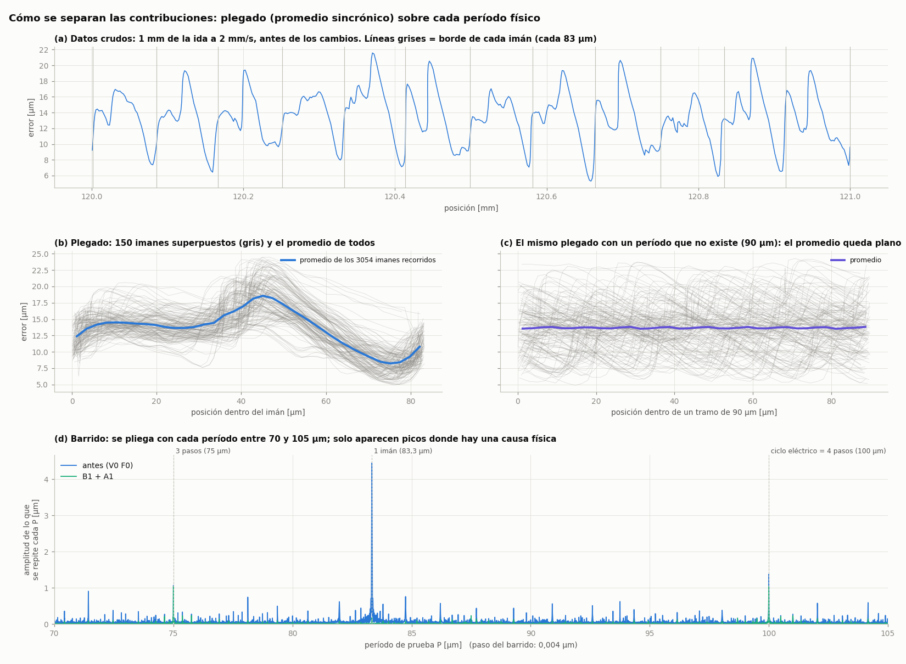

# Cómo identificamos cada contribución al error, qué ganamos y cómo seguir

Este documento responde tres preguntas que salieron del [reporte de la prueba de lazo cerrado del 16/10](REPORTE_PRUEBA_LAZO_CERRADO_2026-10-16.md):

1. ¿Cómo se identifica la contribución de cada cosa al error?
2. ¿En qué nos beneficia la mejora? ¿Se vería en la exactitud medida con un comparador u otro instrumento externo?
3. ¿Cómo seguimos para caracterizar el error instrumental y la precisión del equipo?

Las figuras están en `mediciones/2026-10-16/reporte/` y se generan con `tools/analisis_errores.py`.

---

## 1. Cómo se identifica la contribución de cada cosa

El método tiene dos etapas, y las dos hacen falta:

- **Separar:** el plegado dice *qué parte* del error se repite con cada longitud.
- **Atribuir:** los experimentos de intervención y las predicciones dicen *por qué*.

### 1.1 La idea: cada pieza deja una huella con su propia longitud

Cada pieza del equipo que produce error lo produce cada vez que se repite su geometría:

| Pieza | Se repite cada | Veces en 255 mm |
|---|---|---|
| Vuelta del motor (husillo, acople, rueda entera) | 5 mm | 51 |
| Período del encoder (2 imanes) | 167 µm | 1530 |
| Imán | 83,3 µm | 3060 |
| Ciclo eléctrico del motor | 100 µm | 2550 |
| Paso del motor | 25 µm | 10 200 |

Si el error tiene una parte que se repite cada 83,3 µm, esa parte la produce algo que tiene esa longitud, y lo único que la tiene son los imanes. Las longitudes son distintas entre sí (salvo una excepción en 1.4), así que cada huella se puede separar de las otras.

### 1.2 El plegado (promedio sincrónico)

Para una longitud P se toma cada muestra del error, se calcula en qué parte del ciclo de P cae (la fase, `x mod P`) y se promedian todas las muestras que caen en la misma fase. El resultado es **la forma media del error a lo largo de un ciclo de P**.

*Figura 7. (a) Un milímetro de datos crudos de antes de los cambios: se ve un patrón que se repite en cada imán, pero con mucho ruido encima. (b) Plegado sobre el imán: 150 imanes superpuestos en gris y, en azul, el promedio de los 3054 imanes del recorrido. (c) El mismo plegado con un período que no tiene ninguna causa física (90 µm): el promedio queda plano. (d) Barrido: se pliega con cada período entre 70 y 105 µm, en pasos de 0,004 µm. Solo hay picos en 75 µm (3 pasos), 83,3 µm (imán) y 100 µm (ciclo eléctrico). El pico del imán, de 4,5 µm antes, desaparece con los cambios (verde).*

Por qué funciona:

- **Lo que se repite con P se suma en fase.** Todas las muestras de la misma fase tienen el mismo valor de esa componente, y el promedio la conserva entera.
- **El ruido aleatorio se cancela.** Promediar N muestras independientes divide el ruido por √N. En una ida hay ~127 000 muestras de crucero; con 36 intervalos de fase son ~3500 por intervalo. Un ruido de 2 µm queda en 2 / √3500 ≈ **0,03 µm**.
- **Lo que se repite con otra longitud también se cancela,** siempre que no sea múltiplo de P: en cada fase de P cae en todas sus fases por igual. Eso muestra la figura 7(c): plegando con 90 µm, la ondulación de los imanes (que está en los datos) desaparece del promedio.
- **El método es muy selectivo.** Si el período de prueba está corrido δ, a lo largo de L = 255 mm la fase se corre L·δ/P. El pico tiene un ancho de ~P²/L ≈ 0,03 µm. Por eso el barrido de la figura 7(d) tiene picos tan finos, y por eso **no elegimos los períodos a dedo:** el barrido muestra dónde hay algo, y después se busca qué pieza tiene esa longitud.

En el barrido aparecen picos chicos (0,5–0,9 µm) antes de los cambios, en 71,4, 78,1 µm y otros. Son armónicos altos de la forma del imán: por ejemplo, 71,4 = 83,3 × 6/7 recoge el armónico 7 del imán. Desaparecen junto con el pico del imán.

### 1.3 Cómo se arma el presupuesto del error

`analisis_errores.py` (función `budget()`) separa el error de cada tramo, a velocidad de crucero, en este orden:

1. **Constante:** el valor medio.
2. **Por imán:** plegado sobre el ángulo crudo del encoder módulo 180°. Se usa el ángulo del sensor y no la posición en mm, porque es la fase física exacta del imán.
3. **Por paso** (25 µm), 4. **por ciclo eléctrico** (100 µm) y 5. **por vuelta** (5 mm): plegados sobre la posición.
6. **Resto:** el desvío estándar de lo que queda.

**En cada paso se pliega lo que quedó del anterior.** A la forma media de cada componente se la resta de los datos antes de pasar a la siguiente. La amplitud que se informa es la mitad del pico a pico de la forma media.

### 1.4 Dónde hay que tener cuidado

- **Longitudes que son múltiplos entre sí.** Un ciclo eléctrico (100 µm) son exactamente 4 pasos (25 µm). Al plegar sobre 100 µm, la componente del paso también aparece entera. Por eso el paso se saca antes que el ciclo eléctrico. Verificado con los datos de la tarde (B1 + A1): la "componente de 75 µm" del barrido es 1,04 µm, pero después de restar la del paso queda en 0,01 µm (era toda del paso). La de 100 µm queda en 0,32 µm, que sí es propia del ciclo eléctrico.
- **La vuelta contiene a todas.** 5 mm es múltiplo de todas las demás longitudes, así que el plegado por vuelta incluye todo lo que se repite en cada vuelta. Por eso va al final: lo que recoge es lo que **distingue a cada imán (o paso) de los demás** dentro de la vuelta, más el sector de fricción, que no tienen otra explicación.
- **Imán y ciclo eléctrico coinciden cada 500 µm** (6 imanes = 5 ciclos). Comparten el armónico de 60 ciclos/mm, de longitud 16,7 µm. Es un armónico muy alto y de amplitud despreciable.

### 1.5 Del "dónde" al "por qué"

El plegado dice que hay 4,5 µm que se repiten con cada imán, pero no por qué. Una correlación con una longitud no es una causa. La causa la establecimos con tres tipos de evidencia independientes:

**(a) Predicción cuantitativa desde el código, antes de medir.**
- **Atraso:** la integral del lazo de posición está limitada a π/2 rad/s. Ir a 2 mm/s exige 2,518 rad/s, así que la proporcional (×60) necesita (2,518 − 1,571)/60 rad = **12,6 µm**. Medido: 13,25 µm. La diferencia (0,7 µm) es el desfasaje de la telemetría, que aparece con el mismo valor en todas las configuraciones.
- **Ondulación por imán:** la velocidad se calculaba con cuentas crudas, que tienen ±3,8 µm de no linealidad en cada imán de 83 µm. Eso da una ondulación de velocidad de ±2π·3,8/83 ≈ ±29%, del mismo orden que la medida.

**(b) Experimento de intervención: cambiar una sola cosa por vez.** Es la evidencia más fuerte. Con `M58` se prendió y apagó cada corrección por separado, con la misma calibración, el mismo día y el mismo recorrido:

| | Constante | Por imán | RMS |
|---|---|---|---|
| Ninguna (V0 F0) | 13,7 µm | ±5,2 µm | 14,1 µm |
| Solo velocidad con tabla (V1 F0) | 13,3 µm | **±0,2 µm** | 13,3 µm |
| Solo anticipada (V0 F1) | **0,7 µm** | ±5,6 µm | 4,0 µm |
| Las dos (V1 F1) | **0,7 µm** | **±0,2 µm** | 1,2 µm |

Cada cambio saca **su** componente y no toca la otra. Si la ondulación por imán hubiera sido una perturbación mecánica (por ejemplo, una fuerza que se repite en cada imán), cambiar cómo se estima la velocidad la habría modificado, pero no la habría bajado de ±5,2 a ±0,2 µm.

**(c) Repetibilidad y signo.**
- Las dos idas y las dos vueltas dan los mismos números con diferencias de 0,1 µm: son efectos sistemáticos, no casualidad.
- El atraso cambia de signo con el sentido de marcha, como corresponde a un atraso. La forma por imán se mantiene.

### 1.6 Límites de este análisis

- **Todo está en el marco del encoder.** Separamos el error de seguimiento (objetivo − posición medida). Nada de esto dice dónde está el carro de verdad (sección 2).
- **El "resto" no está descompuesto:** incluye ruido, picos de saturación y lo que no es periódico.
- **Un hallazgo que salió al aplicar el método:** con la velocidad calculada con la tabla (B1), la componente del **paso** (25 µm) subió de 0,5 a 0,8 µm en la ida y de 0,6 a 2,1 µm en la vuelta. La anticipada no la toca. La tabla de calibración tiene componentes de 25 µm (0,6–0,8 µm) y de 100 µm (0,9–1,1 µm), que el ángulo crudo no tiene. La explicación más probable:
  - la tabla se arma en lazo abierto, con el rotor siguiendo al campo;
  - el rotor no sigue al campo de manera perfectamente uniforme dentro de cada ciclo eléctrico (retención magnética en cada paso, forma de la corriente);
  - esa irregularidad quedó grabada en la tabla, y ahora la velocidad la hereda.

  El efecto neto sigue siendo muy bueno (RMS de 14 a 1,2 µm), pero ese es el próximo residuo a atacar. También es un ejemplo de error de medición que solo un instrumento externo puede confirmar (sección 3).

---

## 2. En qué nos beneficia la mejora y qué vería un comparador

**Respuesta corta: un comparador que mide con el carro quieto no vería casi diferencia. La mejora es en el movimiento.**

### 2.1 Con el carro quieto: la exactitud no cambia

Un comparador mide donde quedó el carro después de parar. Una vez quieto, el lazo lleva el error de seguimiento a ~0 con o sin los cambios: 0,3 µm de desvío en reposo antes y después. Al terminar un movimiento, **el carro queda en el mismo lugar que antes**, y ese lugar tiene el error que tenía:

- el error de medición del encoder (lo que la tabla no corrigió, o corrigió mal);
- el error de transmisión (paso del husillo, juego, dilatación).

Ninguna de las dos correcciones toca eso. **Si hoy midiéramos posiciones estáticas con un comparador antes y después de los cambios, deberíamos obtener lo mismo**, dentro de lo que resuelva el comparador. Conviene que el equipo lo tenga claro para no esperar una mejora que no corresponde.

Lo único que cambia en el uso estático:
- **Se llega antes y con menos sobrepaso:** el error máximo al frenar bajó de 23 a 5 µm. Importa si se mide o se mecaniza apenas se llega.
- **Más margen de torque:** las muestras con la salida en el límite bajaron de 12 217 a 3 por tramo. Menos riesgo de trabarse o de cortarse por falla, sobre todo cuando se sumen fuerzas de corte.

### 2.2 En movimiento: ahí está la mejora

Mientras el carro se mueve, el error de seguimiento **sí es error de posición del carro** respecto del plan. El lazo lleva la posición medida a donde le dicen, y si va 13 µm atrasado, el carro (visto por el encoder) va 13 µm atrás.

- **Atraso de 13 µm → 0,7 µm.** Mecanizando con avance constante, todo lo que se corta queda corrido 13 µm hacia atrás respecto del programa. Entre una pasada de ida y una de vuelta, el corrimiento es de 26 µm en sentidos opuestos, que se ve como un "juego". Cuando haya más de un eje, atrasos distintos en cada eje deforman la geometría (círculos que se ovalan, esquinas redondeadas).
- **Ondulación por imán de ±4,5 µm → ±0,2 µm.** No era solo un número: según la tabla, **la velocidad real del carro variaba ±38% cada 83 µm** (24 veces por segundo a 2 mm/s). Eso es un avance desparejo: carga de viruta variable, vibración y una ondulación en la superficie mecanizada con un período de 83 µm.

### 2.3 ¿Qué instrumento externo vería la diferencia?

| Instrumento | ¿Vería la mejora? | Por qué |
|---|---|---|
| Comparador o micrómetro, carro quieto | No | Mide el estado final, que no cambió |
| Sensor rápido (capacitivo, LVDT o interferómetro láser leyendo a ≥ 500 muestras/s) con el carro en movimiento | **Sí** | Vería la ondulación de 83 µm antes y no después. Si se sincroniza con el plan, también el atraso |
| Medir la superficie de una pieza mecanizada con avance constante (rugosímetro o perfilómetro) | **Sí** | La ondulación de 83 µm quedaría marcada en la superficie |

Las dos últimas son también **la forma de confirmar desde afuera** que la ondulación por imán era movimiento real del carro y no solo un número de la tabla. Hoy esa conclusión depende de que la tabla diga la verdad.

---

## 3. Cómo seguir: caracterizar el error instrumental y la precisión

### 3.1 Vocabulario

Siguiendo el vocabulario de metrología (VIM):

| Término | Qué es | Cómo se mide |
|---|---|---|
| **Error de medición** | Indicación − valor verdadero = parte sistemática + parte aleatoria | Contra una referencia |
| **Veracidad** | Cercanía del promedio de muchas mediciones al valor verdadero (la parte sistemática) | Contra una referencia |
| **Precisión** | Cercanía entre mediciones repetidas (la parte aleatoria). Se expresa como **repetibilidad** (mismas condiciones, seguido) o **reproducibilidad** (otro día, otra calibración, después de apagar) | Repitiendo; la referencia solo tiene que ser estable |
| **Exactitud** | Las dos juntas | Contra una referencia |
| **Resolución** | El menor cambio que el sistema puede indicar (0,08 nm por cuenta en el chip) | — |
| **Error instrumental** | El error de indicación del instrumento: acá, cuánto se aleja `M114` de la posición real del carro | Contra una referencia |

Nuestro equipo cumple dos papeles:

- **Como instrumento:** ¿cuánto se equivoca `M114` respecto de dónde está realmente el carro?
- **Como posicionador:** ¿cuánto se aleja el carro de donde se le pidió ir?

Con el carro quieto y el lazo cerrado, los dos casi coinciden: el error de posicionamiento es el error instrumental más el error de seguimiento en reposo (0,3 µm). **Midiendo uno se obtiene el otro.**

### 3.2 Principio para elegir la referencia

La referencia tiene que ser **4 a 10 veces mejor** que lo que se quiere resolver:

- **Para ver efectos de ~1 µm** (como los residuos de 25 y 100 µm de la tabla): hace falta una referencia de 0,1–0,25 µm, por ejemplo un comparador o palpador de 0,1 µm, un LVDT o un sensor capacitivo, en carreras cortas.
- **Para el error de paso del husillo a lo largo de 250 mm** (que puede ser de varios µm a decenas de µm): alcanza con una referencia de ~1 µm sobre toda la longitud, por ejemplo bloques patrón más un comparador, una regla lineal de vidrio montada provisoriamente, o un interferómetro láser si se consigue uno.

### 3.3 Preparación (vale para todos los ensayos)

- **Temperatura:** precalentar 30 min moviendo el eje y registrar la temperatura del aire y del husillo durante el ensayo. Como referencia: 1 °C en 250 mm de acero son 3 µm.
- **Montaje del comparador:** sobre la base, rígido, con la línea de medición **alineada con el eje** (si está inclinado, se mide de menos: error de coseno) y **a la altura donde va a estar la herramienta** (si se mide lejos del punto de trabajo, cualquier cabeceo del carro aparece como error: error de Abbe).
- **Arranque:** con `M56`, no con `G28` desde la flash (sección 6 de [CAMBIOS_2026-10-16.md](CAMBIOS_2026-10-16.md)). Anotar los números de la calibración.
- **Firmware:** con las dos correcciones prendidas (`M58 V1 F1`). Anotarlo en cada ensayo.

### 3.4 Ensayos, en orden

**E1. Repetibilidad y reversa en un punto** (comparador de 1 µm o mejor; 30 min)
- **Procedimiento:**
  - ir a X = 100 mm viniendo desde 95 mm, esperar 2 s, leer; repetir 10 veces;
  - lo mismo viniendo desde 105 mm;
  - repetir en X = 20 y en X = 230.
- **Resultados:**
  - la **repetibilidad unidireccional** en cada sentido (en ISO 230-2, R = 4 desvíos estándar);
  - el **valor de reversa** B, la diferencia entre los promedios de los dos sentidos. Es el juego del husillo y la tuerca más la elasticidad del acople: el encoder del motor no lo ve.

**E2. Mínimo desplazamiento real** (comparador de 0,1–0,5 µm; 30 min)
- **Procedimiento:** con `G91`, pasos de 0,5, 1, 2 y 5 µm, 10 de cada uno hacia adelante y 10 hacia atrás, leyendo cada uno.
- **Resultado:** a partir de qué tamaño el carro realmente se mueve lo pedido. Es la resolución real del eje, limitada por la fricción estática, no por el encoder.

**E3. Error instrumental dentro de la vuelta: encoder y tabla** (comparador de 0,1 µm o LVDT; 1 h)
- **Procedimiento:**
  - en un tramo de 10 mm (2 vueltas), un punto cada 0,25 mm en los dos sentidos;
  - y en un tramo de 0,5 mm (6 imanes), un punto cada 10 µm.
- **Análisis:**
  - a lo largo de 10 mm el error del husillo es prácticamente una recta: se ajusta y se resta;
  - lo que queda, plegado sobre 5 mm, 83 µm, 100 µm y 25 µm con el mismo método de la sección 1, **es el error instrumental del encoder más la tabla**;
  - acá se ve si las componentes de 25 y 100 µm de la tabla (sección 1.6) son reales o error de medición.
- **Reproducibilidad:** repetir después de un `M56` nuevo y después de apagar y prender.

**E4. Exactitud a lo largo del recorrido, al estilo ISO 230-2** (referencia larga; medio día)
- **Puntos:** ~11 puntos entre 0 y 250 mm, **con separación irregular** (por ejemplo 0, 24,7, 50,3, 75,9, ...), para no caer siempre en la misma fase de la vuelta de 5 mm. Si no, un error que se repite en cada vuelta queda escondido o se exagera.
- **Ciclos:** 5 ciclos completos, llegando a cada punto desde los dos sentidos.
- **Referencia:** interferómetro láser (lo ideal), o regla lineal provisoria, o bloques patrón con comparador.
- **Resultados:**
  - la **curva de desviación sistemática** (error de paso del husillo);
  - la reversa B y la repetibilidad R en cada punto;
  - la **exactitud** A, el rango total que cubren los promedios ± 2 desvíos en los dos sentidos.

  Ver la norma ISO 230-2 para las definiciones exactas.

**E5. Deriva térmica** (comparador; 2 h)
- **Procedimiento:** carro quieto en X = 125 con el lazo activo, leer el comparador y la temperatura cada 5 min.
- **Resultado:** cuánto se mueve el punto con el calentamiento del motor y del ambiente.

**E6. Verificación dinámica (opcional)** (sensor capacitivo o LVDT leído a ≥ 500 muestras/s)
- **Procedimiento:** con el carro moviéndose a 2 mm/s sobre la carrera del sensor, comparar `M58 V0 F0` con `M58 V1 F1`.
- **Resultado:** confirma desde afuera lo de la sección 2.3: la ondulación de 83 µm antes y no después, y cuánto de la componente de 25 µm es real.

### 3.5 Qué hacer con los resultados

1. **Un presupuesto de incertidumbre:** una tabla con cada contribución (resolución, repetibilidad, error de tabla, reversa, error de paso, térmico, incertidumbre de la referencia) combinada en una incertidumbre total del eje. Eso responde "¿qué tan bien posiciona este equipo?" con un número defendible.
2. **Corregir según lo que pese más:**
   - **Error de paso del husillo grande y repetible:** una tabla de compensación en el firmware (mm pedidos → mm reales), armada con E4.
   - **Reversa grande:** compensación de reversa, o precarga de la tuerca.
   - **Error instrumental de la tabla (E3) grande:** mejorar la calibración (más lenta, promediando más vueltas, o suavizando la tabla en la escala del paso).
   - **Si dominan el husillo y la temperatura:** un encoder lineal sobre el carro, que el firmware ya tiene en esqueleto (`cascade_corrector`).

### 3.6 Herramientas

Para E1–E4 conviene un script que mueva el eje a la secuencia de puntos, espere, pida la lectura del comparador (o la lea directo si el comparador tiene salida USB), guarde todo y calcule R, B, la curva sistemática y A. Se puede armar con la misma base que `tools/closed_loop_test.py`.
