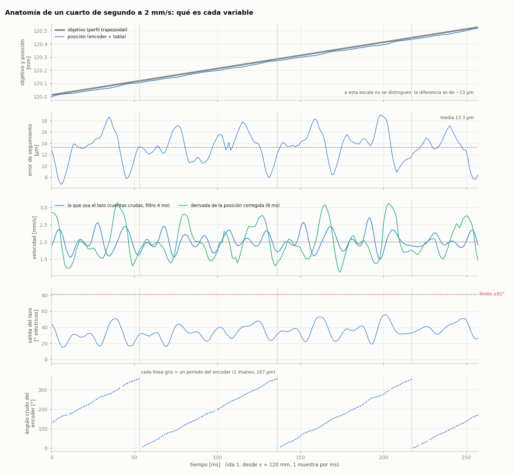
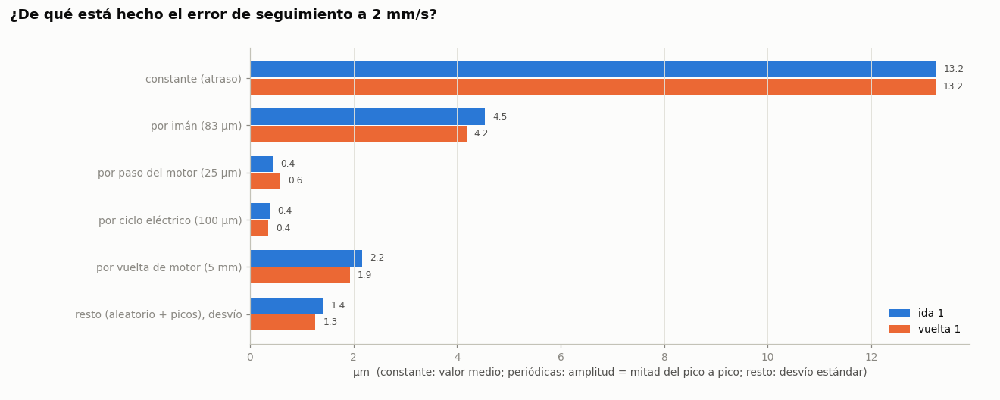
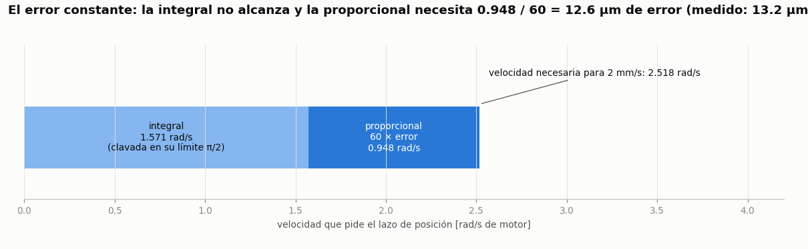
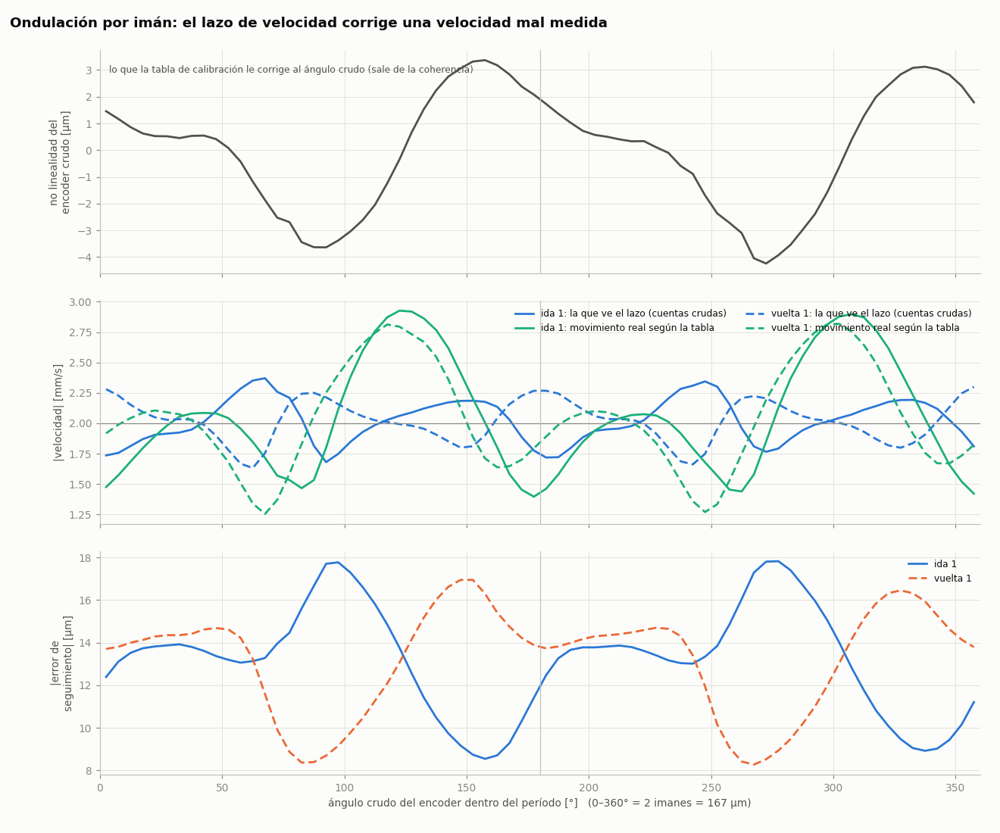
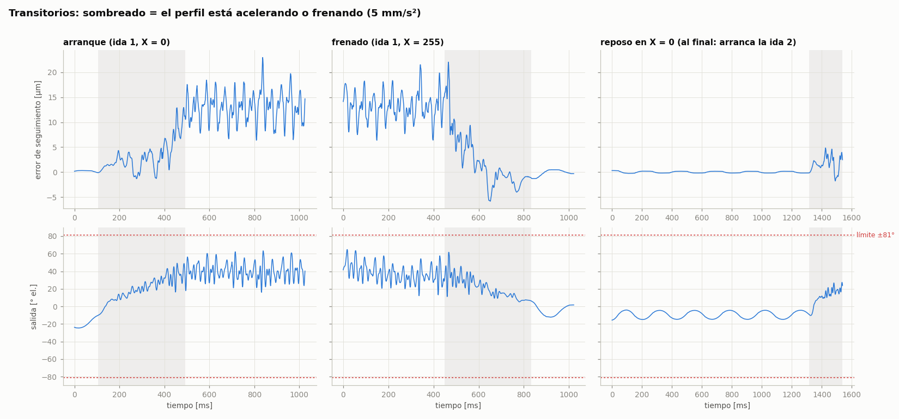
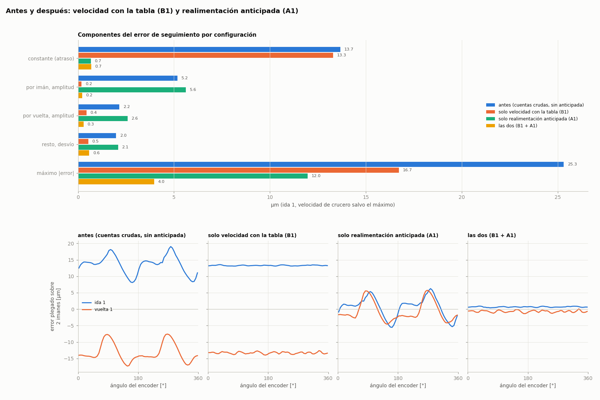

# Reporte: prueba de lazo cerrado del 16/10/2026

**Qué medimos, de dónde sale cada número y cómo entender los errores del eje**

Este reporte explica desde cero la prueba de idas y vueltas del 16/10. La idea es que alguien que no conoce el firmware pueda entender qué representa cada variable, qué tipos de error existen, cuáles medimos y de dónde viene cada uno. La segunda parte evalúa qué se puede hacer para reducirlos.

Datos: `mediciones/2026-10-16/lazo_cerrado_20261016_093928.npz`. Figuras del reporte: `mediciones/2026-10-16/reporte/`, generadas con `python3 tools/analisis_errores.py <archivo.npz>`. Cambios de firmware del día: [CAMBIOS_2026-10-16.md](CAMBIOS_2026-10-16.md).

---

## Resumen

- El carro hizo dos idas y vueltas completas (0 → 255 → 0 mm, a 2 mm/s) **sin trabarse ni cortarse**.
- Mientras se mueve, la posición que mide el encoder va **13 µm atrasada** respecto de donde debería estar, con una oscilación de **±4,5 µm** y picos de hasta **24 µm**. Quieto, el error es de **0,1–0,4 µm**.
- El atraso de 13 µm es casi todo **una decisión de ajuste del lazo**: un límite en la parte integral del controlador. Se puede eliminar.
- La oscilación de ±4,5 µm se repite **una vez por imán**. La explicación más probable es que el lazo usa una medición de velocidad que no está corregida por la calibración. También se puede corregir en el firmware.
- **Actualización (tarde del 16/10):** las dos correcciones se implementaron y se probaron (Parte 3). El error de seguimiento en crucero pasó de 13 ± 4,5 µm a **0,7 ± 0,2 µm** (RMS 1,2 µm, máximo 4–6 µm).
- **Esto no es la exactitud del carro.** Todo lo que medimos pasa por el mismo encoder del motor. Si el encoder o el husillo tienen error, el carro está corrido y el lazo no lo ve. Para saber dónde está realmente el carro hace falta una referencia externa.

---

# Parte 1: entender la prueba

## 1. El equipo y sus longitudes características

```
  motor paso a paso ──acople── husillo de bolas (5 mm por vuelta) ── tuerca ── carro
        │
   rueda de 60 imanes (en el eje del motor)
        │
   sensor MT6835 (mide la dirección del campo magnético de la rueda)
```

Casi todos los errores de un eje se repiten con una longitud fija, que delata qué pieza los produce. Conviene tener a mano estas longitudes. Todas son avance del carro:

| Elemento | De dónde sale | Longitud |
|---|---|---|
| Una vuelta de motor | husillo de 5 mm por vuelta | **5 mm** |
| Un período del encoder | la rueda tiene 60 imanes alternados N-S; el sensor ve una "vuelta" de campo cada 2 imanes: 30 períodos por vuelta | 5 / 30 = **167 µm** |
| Un imán | medio período | **83 µm** |
| Un ciclo eléctrico | el motor tiene 50 pares de polos: 50 ciclos por vuelta | 5 / 50 = **100 µm** |
| Un paso del motor | 200 pasos por vuelta (1,8°) | 5 / 200 = **25 µm** |

Equivalencias de ángulos que aparecen en el firmware:

| Ángulo | Avance del carro |
|---|---|
| 1 radián de motor | 0,796 mm |
| 1 grado de motor | 13,9 µm |
| 1 grado eléctrico (1/50 de grado de motor) | 0,28 µm |

## 2. Cómo funciona el lazo cerrado

El firmware corre en los dos núcleos del RP2040:

```
NÚCLEO 0, 2000 veces por segundo
  perfil trapezoidal ──► OBJETIVO (mm)  ─────────────────────────────┐
                                                                      │
NÚCLEO 1, ~20 000 veces por segundo                                   ▼
  sensor MT6835 ──► ÁNGULO CRUDO ──► contar períodos ──► tabla de ──► POSICIÓN (mm)
                         │                               calibración      │
                         │                                                ▼
                         │                                ERROR = objetivo − posición
                         │                                                │
                         │                              lazo de posición (PI)
                         │                                                │
                         │                                     velocidad pedida
                         ▼                                                │
                   VELOCIDAD medida ─────────────────────────► resta ◄────┘
                   (diferencia de cuentas, filtro 4 ms)          │
                                                          lazo de velocidad (PI)
                                                                 │
                                                              SALIDA (ángulo)
                                                                 │
                    campo del motor = ángulo donde está el rotor + SALIDA
```

En palabras:

1. El **perfil** calcula dónde debería estar el carro en cada instante: acelera a 5 mm/s², viaja a 2 mm/s y frena.
2. El **encoder** dice dónde está el motor. A esa posición se le resta el objetivo y queda el **error**.
3. El **lazo de posición** convierte el error en una velocidad pedida: cuanto más atrasado, más rápido hay que ir. Es un PI: una parte proporcional al error (×60) y una parte integral que acumula el error en el tiempo.
4. El **lazo de velocidad** compara la velocidad pedida con la medida y decide cuánta fuerza hace falta. Otro PI.
5. Esa "fuerza" es la **salida**. En un motor paso a paso con control de campo, el torque depende del ángulo entre el campo magnético que generan las bobinas y el rotor: es proporcional a sen(salida). Con 0° no hay torque, con 90° hay torque máximo. El firmware limita la salida a **±81°** (0,45π), donde ya se tiene el 99% del torque máximo.

## 3. La prueba

Con el eje recién calibrado (`M56 S`) se mandaron estos comandos:

```
M17                  habilitar el lazo cerrado
M120 S1 P2           telemetría: un dato cada 1 ms
G1 X255, G1 X0       dos veces, con 1 s de reposo en cada punta
```

En cada milisegundo la placa mandó, en binario, las variables de la sección 4. Se guardaron 504 104 muestras, unos 8,6 minutos. Cada tramo de 255 mm duró 128,1 s.

Detalle de cómo se toma cada muestra: la toma el núcleo 0 en su interrupción de 2 kHz, cada dos interrupciones (de ahí el `P2`). Lee los valores que dejó el núcleo 1 en su última vuelta del lazo, sin volver a leer el sensor. Se pierde ~2,5% de las muestras, de a una, cuando el núcleo 1 tiene ocupada la memoria compartida. Para el análisis no importa.

## 4. Las variables, una por una

### 4.1 Objetivo (`target_mm`)

- **Qué es:** dónde *debería* estar el carro según el plan de movimiento.
- **Cómo se obtiene:** lo calcula el perfil trapezoidal en el núcleo 0, 2000 veces por segundo. No es una medición.
- **Ojo:** el objetivo avanza en escalones de 0,5 ms (1 µm a 2 mm/s). Por eso la telemetría compara un objetivo recién calculado con una posición de un instante antes. Eso agrega ~0,5–1 µm al error que vemos en la telemetría, que no es error del lazo (ver 6.1).

### 4.2 Ángulo crudo del encoder (`chip_raw`)

- **Qué es:** la dirección del campo magnético de la rueda, tal como la mide el sensor MT6835.
- **Cómo se obtiene:** el chip la entrega como un número de 21 bits, de 0 a 2 097 151 para 0–360°. Pero 360° del chip no son una vuelta de motor: son **un período del encoder**, 2 imanes = 167 µm de carro.
- **Resolución:** 167 µm / 2²¹ = **0,08 nm por cuenta**. Es la resolución digital, que no hay que confundir con la exactitud. Que el número tenga muchos dígitos no quiere decir que esos dígitos sean ciertos.
- **Por qué no es proporcional a la posición:** el campo de una rueda de imanes no es una sinusoide perfecta, y los imanes no son idénticos ni están perfectamente espaciados. Si el motor gira a velocidad constante, el ángulo crudo avanza con pequeños adelantos y atrasos dentro de cada imán. Esta **no linealidad** es de ±3,8 µm (figura 4, arriba).

### 4.3 Posición (`pos_mm`)

- **Qué es:** dónde cree el sistema que está el carro.
- **Cómo se obtiene, en tres pasos:**
  1. **Contar períodos.** El firmware cuenta cuántas veces el ángulo crudo pasó por 360° y arma un ángulo absoluto: períodos completos más el ángulo dentro del período.
  2. **Tabla de calibración.** Ese ángulo absoluto se pasa por una tabla de 1024 puntos que lo convierte en ángulo del motor. La tabla se arma en `M56`: se gira el campo del motor a velocidad constante, en lazo abierto, una vuelta y algo, ida y vuelta. Se anota qué ángulo crudo corresponde a cada ángulo del campo. Así la tabla **corrige la no linealidad** del encoder. Ajuste de la calibración de hoy: error RMS de 0,099° de motor, o sea **1,4 µm**.
  3. **De ángulo a mm.** Ángulo del motor / 2π × 5 mm.
- **Detalle importante:** la tabla cubre una sola vuelta de motor y se repite en todas. Corrige lo que se repite en cada vuelta, como la forma de los imanes, pero no lo que cambia de un lugar del carril a otro.
- **Lo que NO es:** la posición real del carro. Es la del motor, vista a través del encoder y la tabla. Entre el motor y el carro están el acople, el husillo y la tuerca.

### 4.4 Error de seguimiento (`err = target_mm − pos_mm`)

- **Qué es:** cuánto va atrasada (o adelantada) la posición medida respecto del plan. Positivo = atrasado yendo hacia +X. En la vuelta el signo se invierte.
- **Cómo se obtiene:** es una resta entre dos números del propio firmware. La placa no la manda: se calcula en la PC.
- **Lo que NO es:** el error real del carro. Ver la sección 5.

### 4.5 Velocidad (`vel`, en mm/s)

- **Qué es:** la velocidad del motor que usa el lazo de velocidad.
- **Cómo se obtiene:** en cada vuelta del lazo, la diferencia de cuentas crudas respecto de la vuelta anterior se multiplica por una constante (el promedio de radianes por cuenta) y se divide por el tiempo. Después pasa por un filtro de 4 ms.
- **Ojo, esto es clave en la sección 6.2:** la velocidad **no pasa por la tabla de calibración**. Se calcula con el ángulo crudo, que tiene la no linealidad de ±3,8 µm por imán. El comentario del código dice que se hizo así a propósito, para evitar problemas de precisión numérica y de la costura de la tabla.

### 4.6 Salida del lazo (`out`, en grados eléctricos)

- **Qué es:** cuánto se adelanta el campo magnético respecto del rotor. Es la medida directa de cuánto torque está pidiendo el lazo.
- **Cómo se obtiene:** es la salida del PI de velocidad, limitada a ±81°.
- **Cómo leerla:**
  - **Con el carro quieto y sin carga, ~0°.**
  - **Contra la fricción, en movimiento, ~41°.** Es sen(41°) = 66% del torque máximo, solo para vencer la fricción del husillo y de la guía.
  - **En el límite de 81°, el lazo no tiene más para dar.** Si se queda ahí, el carro se atrasa hasta que salta el corte por falla.
  - **El margen de torque** es cuánto le falta a la salida para llegar a 81°.

### 4.7 Estado del encoder (`status`)

Bits que reporta el propio chip: velocidad excesiva, campo débil (la rueda está lejos del sensor o hay un imán flojo) y subtensión. En toda la prueba **no apareció ninguno**.

### 4.8 Coherencia del encoder (calculada en la PC)

- **Qué es:** compara la posición (que pasó por la tabla) con el ángulo crudo (que no pasó). Se calcula como la fase dentro del período que sale de la posición, menos el ángulo crudo.
- **Qué muestra:** cuánto corrige la tabla en cada lugar. Tiene que dar una forma que se repite en cada vuelta y **sin escalones**. Un escalón de 360° querría decir que el contador de períodos se salteó uno: el problema del 09/10, que deja la conmutación corrida. En la prueba no hubo ninguno.

### 4.9 Resumen

| Variable | Fuente | Medida o calculada | Representa |
|---|---|---|---|
| Objetivo | perfil, núcleo 0 | calculada | el plan |
| Ángulo crudo | sensor MT6835 | medida | la dirección del campo de la rueda (sin corregir) |
| Posición | ángulo crudo + tabla | medida y corregida | el ángulo del motor según el encoder |
| Error | objetivo − posición | calculada | qué tan bien sigue el lazo **su propia medición** |
| Velocidad | ángulo crudo, filtro 4 ms | medida, sin corregir | lo que el lazo cree que es la velocidad |
| Salida | PI de velocidad | calculada | el torque pedido (límite 81°) |
| Estado | sensor MT6835 | medida | la salud de la señal magnética |
| Coherencia | posición − ángulo crudo | calculada | la corrección de la tabla; detecta saltos del contador |

## 5. Los distintos "errores": cuál medimos y cuál importa

Cuando decimos "error del eje" podemos estar hablando de cuatro cosas distintas:

```
  objetivo ──(1)── posición medida ──(2)── giro real del motor ──(3)── posición real del carro
```

| | Nombre | Qué es | ¿Lo mide esta prueba? |
|---|---|---|---|
| (1) | **Error de seguimiento** | objetivo − posición medida | **Sí.** Es lo que analiza este reporte |
| (2) | **Error de medición** | posición medida − giro real del motor (no linealidad que la tabla no corrigió, error de la calibración, ruido) | No |
| (3) | **Error de transmisión** | lo que el carro no avanza como debería para un giro del motor: error de paso del husillo, juego, elasticidad del acople, dilatación térmica | No |
| (1+2+3) | **Error de posición real** | objetivo − posición real del carro. **Es el que importa para mecanizar** | No |

**El punto clave:** el lazo cerrado lleva a cero el error (1), y solo ese. Hace que la *medición* siga al objetivo. Si la medición está corrida 5 µm, el lazo deja el carro corrido 5 µm y queda conforme. El lazo **no corrige** los errores (2) y (3): los copia tal cual en la posición del carro.

Por eso esta prueba dice **qué tan bien el control sigue al encoder**, no qué tan bien queda posicionado el carro. Las dos cosas importan:
- Si el error (1) es grande, el carro se atrasa, oscila o se traba. Eso es lo que medimos acá.
- Para el error real, (2) y (3) pueden ser del mismo orden o mayores. Por ejemplo, el acero se dilata 11,5 µm por metro y por grado: 250 mm de husillo con 1 °C más son 3 µm. Y el error de paso de un husillo de bolas, según su clase, va de algunos µm a decenas de µm a lo largo del recorrido.

Tres palabras que se confunden:
- **Resolución:** el menor cambio que el sistema puede expresar (0,08 nm por cuenta en el chip).
- **Repetibilidad:** cuánto cambia el resultado si se repite lo mismo (acá, entre la ida 1 y la ida 2: igual a la décima de µm).
- **Exactitud:** cuánto se aleja el resultado del valor verdadero. Solo se puede medir con una referencia externa.

## 6. Resultados: de qué está hecho el error de seguimiento



*Figura 1: un cuarto de segundo a velocidad de crucero, en x ≈ 120 mm. Arriba, objetivo y posición se ven superpuestos porque la diferencia es de 13 µm sobre 0,5 mm. El error oscila alrededor de 13 µm con un período que coincide con medio período del encoder (las líneas grises marcan cada período, o sea cada 2 imanes). La velocidad que usa el lazo (azul) y la velocidad real según la tabla (verde) no coinciden.*



*Figura 2: el error de seguimiento a 2 mm/s separado en componentes. Las periódicas se obtienen "plegando" los datos: se promedian todos los puntos que caen en la misma fase de un imán, de un paso, de un ciclo eléctrico o de una vuelta. Lo que queda es el resto.*

| Componente | Ida | Vuelta | Origen | Sección |
|---|---|---|---|---|
| Constante (atraso) | 13,25 µm | 13,24 µm | límite de la integral del lazo de posición | 6.1 |
| Por imán (83 µm) | ±4,5 µm | ±4,2 µm | velocidad medida sin pasar por la tabla | 6.2 |
| Por vuelta de motor (5 mm) | ±2,2 µm | ±1,9 µm | diferencias entre imanes y sector de fricción | 6.3 |
| Por paso del motor (25 µm) | ±0,4 µm | ±0,6 µm | el propio motor | 6.4 |
| Por ciclo eléctrico (100 µm) | ±0,4 µm | ±0,4 µm | el propio motor | 6.4 |
| Resto (desvío estándar) | 1,4 µm | 1,3 µm | ruido y picos de saturación | 6.5 |

Las dos idas dieron lo mismo con diferencias de centésimas de µm, y las dos vueltas también. **El comportamiento es completamente repetible.**

### 6.1 El atraso constante de 13 µm



*Figura 3: la velocidad que pide el lazo de posición tiene dos partes. Para ir a 2 mm/s hacen falta 2,518 rad/s de motor, pero la parte integral está limitada a π/2 = 1,571 rad/s. El resto lo tiene que poner la parte proporcional, y para eso necesita error.*

El cálculo:

- **Velocidad necesaria:** 2 mm/s = 2,518 rad/s de motor (medida: 2,004 mm/s).
- **Lo que pone la integral:** como mucho 1,571 rad/s. Es el límite antisaturación (`windup_limit`) que se le pasa al PI de posición en `servo_controller.cpp`. Está clavada ahí todo el viaje.
- **Lo que tiene que poner la proporcional:** 2,518 − 1,571 = 0,947 rad/s = 60 × error.
- **El error necesario:** 0,947 / 60 = 0,0158 rad de motor = **12,6 µm**.
- **Medido: 13,25 µm.** La diferencia de ~0,7 µm es casi seguro el desfasaje de la telemetría de la sección 4.1.

La figura 5 (arranque) lo confirma. Mientras el perfil acelera, el error se queda cerca de 0 hasta que la velocidad pasa de ~1,25 mm/s (= 1,571 rad/s), y recién ahí sube a 13 µm. Sin ese límite, la integral habría absorbido toda la velocidad y el atraso en crucero tendería a cero.

**En resumen:** no es una limitación física del motor ni del encoder. Es un parámetro del controlador, heredado del proyecto original (brazos livianos, otras velocidades).

### 6.2 La ondulación por imán (±4,5 µm)



*Figura 4: todo plegado sobre el ángulo crudo del encoder, de 0 a 360° = 2 imanes. Arriba, la no linealidad del ángulo crudo, que es lo que corrige la tabla. En el medio, la velocidad que ve el lazo (azul) y el movimiento real según la tabla (verde). Abajo, el error de seguimiento.*

La forma se repite **dos veces por período del encoder, una por imán**. Tiene una amplitud de ±4,5 µm en el error y de ±0,77 mm/s (±38%) en la velocidad real según la tabla. El mecanismo más probable:

1. El ángulo crudo tiene una no linealidad de ±3,8 µm por imán (figura 4, arriba). Si el motor gira parejo, el ángulo crudo avanza a veces más rápido y a veces más lento.
2. La velocidad que usa el lazo se calcula con ese ángulo crudo, **sin la corrección de la tabla** (sección 4.5). Entonces el lazo "ve" una velocidad que oscila aunque el motor gire parejo.
3. El lazo de velocidad intenta aplanar esa oscilación ficticia. La salida oscila ±12° y, como esa salida es torque real, **el motor pasa a moverse de verdad con oscilaciones**.
4. La posición, que sí está corregida por la tabla, muestra esas oscilaciones reales: ±4,5 µm de error y ±38% de velocidad.

Lo que lo respalda:
- La velocidad que ve el lazo ondula **0,69 mm/s pico a pico** y la real según la tabla **1,53 mm/s**. El lazo logró aplanar parcialmente la que mide, a costa de ondular la real. Si la oscilación fuera real y el lazo la estuviera corrigiendo, debería ser al revés.
- El tamaño cierra. Una no linealidad de ~3,8 µm en un imán de 83 µm cambia la pendiente en ±2π·3,8/83 ≈ ±29%, del mismo orden que lo medido.
- No hay otra pieza del equipo que se repita cada 83 µm: el motor tiene 25 y 100 µm, el husillo 5 mm.

**Duda que queda:** esto supone que la tabla de calibración es la que dice la verdad y el ángulo crudo el que miente. Es lo esperable, porque la tabla se armó girando el campo a velocidad constante. Pero se confirma recién al cambiar el cálculo de velocidad (Parte 2, B1). Si la ondulación desaparece, era esto.

Esta oscilación **también se come margen de torque**: los ±12° de salida se suman a los 41° de la fricción.

### 6.3 Lo que se repite en cada vuelta de motor (±2 µm)

Al plegar sobre una vuelta de 5 mm, lo que aparece es la parte que distingue a cada uno de los 60 imanes. El plegado de 6.2 promedia todos los imanes juntos; este plegado ve que el imán 17 es un poco distinto del 18. A eso se suma el **sector de fricción** en la fase 2,3–3,2 mm de cada vuelta, que sube la salida unos 15°. Ese sector ya se había visto el 13/10 y es mecánico: acople, alineación del husillo o roce de la rueda.

### 6.4 El motor en sí: muy parejo (≤ 0,6 µm)

Las componentes del paso (25 µm) y del ciclo eléctrico (100 µm) son menores a 0,6 µm. Esto es una buena noticia: el control de campo hace que el motor paso a paso gire suave, sin el "escalonado" típico de los pasos.

### 6.5 El resto y los picos de 24 µm

Después de sacar todo lo periódico queda un desvío de 1,4 µm. Ahí entran el ruido y los picos. Los picos máximos (23,8 µm en la ida, 21,6 µm en la vuelta) aparecen cuando la salida toca el límite de 81° durante 1–5 ms. Eso pasa cuando se juntan, en el mismo lugar:

- la fricción de base (~41°);
- el sector de fricción de cada vuelta (+15°);
- la ondulación por imán (±12°).

En la ida pasó ~100 veces por tramo, casi siempre de los 120 mm en adelante. En la vuelta, 1 o 2 veces. Ninguno trabó el carro: la velocidad medida bajó por unos milisegundos, como mínimo a 0,8 mm/s.

### 6.6 Arranques y frenadas



*Figura 5: arranque, frenado y reposo. El sombreado marca cuándo acelera o frena el perfil.*

- **Arranque:** el error sube de 0 a 13 µm a medida que la velocidad pasa de 1,25 mm/s (sección 6.1). Máximo: 23 µm.
- **Frenado:** el error baja, se pasa de largo hasta −5,7 µm (el carro queda adelantado) y se asienta en ~0,4 s. Ese pasarse es la integral, que se descarga.
- **Reposo:** queda una oscilación lenta (~4 Hz) de ±0,3 µm, con la salida yendo y viniendo ±5°. Es el resto del ciclo límite del 13/10, ya chico.

### 6.7 Quieto

| Lugar | Desvío | Pico a pico | Salida media |
|---|---|---|---|
| X = 255 mm | 0,11 µm | 0,31 µm | −4° |
| X = 0 mm (cerca del tope) | 0,37 µm | 3,8 µm | −11° |

Quieto, el lazo mantiene la posición del encoder dentro de fracciones de µm.

### 6.8 Salud del encoder

- **Bits de estado:** ningún bit de estado en los 510 mm × 2.
- **Coherencia:** periódica en todo el recorrido, sin escalones. El contador de períodos nunca se corrió.
- **Repetibilidad:** las dos pasadas en el mismo sentido coinciden.

### 6.9 Los gráficos de `closed_loop_test.py`

| Gráfico | Qué mirar |
|---|---|
| `_resumen.png` | Todo el carril, con un punto por período del encoder (línea = media, banda = mínimo a máximo). Que el error sea plano en todo el recorrido; que la banda de la salida no toque la línea roja |
| `_tiempo.png` | La prueba completa: que los cuatro tramos duren lo mismo y no haya mesetas (trabas) |
| `_mapa.png` | Una fila por vuelta de motor. **Bandas verticales:** algo que pasa en cada vuelta (acople, tabla). **Bandas horizontales:** algo de un lugar del carril (husillo, guía). Hoy se ve una banda vertical en 2,3–3,2 mm (fricción) que se oscurece hacia los 255 mm |
| `_ventanas.png` | Datos crudos cada 10 mm, para mirar un lugar puntual |
| `_plegado.png` | Las formas que se repiten por vuelta y por período del encoder |

---

# Parte 2: cómo reducir el error

Ordenado por componente, de mayor a menor. "Efecto esperado" es una estimación a confirmar con la misma prueba.

## A. El atraso constante (13 µm)

| Opción | Qué es | Efecto esperado | Esfuerzo | Riesgo |
|---|---|---|---|---|
| **A1. Realimentación anticipada de velocidad** (recomendada) | El perfil ya sabe a qué velocidad hay que ir. Se le pasa esa velocidad directamente al lazo de velocidad, y el PI de posición solo corrige lo que falte | Atraso en crucero de 13 µm a ~1 µm. Además permite bajar más `POS_KI` (mejor quieto) | Medio: llevar la velocidad del perfil al núcleo 1 por la memoria compartida | Bajo. Es la solución estándar en control de ejes |
| A2. Subir el límite de la integral | Cambiar π/2 por 2π en `servo_controller.cpp` | Atraso en crucero ~0 una vez cargada la integral | Una línea | Más sobrepaso al frenar (la integral cargada tarda en descargarse) y más tiempo de asentamiento. Sirve como experimento rápido para confirmar 6.1 |
| A3. Subir `POS_KP` | Más ganancia proporcional | El atraso baja en proporción (KP 60 → 120: 13 → 6 µm) | Probar con `M55` | Estabilidad. El 13/10, cambiar `POS_KP` no mejoró la oscilación en reposo |

## B. La ondulación por imán (±4,5 µm)

| Opción | Qué es | Efecto esperado | Esfuerzo | Riesgo |
|---|---|---|---|---|
| **B1. Calcular la velocidad con la posición corregida** (recomendada) | En `ServoController::update()`, calcular la diferencia de posición con la tabla en vez de con cuentas crudas. Para no perder precisión, se evalúa la tabla sobre el ángulo reducido a una vuelta, con números chicos | Si 6.2 es correcto: la mayor parte de los ±4,5 µm desaparece, y la salida deja de oscilar ±12° (más margen de torque y menos picos). Si no cambia nada, la hipótesis era falsa y la oscilación es real | Bajo–medio, solo firmware | Bajo. Se verifica con `closed_loop_test.py` y `analisis_errores.py` |
| B2. Más filtro en la velocidad | Subir `VEL_LOWPASS_TC` (hoy 4 ms) | El lazo reacciona menos a la ondulación ficticia | Probar con `M55` | Lazo más lento y menos estable. Es un parche |
| B3. Mejorar la rueda | Imanes más parejos, mejor distancia al sensor | Menos no linealidad de origen | Mecánico | — |

## C. Los picos por fricción (hasta 24 µm) y el margen de torque

| Opción | Efecto esperado |
|---|---|
| Resolver el sector de fricción de cada vuelta (alineación del acople y del husillo, roce de la rueda con la base) | −15° en esos lugares: casi todos los picos desaparecen |
| B1 (arriba) | −12° de oscilación en la salida |
| Subir `MOTOR_MAX_CURRENT_FACTOR` (0,6 → 0,7–0,8) | Más torque disponible, la misma salida significa más fuerza. Vigilar la temperatura del motor y del driver |
| Lubricación o limpieza del husillo y de la guía | Baja la fricción de base (hoy se come el 66% del torque) |

## D. Arranques y frenadas

- **A1** ya reduce mucho el error en las aceleraciones.
- **Perfil con tirón limitado (curva S):** aceleración que sube gradualmente en vez de en escalón. Menos sobrepaso al frenar.

## E. El error que no medimos: exactitud real del carro

Ninguna de las opciones anteriores toca los errores (2) y (3) de la sección 5. Para el mecanizado son tan importantes como el seguimiento, y hoy no sabemos cuánto valen. Pasos sugeridos:

1. **Medirlos.**
   - **Estático:** un comparador o micrómetro de 1 µm (o mejor) contra el carro, en 10–20 posiciones a lo largo del recorrido, comparando lo que dice `M114` con lo que mide el comparador. Da el error de paso del husillo y el juego (yendo a cada posición desde los dos sentidos).
   - **Dinámico:** un interferómetro láser o un sensor capacitivo. Permite ver si la ondulación por imán es real.
2. **Corregirlos según lo que salga:**
   - Si el error es del husillo y repetible: una **tabla de compensación** en el firmware (mm pedidos → mm reales).
   - La solución de fondo: **un encoder lineal sobre el carro.** Mide directamente la posición del carro y saca del medio el husillo, el acople, la dilatación y el encoder del motor. El firmware ya tiene el esqueleto para eso (`cascade_corrector`, desactivado).

## Plan sugerido

1. **B1 y A1 en el firmware**, y repetir la prueba. Esperado: el error de seguimiento en crucero pasa de 13 ± 4,5 µm a unos ±2–3 µm, y la salida tiene más margen.
2. **Revisar la mecánica** del sector de fricción de cada vuelta.
3. **Medir la exactitud real** con una referencia externa, para saber cuánto pesan el encoder y el husillo frente a lo que ya se ganó en seguimiento.

---

# Parte 3: resultado de B1 y A1 (tarde del 16/10)

Se implementaron las dos opciones recomendadas: **B1**, velocidad con la pendiente de la tabla, y **A1**, realimentación anticipada de la velocidad del perfil. Las dos se pueden prender y apagar en caliente con `M58 V<0|1> F<0|1>`, y por defecto quedan prendidas. Detalle del código: [CAMBIOS_2026-10-16.md](CAMBIOS_2026-10-16.md), sección 5.

Con una calibración nueva (`M56 S`), se corrió el carril completo con las cuatro combinaciones, una después de otra y con el mismo equipo:



*Figura 6: arriba, los componentes del error en la ida para cada configuración. Abajo, el error plegado sobre 2 imanes: la ondulación por imán desaparece en cuanto la velocidad se calcula con la tabla.*

| Configuración | Atraso constante | Por imán | Por vuelta | Resto (desvío) | RMS | Máx \|error\| (ida / vuelta) | Salida por imán (pico a pico) | Muestras saturadas (ida) |
|---|---|---|---|---|---|---|---|---|
| Antes (V0 F0) | 13,7 µm | ±5,2 µm | ±2,2 µm | 2,0 µm | 14,1 µm | 25,3 / 22,7 µm | 29° | 12 217 |
| Solo B1 (V1 F0) | 13,3 µm | ±0,2 µm | ±0,4 µm | 0,5 µm | 13,3 µm | 16,7 / 18,6 µm | 2° | 53 |
| Solo A1 (V0 F1) | 0,7 µm | ±5,6 µm | ±2,6 µm | 2,1 µm | 4,0 µm | 12,0 / 12,0 µm | 32° | 5 358 |
| **B1 + A1 (V1 F1)** | **0,7 µm** | **±0,2 µm** | **±0,3 µm** | **0,6 µm** | **1,2 µm** | **4,0 / 5,9 µm** | **2°** | **3** |

La configuración final se corrió dos ciclos completos. Las dos idas y las dos vueltas dieron los mismos números con diferencias de 0,1 µm.

Además:

| | Antes | B1 + A1 |
|---|---|---|
| Máx \|error\| en aceleraciones y frenadas | 23,3 µm | 4,9 µm |
| Reposo en X = 255 (desvío) | 0,32 µm | 0,29 µm |
| Reposo en X = 0 (desvío) | 0,33 µm | 0,44 µm |

## Qué confirma esto

- **6.1 era correcto.** Con la anticipada, la integral ya no tiene que cargar con la velocidad, y el atraso pasa de 13,7 a 0,7 µm. Los 0,7 µm que quedan coinciden con el desfasaje de la telemetría (sección 4.1): en la ida dan +0,7 y en la vuelta −0,7.
- **6.2 era correcto.** Con la velocidad calculada con la tabla, la ondulación por imán pasa de ±5,2 a ±0,2 µm, y la oscilación de la salida de 29° a 2°. La ondulación no era movimiento propio del motor: la generaba el lazo al corregir una velocidad mal medida. También desaparece casi todo lo que se repetía por vuelta (±2,2 → ±0,3 µm), así que eso también venía mayormente de las diferencias entre imanes que veía la velocidad cruda.
- **Las dos son independientes y se suman:** cada una saca su componente y no toca la otra.
- **También mejora el margen de torque.** Las muestras de la ida con la salida en el límite pasan de 12 217 a 3.

## Lo que queda

- **El margen de torque en la ida sigue justo.** La salida media de la ida es +51° y la de la vuelta −33°: con esta calibración la conmutación quedó corrida unos +9° (con la de la mañana estaba simétrica, ±41°). La conmutación varía de una calibración a otra, y la verificación del `G28`/`M56` solo la mira junto al home. Ver la sección 6 de [CAMBIOS_2026-10-16.md](CAMBIOS_2026-10-16.md).
- **La componente del paso del motor (25 µm) subió con B1:** de 0,5 a 0,8 µm en la ida y de 0,6 a 2,1 µm en la vuelta. La tabla de calibración tiene una huella de 25 y 100 µm, aprendida en lazo abierto, que ahora hereda la velocidad. Es el próximo residuo a atacar. Ver la sección 1.6 de [METODO_DE_ERRORES_Y_PLAN_DE_CARACTERIZACION.md](METODO_DE_ERRORES_Y_PLAN_DE_CARACTERIZACION.md).
- **La exactitud real del carro** (Parte 2, E) sigue sin medir. Ahora que el seguimiento está en ~1 µm, lo que domine el error del carro va a ser el encoder y el husillo.
