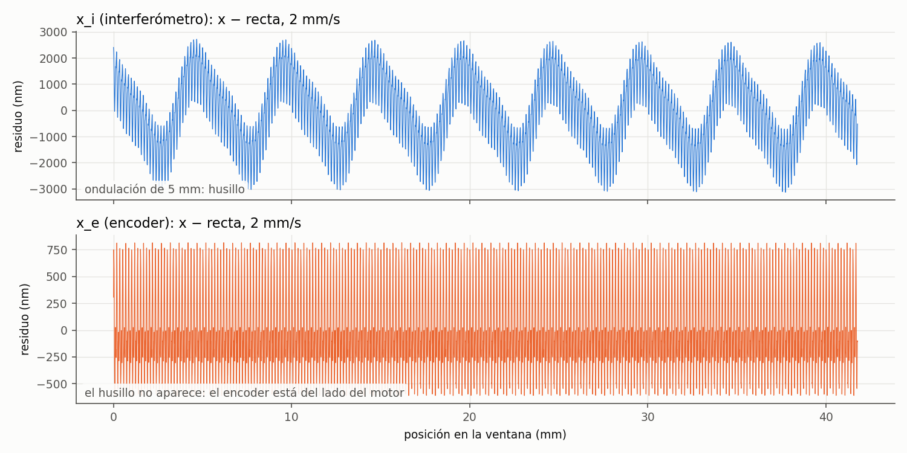
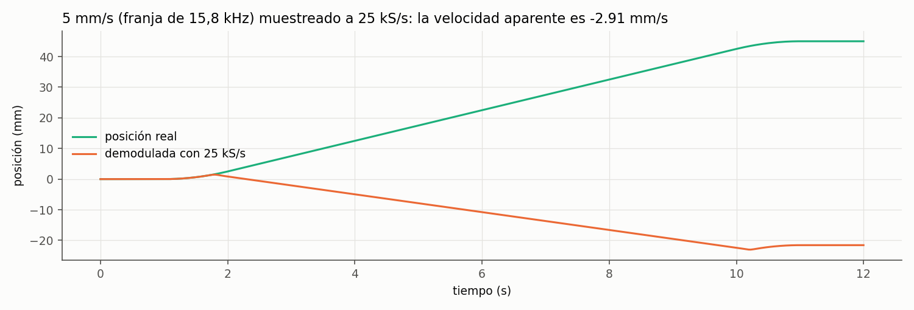

# Prueba 2 simulada: espectro de velocidad con un Michelson

**Fecha:** 17/11/2026. **Estado:** simulación; todavía no hay datos reales.
**Scripts:** `simulaciones/prueba2_simulacion.py` genera los datos; `tools/prueba2_analisis.py` los analiza. El mismo análisis sirve para los datos reales.

## 1. Qué se simuló

Un carro que va de reposo a reposo, 45 mm por corrida, a 1, 2 y 5 mm/s, con aceleración de 5 mm/s². Se generan dos registros con relojes independientes:

- **Michelson:** las dos señales crudas de los fotodetectores (cuadratura), con offsets, ganancias distintas, 7° de error de fase, visibilidad que cae 25 % a lo largo del recorrido, ruido de detector, ADC de 12 bits y turbulencia del aire de 3 nm RMS. Láser HeNe (632,8 nm).
- **Encoder:** la telemetría del RP2040 a 1 kS/s, con 0,8 nm de ruido. Su reloj arranca 0,137 s después y corre 30 ppm más rápido.

### Componentes puestas en el carro

| Componente | Tipo | Valor | Origen del valor |
|---|---|---|---|
| Cogging, paso de 25 µm | fuerza: mueve motor y carro | 1,46 µm sin compensar a 2 mm/s; 0,06 µm con anti-cogging, que se desvanece de 2 a 3 mm/s | medido (20/10) |
| No linealidad del encoder, 166,7 y 83,3 µm | error del sensor: x_i = −n·T, x_e = n·S | 1,0 y 0,4 µm | supuesto |
| Husillo, 5 y 2,5 mm | solo el carro | 1,5 y 0,4 µm, más 40 ppm de escala | supuesto |
| Oscilación del lazo | temporal, los dos sensores | 1,5 nm a 214 Hz | medido (06/11, `VEL_KP` 0,12) |
| Modo mecánico | temporal, solo el carro | 4 nm a 120 Hz | inventado, para probar que el análisis lo encuentra |

El lazo se modeló como un segundo orden de 40 Hz con ζ = 0,7, porque todavía no tenemos su Bode. Ese valor fija cuánto del error del encoder pasa al carro y cuánto cogging queda en cada velocidad. **Las amplitudes esperadas dependen de ese supuesto. Lo que no depende de él es el método.**

## 2. El análisis recupera lo que se puso

Amplitud de pico en nm:

| v (mm/s) | Componente | f (Hz) | x_i puesto | x_i medido | x_e puesto | x_e medido | Sensores |
|---|---|---|---|---|---|---|---|
| 1 | husillo 1x | 0,2 | 1500 | 1500,2 | 0 | 0,0 | solo x_i |
| 1 | encoder 1x | 6 | 1000 | 997,9 | 211 | 211,1 | domina x_i |
| 1 | encoder 2x = imanes | 12 | 399 | 397,1 | 171 | 171,0 | ambos, distinta amplitud |
| 1 | paso motor 1x | 40 | 248 | 246,8 | 248 | 247,0 | ambos, igual amplitud |
| 1 | oscilación del lazo | 214 | 1,5 | 1,5 | 1,5 | 1,5 | ambos, igual amplitud |
| 2 | husillo 1x | 0,4 | 1500 | 1500,1 | 0 | 0,0 | solo x_i |
| 2 | encoder 1x | 12 | 998 | 995,5 | 429 | 428,3 | ambos, distinta amplitud |
| 2 | encoder 2x = imanes | 24 | 379 | 377,1 | 346 | 345,4 | **ambos, igual amplitud** |
| 2 | paso motor 1x | 80 | 60,0 | 59,8 | 60,0 | 59,8 | ambos, igual amplitud |
| 2 | oscilación del lazo | 214 | 1,5 | 1,3 | 1,5 | 1,3 | ambos, igual amplitud |
| 5 | husillo 1x | 1 | 1500 | 1496,8 | 0 | 0,0 | solo x_i |
| 5 | encoder 1x | 30 | 879 | 878,9 | 1047 | 1047,2 | **ambos, igual amplitud** |
| 5 | encoder 2x = imanes | 60 | 164 | 163,5 | 504 | 503,7 | domina x_e |
| 5 | paso motor 1x | 200 | 204 | 204,0 | 204 | 202,9 | ambos, igual amplitud |
| 5 | oscilación del lazo | 214 | 1,5 | 1,9 | 1,5 | 1,9 | ambos, igual amplitud |

- Las amplitudes se recuperan con menos de 1 % de error, salvo la oscilación de 214 Hz. Esa tiene amplitud variable en el tiempo, como en las mediciones reales, y la ventana de 7 s a 5 mm/s promedia otra parte de esa variación.
- El modo de 120 Hz no estaba en la lista de candidatos. El análisis lo encontró como pico desconocido a las tres velocidades, siempre en 120,0 Hz, y lo clasificó como **temporal**.
- El error de escala salió +40,1, +40,0 y +39,9 ppm, contra los 40 puestos.
- Los 30 ppm de diferencia entre relojes no afectaron nada.


En la figura 4 las tres velocidades se dibujan en ciclos/mm. Los picos espaciales caen en el mismo lugar, mientras que los de 120 y 214 Hz aparecen en un lugar distinto para cada velocidad.



## 3. Lo que enseñó la simulación

### 3.1 Comparar amplitudes no alcanza para separar fuerza de error del encoder

Las filas en negrita de la tabla de §2 son errores del encoder que el análisis clasifica como "ambos, igual amplitud", el mismo patrón que una fuerza:

- a 2 mm/s, los 24 Hz;
- a 5 mm/s, los 30 Hz.

Pasa cuando |T| ≈ |S|, cerca del ancho de banda del lazo. Hay dos formas de salir de la ambigüedad.

**a) Mirar el cociente x_i/x_e en las tres velocidades.**

| Componente | 1 mm/s | 2 mm/s | 5 mm/s |
|---|---|---|---|
| encoder 1x | 4,73 | 2,32 | 0,84 |
| paso motor 1x | 1,00 | 1,00 | 1,01 |

En una fuerza, el cociente vale 1 a cualquier velocidad. En un error del sensor, sigue a |T|/|S| y cambia con la velocidad. Esta salida no necesita sincronismo.

**b) Calcular e_m = x_e − x_i con sincronismo.** Como T + S = 1, e_m = n exactamente. Es la no linealidad del encoder, sin la influencia del lazo, y una fuerza se cancela.

Amplitud en e_m a 2 mm/s (nm):

| Sincronismo | husillo 1x | encoder 1x | imanes | paso motor |
|---|---|---|---|---|
| Exacto (disparo por hardware, deriva corregida) | 1496 | 999 | 399 | 0,0 |
| Un pulso al inicio, sin corregir los 30 ppm | 1496 | 1011 | 416 | 11 |
| Alineado a mano, 5 ms de error | 1496 | 1148 | 593 | 114 |
| Puesto | 1500 | 1000 | 400 | 0 |


- **Sin sincronismo,** la prueba 2 igual sirve con el criterio a). El sincronismo no es indispensable.
- **Con un pulso de disparo,** da directamente la no linealidad del encoder. Hay que corregir la deriva con un segundo pulso al final.
- **Alinear a mano no sirve para e_m:** 5 ms de error inventan 114 nm de un cogging que en e_m no existe.

### 3.2 El encoder 2x y los imanes no se pueden separar

60 imanes por vuelta es exactamente el doble de los 30 períodos del encoder, así que caen en la misma frecuencia a cualquier velocidad. Ningún análisis espectral los separa. Habría que cambiar uno de los dos físicamente, o medir la rueda por separado.

### 3.3 El error de escala sin sincronismo pide desplazamientos múltiplos de 5 mm

Se calcula como Δx_i/Δx_e entre el reposo inicial y el final. Cada sensor mide su propio Δx con el carro quieto, así que no hace falta sincronismo.

**El problema:** los errores periódicos se suman en esos dos puntos. En la primera corrida, con desplazamientos que no eran múltiplos de 5 mm, salieron 0,7 y 5,7 ppm en lugar de 40, porque el husillo (1,5 µm) aportaba distinto en el punto inicial y en el final.

**La solución:** con 45 mm, cada punto queda en la misma fase del husillo, del encoder y del paso del motor, porque 5 mm son 1 vuelta, 30 períodos del encoder y 200 pasos. Así salen los 40 ppm. **Las corridas reales tienen que ir de reposo a reposo y recorrer un múltiplo de 5 mm.**

Este método también contradice algo que dije antes: la pendiente de x_i contra x_e muestra a muestra *sí* necesita sincronismo. Lo que no lo necesita es la comparación entre reposos.

### 3.4 Ripple esperado, bajo los supuestos del §1

| v (mm/s) | Ventana analizada | Ripple de velocidad RMS | Pico a pico | Error de escala | Error de demodulación |
|---|---|---|---|---|---|
| 1 | 43,5 mm / 43,5 s | 56 µm/s (5,6 %) | 25 % | +40,1 ppm | 1,8 nm RMS |
| 2 | 41,8 mm / 20,9 s | 70 µm/s (3,5 %) | 15 % | +40,0 ppm | 1,9 nm RMS |
| 5 | 34,7 mm / 6,9 s | 220 µm/s (4,4 %) | 18 % | +39,9 ppm | 2,6 nm RMS |

- **Qué domina el ripple:** el error del encoder impreso en el carro (6–30 Hz) y el cogging. El husillo tiene una amplitud de posición grande pero una frecuencia baja, así que casi no aporta ripple de velocidad (0,2 %).
- **El cogging a 1 mm/s es mayor que a 2 mm/s** (248 contra 60 nm), aunque los dos estén compensados. A 1 mm/s cae en 40 Hz, justo en el pico de la sensibilidad a fuerzas del lazo modelado (P·S con P = 1/ms²). Si se confirma en el carro, conviene revisar el anti-cogging a baja velocidad.
- **Error de demodulación:** está en la frecuencia de franja (kHz), fuera de la banda de análisis. No afecta las amplitudes.

## 4. Adquisición: lo que hay que preguntar en el INTI

Un Michelson da una franja cada λ/2 = 316 nm de recorrido. La frecuencia de franja es f = 2·n·v/λ y crece con la velocidad:

| v (mm/s) | Frecuencia de franja | Muestreo mínimo (2,5×) | Recomendado (5×) | Muestras por canal, 255 mm al recomendado |
|---|---|---|---|---|
| 1 | 3,2 kHz | 8 kS/s | 16 kS/s | 4 M |
| 2 | 6,3 kHz | 16 kS/s | 32 kS/s | 4 M |
| 5 | 15,8 kHz | 40 kS/s | 79 kS/s | 4 M |

A ritmo constante de muestras por franja, una corrida de 255 mm siempre ocupa unos 4 M de muestras por canal, a cualquier velocidad.

**Muestrear por debajo de eso no da ningún error visible: da una velocidad equivocada.** A 5 mm/s con 25 kS/s, la franja de 15,8 kHz se pliega a −9,2 kHz y el carro "retrocede" a −2,91 mm/s (figura 5). Control obligatorio en cada corrida: la velocidad media medida tiene que coincidir con la comandada.



### Uno o dos detectores

| | Cuadratura (dos detectores a 90°) | Un detector |
|---|---|---|
| Espectro a velocidad constante | igual (ver tabla abajo) | igual |
| Sentido del movimiento | lo da la señal | hay que conocerlo de antemano |
| Reposos y rampas | sí | no, porque en reposo no hay franja que seguir |
| Escala entre reposos (§3.3) | sí | no |

Amplitud en x_i a 2 mm/s (nm):

| Componente | Cuadratura | Un detector |
|---|---|---|
| husillo 1x | 1500,1 | 1500,1 |
| encoder 1x | 995,5 | 995,6 |
| encoder 2x = imanes | 377,1 | 377,2 |
| paso motor 1x | 59,8 | 59,8 |
| oscilación del lazo | 1,3 | 1,3 |

Para la prueba 2 alcanza con un detector. La cuadratura agrega el error de escala y las pruebas con inversión.


El ajuste de elipse recupera bien los offsets (1,27/1,19 V contra 1,25/1,18). La fase sale 2,2° en lugar de 7°, porque la visibilidad cambia a lo largo del recorrido y la elipse no es una sola. El error queda en la frecuencia de franja, fuera de banda. Si la visibilidad real cambia mucho, conviene ajustar la elipse por tramos.

### Preguntas para el INTI

1. **Detectores:** ¿cuántos? ¿Hay salida en cuadratura?
2. **Datos que entrega:** ¿intensidades crudas o posición ya calculada? ¿Con qué software?
3. **Adquisición:** frecuencia de muestreo, bits del ADC y memoria. Hace falta llegar a 40 kS/s (mejor 80) y unos 4 M de muestras por canal.
4. **Láser:** longitud de onda y estabilidad. ¿Hay medición de T, P y HR para corregir el índice del aire?
5. **Disparo externo:** ¿se puede arrancar la captura con un pulso TTL? Solo es necesario para e_m (§3.1 b).

## 5. Cómo hacer la prueba 2 en el INTI, según la simulación

1. Cada corrida va de reposo a reposo, con al menos 1 s quieto en cada punta y un desplazamiento múltiplo de 5 mm. Por ejemplo, 45 o 50 mm.
2. La ventana a velocidad constante tiene que cubrir al menos 8 vueltas del husillo, unos 40 mm.
3. Hacerla a 1, 2 y 5 mm/s.
4. Registrar la telemetría del encoder (`M120`) en la misma corrida.
5. En el momento, para cada corrida, verificar que la velocidad media del interferómetro coincida con la comandada.
6. Analizar con:

```bash
python tools/prueba2_analisis.py --interf michelson.csv --modo cuadratura --encoder telemetria.csv
```

**Pendiente:** el análisis espera la telemetría como CSV con columnas `t_s,x_mm`. Falta convertir a ese formato lo que guarda `tools/closed_loop_test.py`, y adaptar la lectura del Michelson al formato que use el INTI.
