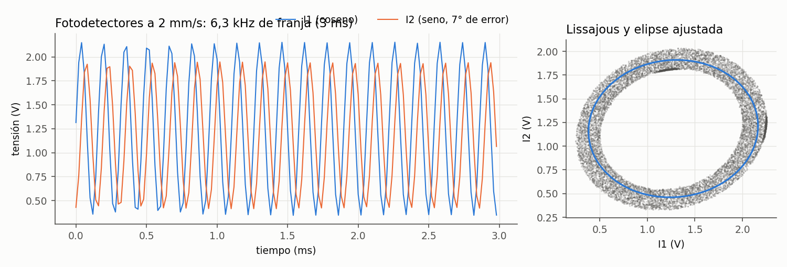
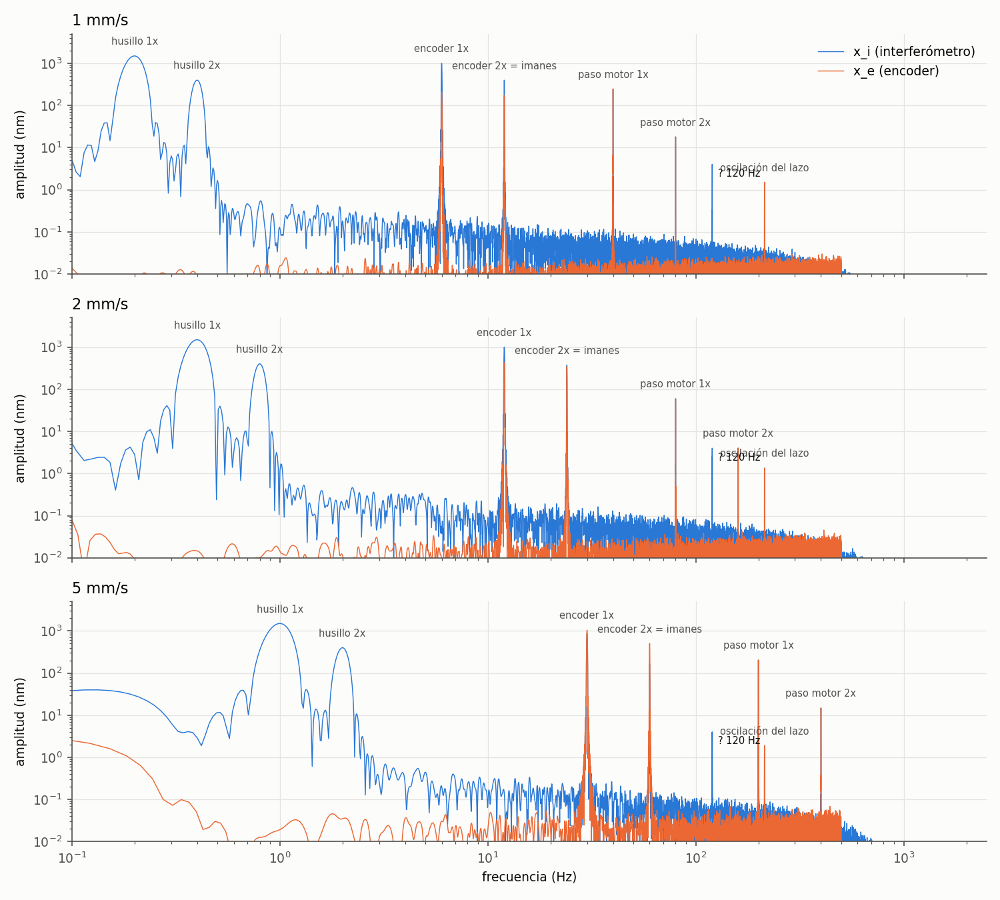
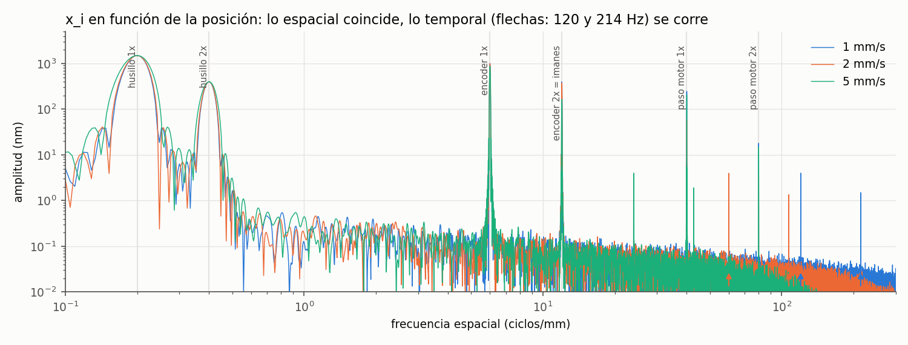
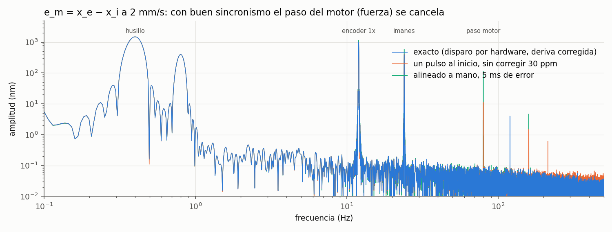

# Prueba 2 simulada: espectro de velocidad con un Michelson

**Fecha:** 17/11/2026. **Estado:** simulación; todavía no hay datos reales.
**Scripts:** `simulaciones/prueba2_simulacion.py` genera los datos; `tools/prueba2_analisis.py` los analiza. El mismo análisis sirve para los datos reales.

Este informe tiene tres partes:
- **Parte I. Fundamentos:** la física de la prueba y por qué se justifica.
- **Parte II. Resultados de la simulación:** qué se simuló, qué se recuperó y qué aprendimos.
- **Parte III. Cómo funciona el análisis:** cómo se obtiene cada número y cada figura.

# Parte I · Fundamentos

## I.1 Qué pregunta responde

Se le pide al carro algo simple: avanzar a velocidad constante. Idealmente su posición sería x(t) = x₀ + v·t. En la realidad avanza a tirones muy chicos, adelantándose y atrasándose respecto de esa recta. A esa desviación la llamamos δ(t):

```
x_i(t) = x₀ + v·t + δ(t)
```

La prueba 2 mide δ(t) con una referencia independiente (el interferómetro), la descompone en frecuencias y averigua de dónde sale cada componente.

**Por qué importa para micromecanizar.** Si la herramienta corta mientras el carro avanza, δ queda grabado en la pieza: una componente de frecuencia f deja marcas de período v/f en la superficie. Además, el ripple de velocidad cambia el avance por diente, y con él la carga de viruta y la terminación.

Posición y velocidad se relacionan por δv = 2π·f·δx. Un error de posición que parece chico puede ser un ripple de velocidad enorme:

| Huella del paso del motor a 1 mm/s (40 Hz) | Ripple de velocidad |
|---|---|
| 1,46 µm (sin anti-cogging) | 2π·40·1,46 µm ≈ 0,37 mm/s = **37 %** de la velocidad |
| 0,06 µm (con anti-cogging) | ≈ 0,015 mm/s = **1,5 %** |

## I.2 Perturbaciones espaciales y temporales

**Espaciales.** Dependen de *dónde está* el mecanismo, no del tiempo:
- cogging y ripple de torque del motor: se repiten cada paso, 200 por vuelta, 25 µm de carro;
- error de paso del husillo: una vez por vuelta, 5 mm;
- no linealidad del encoder: cada período (166,7 µm) o cada imán de la rueda (83,3 µm).

Recorrida a velocidad v, una perturbación de período λ aparece en el tiempo con frecuencia **f = v/λ**. Si la velocidad se duplica, la frecuencia se duplica.

**Temporales.** Tienen una frecuencia propia, que no depende de la posición:
- resonancias mecánicas, del orden de √(k/m)/2π;
- oscilaciones del lazo de control, como la de 205–214 Hz con `VEL_KP` 0,2;
- vibración del entorno, red eléctrica (50 Hz), PWM.

**Por eso se mide a varias velocidades.** Con una sola velocidad, un pico en 200 Hz es ambiguo:

| Pico | 1 mm/s | 2 mm/s | 5 mm/s | Conclusión |
|---|---|---|---|---|
| Paso del motor | 40 Hz | 80 Hz | 200 Hz | se corre con v: espacial |
| Oscilación del lazo | ~210 Hz | ~210 Hz | ~210 Hz | queda fijo: temporal |

**Verificación cruzada:** si el espectro se dibuja en ciclos/mm, lo espacial queda en el mismo lugar a cualquier velocidad y lo temporal se corre.

## I.3 Por qué la descomposición en frecuencias identifica el origen

**El problema.** El residuo es la suma de todo a la vez:

```
δ(t) = cogging + husillo + encoder + oscilación del lazo + vibración + ruido
```

Mirado en el tiempo es una curva irregular, y no se puede saber qué parte viene de cada causa.

**Por qué separar en frecuencias las desenreda:**
1. **Las contribuciones se suman, no se mezclan.** Con desplazamientos de nm a µm el sistema es lineal, y la transformada de Fourier también lo es: el espectro de la suma es la suma de los espectros.
2. **Cada causa periódica concentra su energía en frecuencias precisas.** Una señal que se repite cada T segundos solo tiene componentes en 1/T y sus múltiplos. El ruido aleatorio, en cambio, se reparte como un fondo plano.

**Por qué la frecuencia apunta a una causa.** Cada fuente tiene un período impuesto por la geometría o por la física, y se conoce antes de medir:

| Causa | Qué fija el período | Frecuencia a 2 mm/s |
|---|---|---|
| Vuelta del husillo | paso de 5 mm | 0,4 Hz |
| Encoder | 30 períodos por vuelta | 12 Hz |
| Imanes de la rueda | 60 por vuelta | 24 Hz |
| Paso del motor | 200 por vuelta | 80 Hz |
| Oscilación del lazo | ganancias del controlador | ~210 Hz |
| Red eléctrica | la red | 50 Hz |

La frecuencia funciona como una huella digital que se compara contra una lista de sospechosos. Pero solo da un candidato. Hay que confirmarlo con tres criterios más:

- **Cambiar la velocidad.** Lo espacial se corre con f = v/λ y lo temporal no. Además, λ = v/f tiene que coincidir con una medida física de la máquina.
- **Comparar los dos sensores** (ver I.4).
- **Mirar los armónicos.** Una perturbación no senoidal tiene picos en f, 2f, 3f… que se corren juntos.

## I.4 Cómo llega cada perturbación al carro

Entre cada perturbación y el carro está el lazo de control, que la filtra de forma distinta según la frecuencia. Esto explica qué ve el interferómetro (x_i) y qué ve el encoder (x_e). Hay tres casos.

**a) Fuerzas: cogging, fricción, ripple de torque.** Una fuerza F a frecuencia f produce un error δx(f) = F(f)·G_d(f), con G_d = P/(1 + P·C), donde P es la planta y C el controlador. G_d tiene tres zonas:
- por debajo del ancho de banda, el lazo rechaza la perturbación;
- muy por encima, la masa la filtra sola (δx ≈ F/(m·ω²));
- cerca del ancho de banda no pasa ninguna de las dos cosas, y ahí δx es máximo.

El mismo cogging cambia de amplitud con la velocidad, según dónde caiga en G_d. Como la fuerza mueve de verdad motor y carro, aparece **en x_e y en x_i por igual**.

**b) Errores del sensor: no linealidad del encoder.** El encoder lee x_e = x + n(x). El lazo fuerza x_e ≈ x_c, así que el carro termina en x ≈ x_c − n. Con T la función complementaria del lazo y S = 1 − T:
- en el carro aparece −n·T; por debajo del ancho de banda T ≈ 1, así que **el error del encoder se imprime entero en el carro**;
- en el encoder aparece n·S; por debajo del ancho de banda S ≈ 0, así que **el encoder se ve limpio**.

**c) Errores entre el motor y el carro: husillo, acople, guía.** El encoder está del lado del motor y no los ve, así que el lazo no los puede corregir. Aparecen **solo en x_i**.

**Tabla de interpretación:**

| Aparece en | Se mueve con v | Origen probable |
|---|---|---|
| x_e y x_i | sí | fuerza espacial: cogging, ripple de torque |
| x_e y x_i | no | dinámica del lazo o resonancia del motor |
| solo x_i | sí, en 6 o 12 ciclos/mm | no linealidad del encoder impresa por el lazo |
| solo x_i | sí, en 0,2 ciclos/mm | error de paso del husillo |
| solo x_i | no | resonancia entre motor y carro, o vibración de la guía |
| solo x_e | — | artefacto del sensor por encima del ancho de banda |

La columna "solo x_i" es lo que nunca se pudo medir con el encoder. Es la razón principal para hacer la prueba en el INTI.

## I.5 Por qué el residuo de posición y no la velocidad

Derivar multiplica cada componente por 2πf, así que S_v(f) = (2πf)²·S_x(f). El ruido de alta frecuencia del instrumento crece con f² y tapa justo la zona de interés (100–300 Hz).

Por eso se trabaja con δ(t) = x_i(t) − (a + b·t), con la recta ajustada. Se ajusta en lugar de usar la velocidad comandada porque la velocidad real difiere un poco (escala del husillo, del encoder, de los relojes) y el offset inicial es arbitrario. Si hace falta el espectro de velocidad, se multiplica después por (2πf)², sin derivar datos ruidosos.

## I.6 Ventana, resolución y muestreo

- **Solo el tramo central.** Se descartan la aceleración, el frenado y el asentamiento del lazo, para no mezclar un transitorio con el régimen permanente.
- **Resolución.** Vale Δf = 1/T_ventana. Para separar los armónicos del husillo hacen falta varias vueltas: al menos 8, unos 40 mm.
- **Muestreo.** La componente más alta esperada es el paso a 5 mm/s (200 Hz), con su segundo armónico en 400 Hz. Hace falta más de 800 S/s de posición. Además, el Michelson necesita muestrear las franjas (ver §4 de la Parte II).
- **Aliasing.** Si el instrumento o la telemetría diezman sin filtrar, una componente de 1,2 kHz aparecería falsamente en 200 Hz.

## I.7 Por qué no necesita sincronismo, y el error de escala

**Sincronismo.** La prueba compara espectros de amplitud: cada uno se calcula con su propio reloj y nunca se restan muestras de una señal a la otra. Que los relojes difieran en decenas de ppm corre las frecuencias en decenas de ppm, algo despreciable. El sincronismo solo hace falta para la fase entre x_e y x_i, o para calcular e_m = x_e − x_i (ver §3.1 de la Parte II).

**Error de escala.** Comparar la velocidad media medida contra la comandada mezcla el error de escala mecánico con la deriva entre relojes; los dos son de decenas de ppm. Lo que no necesita sincronismo es comparar **cuánto recorre cada sensor entre dos reposos**. La simulación mostró que, para eso, el desplazamiento tiene que ser múltiplo de 5 mm (ver §3.3 de la Parte II).

## I.8 Qué decide la prueba

1. Si el anti-cogging funciona en el carro y no solo en el encoder. Por encima de 2 mm/s la compensación se desvanece, así que a 5 mm/s se mide sin ella.
2. Si la oscilación de 205–214 Hz mueve el carro, y por lo tanto la herramienta.
3. Cuánto vale el ripple de velocidad real, en µm y en %.
4. Si la no linealidad del encoder (4,4–5,2 µm RMS medidos contra el campo) llega al carro.

## I.9 Justificación para el informe

> Hasta ahora todas las medidas de suavidad del movimiento se hicieron con el encoder, que está del lado del motor y dentro del lazo de control. Ese sensor no puede ver los errores que el lazo le imprime al carro (su propia no linealidad) ni los que ocurren entre el motor y el carro (husillo, acople, guía). La prueba 2 mide el residuo de posición del carro a velocidad constante con una referencia independiente y lo compara en frecuencia con el del encoder. Repetirla a varias velocidades separa las perturbaciones que dependen de la posición (f = v/λ) de las resonancias y oscilaciones de frecuencia fija. Comparar los dos sensores dice si cada componente es una fuerza que mueve todo el sistema, un error del sensor que el lazo traslada al carro o un error mecánico aguas abajo del motor. El resultado es el ripple real del carro, la base para validar la compensación de cogging y para identificar el origen de la oscilación de unos 210 Hz.

# Parte II · Resultados de la simulación

## 1. Qué se simuló

Un carro que va de reposo a reposo, 45 mm por corrida, a 1, 2 y 5 mm/s, con aceleración de 5 mm/s². Se generan dos registros con relojes independientes:

- **Michelson:** las dos señales crudas de los fotodetectores (cuadratura), con offsets, ganancias distintas, 7° de error de fase, visibilidad que cae 25 % a lo largo del recorrido, ruido de detector, ADC de 12 bits y turbulencia del aire de 3 nm RMS. Láser HeNe (632,8 nm).
- **Encoder:** la telemetría del RP2040 a 1 kS/s, con 0,8 nm de ruido. Su reloj arranca 0,137 s después y corre 30 ppm más rápido.

### Componentes puestas en el carro

| Componente | Tipo | Valor | Origen del valor |
|---|---|---|---|
| Cogging, paso de 25 µm | fuerza: mueve motor y carro | 1,46 µm sin compensar a 2 mm/s; 0,06 µm con anti-cogging, que se desvanece de 2 a 3 mm/s | medido (20/10) |
| No linealidad del encoder, 166,7 y 83,3 µm | error del sensor: x_i = −n·T, x_e = n·S | 1,0 y 0,4 µm | supuesto |
| Husillo, 5 y 2,5 mm | solo el carro | 1,5 y 0,4 µm, más 40 ppm de escala | supuesto |
| Oscilación del lazo | temporal, los dos sensores | 1,5 nm a 214 Hz | medido (06/11, `VEL_KP` 0,12) |
| Modo mecánico | temporal, solo el carro | 4 nm a 120 Hz | inventado, para probar que el análisis lo encuentra |

El lazo se modeló como un segundo orden de 40 Hz con ζ = 0,7, porque todavía no tenemos su Bode. Ese valor fija cuánto del error del encoder pasa al carro y cuánto cogging queda en cada velocidad. **Las amplitudes esperadas dependen de ese supuesto. Lo que no depende de él es el método.**

La figura 1 muestra lo que entrega el Michelson simulado: las dos señales de los fotodetectores, desfasadas unos 90°, y su Lissajous, que es la elipse que el análisis ajusta para pasar a posición.



## 2. El análisis recupera lo que se puso

Amplitud de pico en nm:

| v (mm/s) | Componente | f (Hz) | x_i puesto | x_i medido | x_e puesto | x_e medido | Sensores |
|---|---|---|---|---|---|---|---|
| 1 | husillo 1x | 0,2 | 1500 | 1500,2 | 0 | 0,0 | solo x_i |
| 1 | encoder 1x | 6 | 1000 | 997,9 | 211 | 211,1 | domina x_i |
| 1 | encoder 2x = imanes | 12 | 399 | 397,1 | 171 | 171,0 | ambos, distinta amplitud |
| 1 | paso motor 1x | 40 | 248 | 246,8 | 248 | 247,0 | ambos, igual amplitud |
| 1 | oscilación del lazo | 214 | 1,5 | 1,5 | 1,5 | 1,5 | ambos, igual amplitud |
| 2 | husillo 1x | 0,4 | 1500 | 1500,1 | 0 | 0,0 | solo x_i |
| 2 | encoder 1x | 12 | 998 | 995,5 | 429 | 428,3 | ambos, distinta amplitud |
| 2 | encoder 2x = imanes | 24 | 379 | 377,1 | 346 | 345,4 | **ambos, igual amplitud** |
| 2 | paso motor 1x | 80 | 60,0 | 59,8 | 60,0 | 59,8 | ambos, igual amplitud |
| 2 | oscilación del lazo | 214 | 1,5 | 1,3 | 1,5 | 1,3 | ambos, igual amplitud |
| 5 | husillo 1x | 1 | 1500 | 1496,8 | 0 | 0,0 | solo x_i |
| 5 | encoder 1x | 30 | 879 | 878,9 | 1047 | 1047,2 | **ambos, igual amplitud** |
| 5 | encoder 2x = imanes | 60 | 164 | 163,5 | 504 | 503,7 | domina x_e |
| 5 | paso motor 1x | 200 | 204 | 204,0 | 204 | 202,9 | ambos, igual amplitud |
| 5 | oscilación del lazo | 214 | 1,5 | 1,9 | 1,5 | 1,9 | ambos, igual amplitud |

- Las amplitudes se recuperan con menos de 1 % de error, salvo la oscilación de 214 Hz. Esa tiene amplitud variable en el tiempo, como en las mediciones reales, y la ventana de 7 s a 5 mm/s promedia otra parte de esa variación.
- El modo de 120 Hz no estaba en la lista de candidatos. El análisis lo encontró como pico desconocido a las tres velocidades, siempre en 120,0 Hz, y lo clasificó como **temporal**.
- El error de escala salió +40,1, +40,0 y +39,9 ppm, contra los 40 puestos.
- Los 30 ppm de diferencia entre relojes no afectaron nada.

La figura 2 muestra el residuo de cada sensor a 2 mm/s: en x_i se ve la ondulación de 5 mm del husillo, que en x_e no aparece.


La figura 3 es el espectro de esos residuos a las tres velocidades. Las etiquetas marcan los candidatos detectados, y "?" los picos no esperados.



En la figura 4 las tres velocidades se dibujan en ciclos/mm. Los picos espaciales caen en el mismo lugar, mientras que los de 120 y 214 Hz aparecen en un lugar distinto para cada velocidad.



## 3. Lo que enseñó la simulación

### 3.1 Comparar amplitudes no alcanza para separar fuerza de error del encoder

Las filas en negrita de la tabla de §2 son errores del encoder que el análisis clasifica como "ambos, igual amplitud", el mismo patrón que una fuerza:

- a 2 mm/s, los 24 Hz;
- a 5 mm/s, los 30 Hz.

Pasa cuando |T| ≈ |S|, cerca del ancho de banda del lazo. Hay dos formas de salir de la ambigüedad.

**a) Mirar el cociente x_i/x_e en las tres velocidades.**

| Componente | 1 mm/s | 2 mm/s | 5 mm/s |
|---|---|---|---|
| encoder 1x | 4,73 | 2,32 | 0,84 |
| paso motor 1x | 1,00 | 1,00 | 1,01 |

En una fuerza, el cociente vale 1 a cualquier velocidad. En un error del sensor, sigue a |T|/|S| y cambia con la velocidad. Esta salida no necesita sincronismo.

**b) Calcular e_m = x_e − x_i con sincronismo.** Como T + S = 1, e_m = n exactamente. Es la no linealidad del encoder, sin la influencia del lazo, y una fuerza se cancela.

Amplitud en e_m a 2 mm/s (nm):

| Sincronismo | husillo 1x | encoder 1x | imanes | paso motor |
|---|---|---|---|---|
| Exacto (disparo por hardware, deriva corregida) | 1496 | 999 | 399 | 0,0 |
| Un pulso al inicio, sin corregir los 30 ppm | 1496 | 1011 | 416 | 11 |
| Alineado a mano, 5 ms de error | 1496 | 1148 | 593 | 114 |
| Puesto | 1500 | 1000 | 400 | 0 |



- **Sin sincronismo,** la prueba 2 igual sirve con el criterio a). El sincronismo no es indispensable.
- **Con un pulso de disparo,** da directamente la no linealidad del encoder. Hay que corregir la deriva con un segundo pulso al final.
- **Alinear a mano no sirve para e_m:** 5 ms de error inventan 114 nm de un cogging que en e_m no existe.

### 3.2 El encoder 2x y los imanes no se pueden separar

60 imanes por vuelta es exactamente el doble de los 30 períodos del encoder, así que caen en la misma frecuencia a cualquier velocidad. Ningún análisis espectral los separa. Habría que cambiar uno de los dos físicamente, o medir la rueda por separado.

### 3.3 El error de escala sin sincronismo pide desplazamientos múltiplos de 5 mm

Se calcula como Δx_i/Δx_e entre el reposo inicial y el final. Cada sensor mide su propio Δx con el carro quieto, así que no hace falta sincronismo.

**El problema:** los errores periódicos se suman en esos dos puntos. En la primera corrida, con desplazamientos que no eran múltiplos de 5 mm, salieron 0,7 y 5,7 ppm en lugar de 40, porque el husillo (1,5 µm) aportaba distinto en el punto inicial y en el final.

**La solución:** con 45 mm, cada punto queda en la misma fase del husillo, del encoder y del paso del motor, porque 5 mm son 1 vuelta, 30 períodos del encoder y 200 pasos. Así salen los 40 ppm. **Las corridas reales tienen que ir de reposo a reposo y recorrer un múltiplo de 5 mm.**

Esto corrige una idea anterior: la pendiente de x_i contra x_e muestra a muestra *sí* necesita sincronismo. Lo que no lo necesita es la comparación entre reposos.

### 3.4 Ripple esperado, bajo los supuestos del §1

| v (mm/s) | Ventana analizada | Ripple de velocidad RMS | Pico a pico | Error de escala | Error de demodulación |
|---|---|---|---|---|---|
| 1 | 43,5 mm / 43,5 s | 56 µm/s (5,6 %) | 25 % | +40,1 ppm | 1,8 nm RMS |
| 2 | 41,8 mm / 20,9 s | 70 µm/s (3,5 %) | 15 % | +40,0 ppm | 1,9 nm RMS |
| 5 | 34,7 mm / 6,9 s | 220 µm/s (4,4 %) | 18 % | +39,9 ppm | 2,6 nm RMS |

- **Qué domina el ripple:** el error del encoder impreso en el carro (6–30 Hz) y el cogging. El husillo tiene una amplitud de posición grande pero una frecuencia baja, así que casi no aporta ripple de velocidad (0,2 %).
- **El cogging a 1 mm/s es mayor que a 2 mm/s** (248 contra 60 nm), aunque los dos estén compensados. A 1 mm/s cae en 40 Hz, justo en el pico de la sensibilidad a fuerzas del lazo modelado (P·S con P = 1/ms²). Si se confirma en el carro, conviene revisar el anti-cogging a baja velocidad.
- **Error de demodulación:** está en la frecuencia de franja (kHz), fuera de la banda de análisis. No afecta las amplitudes.

## 4. Adquisición: lo que hay que preguntar en el INTI

Un Michelson da una franja cada λ/2 = 316 nm de recorrido. La frecuencia de franja es f = 2·n·v/λ y crece con la velocidad:

| v (mm/s) | Frecuencia de franja | Muestreo mínimo (2,5×) | Recomendado (5×) | Muestras por canal, 255 mm al recomendado |
|---|---|---|---|---|
| 1 | 3,2 kHz | 8 kS/s | 16 kS/s | 4 M |
| 2 | 6,3 kHz | 16 kS/s | 32 kS/s | 4 M |
| 5 | 15,8 kHz | 40 kS/s | 79 kS/s | 4 M |

A ritmo constante de muestras por franja, una corrida de 255 mm siempre ocupa unos 4 M de muestras por canal, a cualquier velocidad.

**Muestrear por debajo de eso no da ningún error visible: da una velocidad equivocada.** A 5 mm/s con 25 kS/s, la franja de 15,8 kHz se pliega a −9,2 kHz y el carro "retrocede" a −2,91 mm/s (figura 6). Control obligatorio en cada corrida: la velocidad media medida tiene que coincidir con la comandada.


### Uno o dos detectores

| | Cuadratura (dos detectores a 90°) | Un detector |
|---|---|---|
| Espectro a velocidad constante | igual (ver tabla abajo) | igual |
| Sentido del movimiento | lo da la señal | hay que conocerlo de antemano |
| Reposos y rampas | sí | no, porque en reposo no hay franja que seguir |
| Escala entre reposos (§3.3) | sí | no |

Amplitud en x_i a 2 mm/s (nm):

| Componente | Cuadratura | Un detector |
|---|---|---|
| husillo 1x | 1500,1 | 1500,1 |
| encoder 1x | 995,5 | 995,6 |
| encoder 2x = imanes | 377,1 | 377,2 |
| paso motor 1x | 59,8 | 59,8 |
| oscilación del lazo | 1,3 | 1,3 |

Para la prueba 2 alcanza con un detector. La cuadratura agrega el error de escala y las pruebas con inversión.

El ajuste de elipse (figura 1) recupera bien los offsets (1,27/1,19 V contra 1,25/1,18). La fase sale 2,2° en lugar de 7°, porque la visibilidad cambia a lo largo del recorrido y la elipse no es una sola. El error queda en la frecuencia de franja, fuera de banda. Si la visibilidad real cambia mucho, conviene ajustar la elipse por tramos.

### Preguntas para el INTI

1. **Detectores:** ¿cuántos? ¿Hay salida en cuadratura?
2. **Datos que entrega:** ¿intensidades crudas o posición ya calculada? ¿Con qué software?
3. **Adquisición:** frecuencia de muestreo, bits del ADC y memoria. Hace falta llegar a 40 kS/s (mejor 80) y unos 4 M de muestras por canal.
4. **Láser:** longitud de onda y estabilidad. ¿Hay medición de T, P y HR para corregir el índice del aire?
5. **Disparo externo:** ¿se puede arrancar la captura con un pulso TTL? Solo es necesario para e_m (§3.1 b).

## 5. Cómo hacer la prueba 2 en el INTI, según la simulación

1. Cada corrida va de reposo a reposo, con al menos 1 s quieto en cada punta y un desplazamiento múltiplo de 5 mm. Por ejemplo, 45 o 50 mm.
2. La ventana a velocidad constante tiene que cubrir al menos 8 vueltas del husillo, unos 40 mm.
3. Hacerla a 1, 2 y 5 mm/s.
4. Registrar la telemetría del encoder (`M120`) en la misma corrida.
5. En el momento, para cada corrida, verificar que la velocidad media del interferómetro coincida con la comandada.
6. Analizar con:

```bash
python tools/prueba2_analisis.py --interf michelson.csv --modo cuadratura --encoder telemetria.csv
```

**Pendiente:** el análisis espera la telemetría como CSV con columnas `t_s,x_mm`. Falta convertir a ese formato lo que guarda `tools/closed_loop_test.py`, y adaptar la lectura del Michelson al formato que use el INTI.

# Parte III · Cómo funciona el análisis

## III.1 De las señales del Michelson al residuo

Todo está en `tools/prueba2_analisis.py`. Para cada corrida, `analizar_senal` hace lo siguiente:

1. **Demodula.** Pasa de las dos señales del Michelson a la posición x_i(t) (`fase_cuadratura`):
   - ajusta una elipse a los pares (I1, I2) (método de Heydemann), que corrige offsets, ganancias distintas y el error de 90°;
   - calcula la fase con atan2 y la desenrolla;
   - la multiplica por λ/(4π·n): cada vuelta de fase son λ/2 = 316 nm.
2. **Diezma a 5 kS/s** (`diezmar`), con un filtro que evita que se plieguen frecuencias altas. Antes saca la rampa, para no filtrar la tendencia.
3. **Busca la ventana a velocidad constante** (`ventana_crucero`). Suaviza la velocidad 0,5 s, se queda con el tramo más largo dentro de ±5 % de la velocidad de crucero y descarta 0,5 s en cada borde.
4. **Calcula el residuo:** δ(t) = x(t) − (a + b·t), con la recta ajustada por mínimos cuadrados. La pendiente b es la velocidad medida.
5. **Calcula el espectro de amplitud** (`espectro_amplitud`): multiplica δ por una ventana de Hann, completa con ceros hasta 4 veces el largo y hace la FFT. La amplitud se calcula como 2·|X|/Σ(ventana), así cada pico da directamente la amplitud de la senoide en nm. El relleno de ceros hace que el máximo del pico no dependa de dónde cae el bin.

Lo mismo se hace con x_e, que viene de la telemetría.

## III.2 Amplitud y clasificación de cada componente

- **Candidatos** (`candidatos`): los períodos espaciales (husillo 5 y 2,5 mm, encoder 166,7 µm, imanes 83,3 µm, paso del motor 25 y 12,5 µm) dan f = v/λ, cada sensor con su propia velocidad medida. Las frecuencias fijas (214 Hz, 50 Hz) se buscan tal cual.
- **Amplitud** (`amplitud_en`): el máximo del espectro dentro de una tolerancia alrededor de la frecuencia esperada. La tolerancia es 0,5 % para lo espacial y 5 % para lo temporal, nunca menos de 3 resoluciones.
- **Piso de ruido:** la mediana del espectro entre f/3 y 3f, sin el lóbulo del propio pico.
- **Sensores** (`clasificar_sensores`): una componente se considera detectada si supera 5 veces el piso. Si aparece en los dos sensores, se mira el cociente x_i/x_e:

| Cociente x_i/x_e | Clasificación |
|---|---|
| entre 0,8 y 1,25 | "ambos, igual amplitud" |
| mayor que 3 | "domina x_i" |
| menor que 1/3 | "domina x_e" |
| el resto | "ambos, distinta amplitud" |

- **Picos no esperados** (`picos_desconocidos`): picos que superan 8 veces el piso y no coinciden con ningún candidato. Se ignora todo lo que cae a menos de 10 resoluciones de un pico mayor, porque son lóbulos laterales de la ventana, no componentes.
- **Entre velocidades** (`clasificar_entre_velocidades`): si un pico desconocido aparece en la misma frecuencia (±2 %) en otra velocidad, es temporal. Si aparece en el mismo período espacial v/f, es espacial.

## III.3 Escala entre reposos y e_m

- **Escala** (`escala_entre_reposos`): el promedio de cada sensor en los primeros y los últimos 0,5 s, con el carro quieto, da su Δx. El error de escala es Δx_i/Δx_e − 1, en ppm.
- **e_m** (`espectro_em`): pasa los tiempos del encoder al reloj del interferómetro, con el desfase y la deriva que se le den; interpola x_i en esos instantes y calcula e_m = x_e − x_i. Después sigue el mismo camino: ventana, residuo, espectro.

## III.4 Cómo se obtiene cada figura

| Figura | Qué muestra | Cómo se obtiene |
|---|---|---|
| 1 | señales crudas y Lissajous | 3 ms de I1 e I2 a 2 mm/s; a la derecha, I1 contra I2 con la elipse ajustada. La banda es ancha porque la visibilidad cae a lo largo del recorrido. |
| 2 | residuos a 2 mm/s | δ de x_i y de x_e contra la posición dentro de la ventana |
| 3 | espectros en Hz | el espectro de amplitud de III.1, para x_i y x_e, una fila por velocidad, con los candidatos detectados y los picos no esperados marcados |
| 4 | espectro espacial | **el mismo espectro de x_i de la figura 3, con el eje dividido por la velocidad medida** (ver III.5) |
| 5 | e_m según el sincronismo | `espectro_em` a 2 mm/s con tres desfases y derivas distintos |
| 6 | submuestreo | posición demodulada con 25 kS/s a 5 mm/s, contra la real |

## III.5 Espectro en el tiempo contra espectro espacial

La figura 4 no usa una transformada nueva. El eje horizontal es f/v, en ciclos/mm. Vale porque a velocidad constante x = v·t: un error que se repite cada λ mm aparece en f = v/λ, y al dividir por v queda 1/λ, que no depende de la velocidad.

La información es la misma; cambia qué queda fijo al superponer las velocidades:

| | Figura 3 (Hz) | Figura 4 (ciclos/mm) |
|---|---|---|
| Lo espacial (husillo, encoder, paso del motor) | se corre con la velocidad | queda en el mismo lugar |
| Lo temporal (120 Hz, 214 Hz) | queda en el mismo lugar | se corre (a 120/v, 214/v) |
| Para qué sirve | ver el sistema como lo ve el lazo | identificar errores de la máquina por su período |

- **Resolución.** En Hz es 1/T, con T la duración de la ventana. En ciclos/mm es 1/L, con L los mm recorridos. Como las ventanas recorren 35–43 mm, la resolución espacial es parecida en las tres velocidades.
- **Una simplificación del código.** Dividir el eje por v supone velocidad constante. Con un ripple de varios %, los picos espaciales se ensanchan un poco. El método riguroso es remuestrear δ contra la posición medida, con paso fijo en mm, antes de la FFT. En la simulación no cambia nada visible, pero con datos reales de mucho ripple conviene agregarlo.
