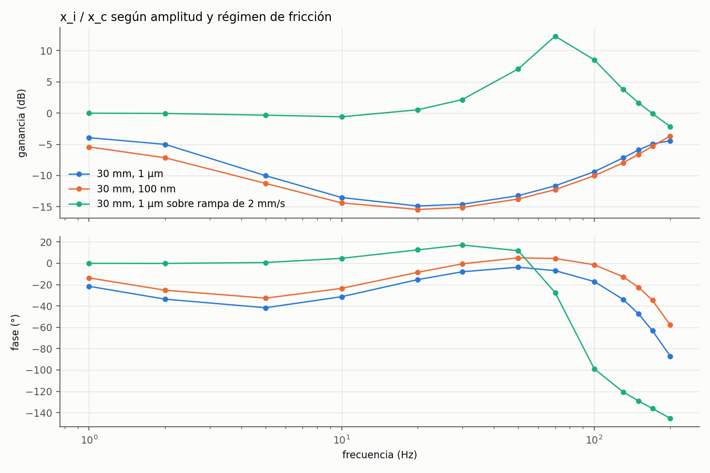
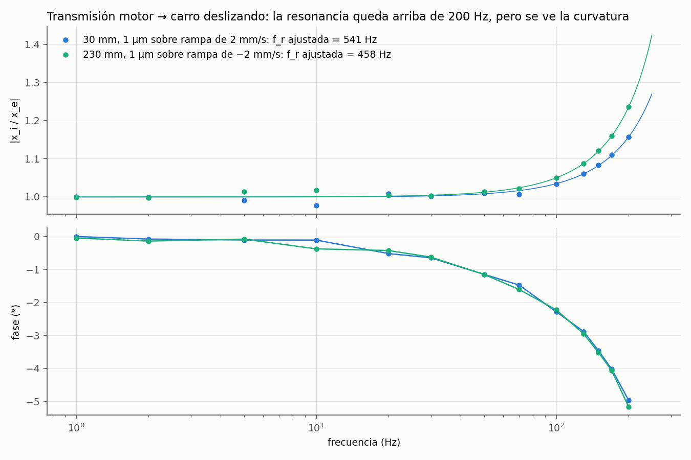
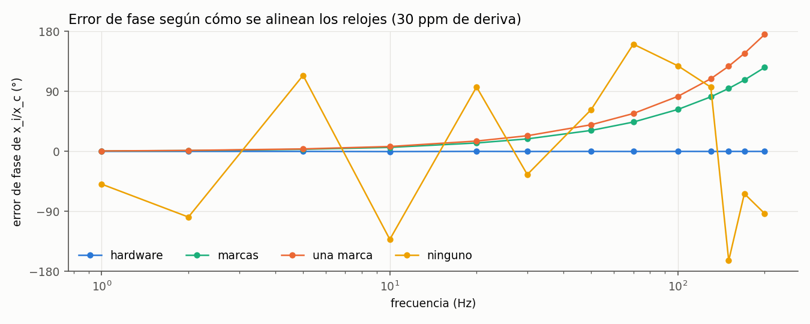

# Prueba 4 simulada: respuesta en frecuencia con un Michelson

**Fecha:** 18/11/2026. **Estado:** simulación; todavía no hay datos reales ni comando de senoide en el firmware.
**Scripts:** `simulaciones/prueba4_simulacion.py` genera los datos; `tools/prueba4_analisis.py` los analiza (sirve para los datos reales) y usa la demodulación de `tools/prueba2_analisis.py`.

Este informe tiene tres partes:
- **Parte I. Fundamentos:** qué mide la prueba, cómo se excita el carro y dónde.
- **Parte II. Resultados de la simulación:** qué se simuló, qué se recuperó y qué aprendimos.
- **Parte III. Cómo se obtiene cada gráfico.**

# Parte I · Fundamentos

## I.1 La prueba 2 escucha, la prueba 4 pregunta

**Prueba 2.** Se mueve el carro a velocidad constante y se mide lo que sale. Las frecuencias las pone la propia máquina (cogging, encoder, husillo, lazo). Responde **cuánto ripple hay y de dónde viene**, pero lo que mide es una mezcla:

```
lo que se ve = tamaño de la perturbación × cómo la transmite el sistema
```

**Prueba 4.** Se comanda una senoide conocida, a una frecuencia elegida, y se mide cuánto sale (ganancia) y con qué retraso (fase). No mide perturbaciones sino **propiedades del sistema**: respuesta del lazo, ancho de banda, resonancias del husillo y del acople.

| | Prueba 2 | Prueba 4 |
|---|---|---|
| Qué excita al sistema | sus propias perturbaciones | una senoide que ponemos nosotros |
| Quién elige las frecuencias | la geometría y la velocidad (f = v/λ) | nosotros, de 1 a 200 Hz |
| Qué se obtiene | amplitud de cada perturbación en el carro | ganancia y fase (Bode) |
| Sincronismo | no hace falta | hace falta para la fase |
| Firmware | alcanza con `G1` | falta un comando de senoide |
| Régimen de fricción | deslizando | quieto, salvo que se agregue una rampa |

**Cómo se complementan:**
- **La prueba 4 da el factor de transmisión que la prueba 2 no puede separar.** En la simulación de la prueba 2 hubo que suponer el lazo (40 Hz, ζ = 0,7). Con el Bode medido, cada pico de la prueba 2 se puede dividir y se obtiene el tamaño real de la perturbación.
- **La prueba 2 da algunos puntos del Bode gratis.** En los componentes del encoder, x_i/x_e = |T|/|S|, sin comando nuevo ni sincronismo.

## I.2 Cómo se mete la senoide

Nadie empuja el carro desde afuera. La senoide se mete **en la consigna**: en lugar de pedirle al lazo "andá a 10 mm", se le pide a cada instante una posición que oscila, y el lazo hace que el motor la siga.

Hoy, con `G1 X10`, el generador de perfil (`TrapezoidalProfile`) calcula cada 0,5 ms dónde debería estar el carro, y esa posición entra al lazo con `update_servo(posición, …, velocidad)`. El lazo no sabe de dónde viene la consigna. Para la prueba 4, el generador calcularía en cada tick:

```
x_c(t) = x₀ + A · sen(2π·f·t)
v_c(t) = A · 2π·f · cos(2π·f·t)      (la velocidad, para la anticipación)
```

**Por qué hay que tocar el firmware.** Ningún comando actual genera esto: `G0`/`G1` hacen trapecios.
- **Opción recomendada:** agregar un comando, por ejemplo `M60 A<µm> F<Hz> N<ciclos>`, que calcule la senoide en el RP2040 con su propio reloj, con arranque y frenado suaves.
- **Mandarla desde la PC con muchos `G1` chicos no sirve:** el USB tiene milisegundos de latencia y jitter (1 ms son 36° a 100 Hz), cada `G1` es un trapecio que arranca y frena, y no se sabe cuándo empezó cada punto.

**Dónde se suma la senoide define qué se mide:**

| Dónde se inyecta | Qué se mide |
|---|---|
| Consigna de posición | cómo sigue el carro una orden: ancho de banda, T(f) |
| Salida del controlador (torque) | cómo responde a una fuerza: G_d(f), lo que define cuánto cogging llega al carro |
| Consigna de velocidad | el lazo interno, donde nació la oscilación de 214 Hz |

## I.3 Elección del punto del recorrido

El Bode describe la respuesta **alrededor de un punto**. No hay un punto "correcto", porque varias cosas cambian con la posición:

1. **Rigidez del husillo.** k ≈ E·A/L, con L el tramo entre el rodamiento fijo y la tuerca. La resonancia carro-husillo va como √(k/m), así que se corre a lo largo del recorrido.
2. **Efectos dentro de un paso.** Con A = 1 µm el carro queda dentro de una fracción del paso (25 µm) y del período del encoder (166,7 µm):
   - la pendiente del cogging en x₀ actúa como un resorte extra;
   - la pendiente de la no linealidad del encoder (hasta ±3,8 %) cambia la ganancia del lazo.
3. **Fricción e historia.** Con 1 µm o 100 nm la fricción casi no desliza y se comporta como un resorte que depende del lugar y del último sentido de movimiento.
4. **Resolución del firmware.** La tabla del encoder resuelve 2,5 nm a 30 mm pero 20 nm por encima de unos 170 mm (`docs/CAMBIOS_2026-10-23_PRECISION.md`). Para 100 nm de amplitud eso pesa.
5. **Medición.** Más lejos del interferómetro hay más camino de aire y más turbulencia; si el carro cabecea, entra el error de Abbe.

| Recomendación | Por qué |
|---|---|
| ~30 mm, centro y ~230 mm | ver cuánto se corre la resonancia |
| incluir la zona de mecanizado | es la respuesta que importa |
| 30 mm como referencia | ahí se hicieron las escaleras de 10 nm y el firmware resuelve 2,5 nm |
| en un punto, repetir con x₀ corrido ¼ y ½ paso | medir los efectos locales |
| llegar siempre desde el mismo sentido | mismo estado de la fricción |
| 100 nm solo cerca del home | lejos, la cuantización del firmware contamina |

## I.4 Relación con la prueba 2

Cada pico de la prueba 2 es (tamaño de la perturbación) × (transmisión). La prueba 4 da la transmisión. Por ejemplo, en la simulación de la prueba 2, a 2 mm/s el encoder 1x apareció con 995 nm en el carro. Si el Bode dice |T(12 Hz)| = 0,998, la no linealidad del encoder vale 995/0,998 ≈ 997 nm (se habían puesto 1000).

Como la transmisión puede cambiar con la posición, **la prueba 4 se tiene que medir en la misma zona donde corrió la prueba 2**. Dentro de una ventana de 45 mm la rigidez del husillo cambia poco, así que alcanza con un punto dentro de esa ventana.

# Parte II · Resultados de la simulación

## 1. Qué se simuló

### El lazo, tal como está en el firmware

| Parte | Valor | Fuente |
|---|---|---|
| PI de posición | KP 60, KI 100, salida ±2π rad/s, integral ±π/2 | `hw_config.h`, `servo_controller.cpp` |
| PI de velocidad | KP 0,12, KI 54, salida ±0,45π (81°) | `hw_config.h` |
| Filtro de la velocidad | 4 ms | `VEL_LOWPASS_TC` |
| Anticipación de velocidad | activada | `VELOCITY_FEEDFORWARD` |
| Tasas | perfil a 2 kHz, servo a 16 kHz, telemetría a 1 kHz | firmware y documentos |
| Torque | T0·sen(adelanto), con retardo de un ciclo y L/R = 1,12 ms | 37 mH / 33 Ω |

### La mecánica

Motor y rueda de imanes, acople, husillo, tuerca y carro.

| Parámetro | Valor | Fuente |
|---|---|---|
| Inercia del motor + rueda | 6·10⁻⁶ kg·m² | supuesto |
| Husillo + acople | 1·10⁻⁶ kg·m² | supuesto |
| Carro | 1 kg | supuesto |
| Rigidez torsional del acople | 30 N·m/rad (acople helicoidal chico) | supuesto |
| Rigidez axial | husillo de 6 mm de raíz en serie con la tuerca: 21,9 N/µm a 30 mm y 12,3 N/µm a 230 mm | supuesto |
| Amortiguamiento por fuerza contraelectromotriz | Kt²/R = 6,4·10⁻³ N·m·s/rad | medido (Kt 0,46, R 33 Ω) |
| Rozamiento | 20 mN·m | medido (14–30) |
| Fricción antes de deslizar | modelo de Dahl, rigidez 30 N·m/rad: el carro desliza recién después de ~0,5 µm | supuesto |

### El comando

Una marca de 50 µm, después 13 senoides (1, 2, 5, 10, 20, 30, 50, 70, 100, 130, 150, 170 y 200 Hz), después otra marca. Cada senoide tiene:
- 0,2 s de entrada suave;
- 0,3 s de asentamiento;
- una ventana de medición con un número entero de ciclos (al menos 5 ciclos y 0,5 s);
- 0,2 s de salida suave.

Todo el barrido dura **25,6 s**.

### Las mediciones

- **Michelson en cuadratura** a 25 kS/s, con el reloj del INTI.
- **Telemetría del encoder** (x_c, x_e) a 1 kS/s, con el reloj del RP2040. El reloj del RP2040 corre 30 ppm distinto y arranca 137 ms después.

### Corridas

| | Posición | Amplitud | Rampa | Para ver |
|---|---|---|---|---|
| A | 30 mm | 1 µm | — | caso principal |
| B | 30 mm | 100 nm | — | linealidad |
| C | 230 mm | 1 µm | — | husillo más largo |
| D | 30 mm | 1 µm | +2 mm/s | carro deslizando |
| E | 230 mm | 1 µm | −2 mm/s | husillo largo, deslizando |

### Lo que no reproduce

**El modelo no reproduce la oscilación de 214 Hz** que aparece en la máquina con `VEL_KP` ≥ 0,16. Probé combinaciones razonables de inercias, acople, fricción y torque, y ninguna da a la vez estabilidad con 0,12 e inestabilidad a 214 Hz con 0,16–0,2. Hay algo de la máquina real que no está modelado. Esa es una razón más para medir el Bode.

**Las curvas de la §3 dependen de dos valores que no conocemos:** la rigidez del acople y la de la fricción antes de deslizar. Lo que no depende de ellos es el método (§2), los requisitos (§4) y el diseño de la prueba (§5).

## 2. El análisis recupera la respuesta verdadera

Corrida A, sincronismo por hardware, x_i/x_c:

| f (Hz) | Ganancia verdadera (dB) | Estimada | Fase verdadera (°) | Estimada |
|---|---|---|---|---|
| 1 | −3,94 | −3,94 | −21,6 | −21,6 |
| 5 | −10,03 | −10,03 | −41,7 | −41,7 |
| 20 | −14,87 | −14,89 | −15,4 | −15,3 |
| 50 | −13,24 | −13,24 | −3,7 | −3,7 |
| 100 | −9,40 | −9,39 | −17,1 | −17,1 |
| 150 | −5,90 | −5,90 | −47,6 | −47,6 |
| 200 | −4,43 | −4,42 | −87,0 | −87,0 |

- **Error:** menos de 0,03 dB en ganancia y 0,2° en fase en todo el barrido.
- **Referencia "verdadera":** usa el x_c tal como lo registra la telemetría. El perfil a 2 kHz retiene cada valor 0,5 ms, lo que equivale a unos 0,22 ms de retardo, o −16° a 200 Hz. **Ese retardo es parte de lo que se mide en la máquina real.** Si se quiere separar, hay que restarlo.

La figura 1 muestra el Bode completo de la corrida A: los puntos estimados caen sobre la referencia verdadera.


## 3. Lo que muestra la simulación

### 3.1 Con 1 µm, la fricción decide todo

Con el carro quieto, una senoide de 1 µm apenas supera el rango en que la fricción todavía no desliza (~0,5 µm). En ese régimen:

- **El carro se mueve 0,5–0,65 veces lo que dice el encoder** (|G_m| ≈ 0,51–0,65). El acople se tuerce contra la fricción y el encoder, que está del lado del motor, no lo ve.
- **El lazo casi no sigue la orden:** ancho de banda de unos 3 Hz, mínimo de −15 dB a 20 Hz y subida hacia 200 Hz. Hasta el encoder cae a −9 dB a 20 Hz.
- **Distorsión armónica de x_i entre 2 y 11 %:** el movimiento no es lineal.

Sobre una rampa de 2 mm/s (corrida D) el carro desliza siempre y la respuesta es otra:

- 0 dB hasta 20 Hz;
- **un pico de +12 dB a 70 Hz** (el modo del lazo de velocidad);
- |G_m| ≈ 1 a baja frecuencia;
- distorsión menor que 2 %.

La figura 2 compara la respuesta del carro en las tres situaciones.



**Consecuencia:** el Bode con el carro quieto y el Bode en movimiento son dos sistemas distintos. Para elegir `VEL_KP` y `POS_KP` hay que medir los dos. El pico de 70 Hz en movimiento sería relevante para la prueba 2: a 2 mm/s el paso del motor cae en 80 Hz, cerca de ese pico.

### 3.2 La amplitud de 100 nm mide otro régimen

Con 100 nm la fricción no llega a deslizar (corrida B, curva naranja de la figura 2):

| | 1 µm (A) | 100 nm (B) |
|---|---|---|
| \|G_m\| | 0,51–0,65 | 0,48–0,55 |
| Fase de G_m | hasta −10° (rozamiento con histéresis) | menos de 1° (resorte puro) |
| Distorsión armónica | 2–11 % | < 1 % por encima de 30 Hz; hasta 7 % a 1 Hz |

Comparar las dos amplitudes es la prueba de linealidad que pedía el documento. Si coinciden, el modelo lineal sirve. Si no, la fricción manda.

### 3.3 La transmisión al carro deja ver la resonancia aunque no se llegue a ella

El modo del husillo + carro con el motor quieto está en 558 Hz a 30 mm y en 477 Hz a 230 mm, por encima de los 200 Hz del barrido. Aun así, |x_i/x_e| ya sube 16–24 % a 200 Hz. Ajustando |G_m| ≈ g₀/|1 − (f/f_r)²| en las corridas que deslizan:

| Corrida | f_r ajustada | Modo real | Error |
|---|---|---|---|
| D, 30 mm | 541 Hz | 558 Hz | −3 % |
| E, 230 mm | 458 Hz | 477 Hz | −4 % |

En las corridas sin rampa el ajuste no sirve (428 y 389 Hz), porque la fricción también curva |G_m|.

La figura 3 muestra los puntos medidos y la curva ajustada en las dos posiciones.



**Consecuencia:** la rigidez del husillo y su variación con la posición se miden con el carro deslizando, en dos puntos del recorrido.

### 3.4 Sin sincronismo por hardware, la fase no sirve

| Sincronismo | Desfase estimado | Deriva estimada | Error de fase a 20 Hz | a 100 Hz | a 200 Hz |
|---|---|---|---|---|---|
| Por hardware | 137,000 ms | 30,0 ppm | +0,05° | +0,02° | 0,00° |
| Dos marcas de 50 µm | 138,745 ms | 29,8 ppm | +12,6° | +62,9° | +125,9° |
| Una marca | 138,727 ms | 0 | +15,5° | +82,6° | +175,4° |
| Ninguno | 0 | 0 | +97° | +128° | −93° |

Las marcas estiman bien la deriva entre relojes, pero el desfase sale corrido en 1,7 ms. No es un error de cálculo, es física: mientras se mueve, el carro va atrasado respecto del motor una cantidad fija (el acople torcido por el rozamiento, ~0,5 µm). Visto en el tiempo, ese atraso es indistinguible de un desfase de relojes. **Ningún método que alinee x_i con x_e usando los datos de posición puede separar el atraso mecánico del desfase de relojes.**



**Qué hacer:**
- **La ganancia no necesita sincronismo,** y G_e (encoder contra comando) tampoco, porque usa un solo reloj.
- **Para la fase de x_i** hace falta una señal de tiempo que no pase por la mecánica:
  - un pulso de disparo, o
  - **mejor todavía, si la adquisición del INTI tiene un canal libre** (osciloscopio o placa de adquisición), grabar en ese canal una salida digital del RP2040 que cambie con cada segmento. Así cada senoide queda marcada en los dos relojes.

### 3.5 Un solo detector no sirve para esta prueba

A diferencia de la prueba 2, acá el carro invierte el sentido dos veces por ciclo. Un detector solo da la intensidad, que es igual yendo y viniendo, así que no puede saber para qué lado va el carro. En 50 Hz el error fue de 870 nm RMS, contra 0,2 nm con cuadratura (figura 5).


## 4. Requisitos para la adquisición

| Qué | Valor | Por qué |
|---|---|---|
| Detectores | **cuadratura, obligatoria** | el carro invierte el sentido |
| Muestreo | ≥ 10 kS/s quieto; 25 kS/s como mínimo con rampa de 2 mm/s, mejor 50 kS/s | velocidad pico 2π·200 Hz·1 µm = 1,3 mm/s, más la rampa: franjas de hasta 10 kHz |
| Duración | ~26 s por barrido de 13 frecuencias | 4 corridas útiles en ~2 minutos de captura |
| Memoria | ~650 k muestras por canal y por barrido a 25 kS/s | |
| Sincronismo | pulso o canal extra con una salida digital del RP2040 | §3.4 |
| Turbulencia del aire | con 100 nm de amplitud, 3 nm de ruido son el 3 % | conviene la amplitud de 100 nm cerca del interferómetro |

## 5. Diseño de la prueba 4

1. **Comando nuevo en el firmware:** `M60 A<µm> F<Hz> N<ciclos>`, o mejor uno que haga el barrido completo, con entrada y salida suaves y una salida digital que marque cada segmento.
2. **Antes de ir al INTI, medir G_e en el laboratorio.** Solo usa el encoder y un reloj. Ya muestra en qué régimen está la máquina: si el encoder a 1 µm cae a −9 dB en 20 Hz como en la simulación, la fricción manda.
3. **En el INTI, cuatro barridos de ~26 s cada uno:**

| Barrido | Para qué |
|---|---|
| 30 mm, 1 µm, quieto | respuesta en reposo |
| 30 mm, 100 nm, quieto | linealidad |
| 30 mm, 1 µm sobre rampa de +2 mm/s | respuesta deslizando; rigidez del husillo |
| 230 mm, 1 µm sobre rampa de −2 mm/s | rigidez del husillo en la otra punta |

4. **Condición para la rampa:** que la senoide nunca invierta el sentido, 2π·f·A < v. Con 1 µm y 200 Hz hacen falta más de 1,3 mm/s. Con 0,5 mm/s, por encima de 80 Hz el carro vuelve a frenar contra la fricción.
5. **Frecuencias de la senoide con rampa:** que no caigan sobre las de los errores espaciales (v/λ). A 2 mm/s, el encoder está en 12 Hz, los imanes en 24 Hz y el paso del motor en 80 Hz. Con ventanas de un número entero de ciclos no se mezclan, pero conviene no elegir justo esas frecuencias.

## 6. Pendientes

- **Comando de senoide en el firmware,** con salida digital de sincronismo.
- **Formato de la telemetría:** el análisis espera t, x_c y x_e en reloj del RP2040.
- **Barrido de G_e en el laboratorio,** para contrastar el modelo (sobre todo la rigidez del acople y de la fricción) antes de la visita.

# Parte III · Cómo se obtiene cada gráfico

## III.1 La parte común a todas las figuras

Todo está en `tools/prueba4_analisis.py`.

1. **Datos de entrada.** Del RP2040: t, x_c y x_e a 1 kS/s, con su reloj. Del Michelson: I1 e I2 a 25 kS/s, con el reloj del INTI.
2. **Demodulación.** Igual que en la prueba 2: elipse, atan2, desenrollado, x_i en mm, diezmado a 5 kS/s.
3. **Paso de reloj.** Los tiempos del interferómetro se llevan al reloj del RP2040:

```
t_rp = (t_interf − desfase) · (1 + deriva)
```

   Qué desfase y qué deriva se usan depende del método de sincronismo (ver figura 4).
4. **Ajuste por segmento** (`ajuste_senoidal`). Para cada frecuencia f se toma la ventana de medición, que dura un número entero de ciclos, y cada señal se ajusta por mínimos cuadrados con:

```
y(t) ≈ Σ_{h=1..3} [c_h·cos(2πhft) + s_h·sen(2πhft)] + a + b·t + c·t²
```

   De ahí sale un número complejo por armónico, X_h = c_h − j·s_h: el módulo es la amplitud y el ángulo la fase. Los términos a + b·t + c·t² absorben la posición media, la rampa y las derivas lentas.

   **Por qué mínimos cuadrados y no FFT:** la frecuencia se conoce exactamente, porque la eligió el comando. Ajustando a esa frecuencia, con un número entero de ciclos, no hay derrame entre frecuencias. Además funciona aunque x_c, x_e y x_i tengan distinta frecuencia de muestreo y distintos instantes de muestra.
5. **Cocientes** (`analizar_barrido`), usando el armónico fundamental:

```
G_e = X_e / X_c     encoder contra comando
G_i = X_i / X_c     carro contra comando
G_m = X_i / X_e     carro contra motor
```

   La ganancia en dB es 20·log₁₀|G| y la fase es el ángulo de G. La distorsión armónica de x_i es √(|X₂|² + |X₃|²)/|X₁|.

Cada punto de los Bode es el resultado de este proceso para una frecuencia.

## III.2 Figura 1: Bode del lazo

- **Datos:** corrida A (30 mm, 1 µm, quieto), con sincronismo por hardware (desfase y deriva reales).
- **Naranja:** G_e. **Azul:** G_i. Arriba la ganancia, abajo la fase.
- **Línea punteada ("verdadero"):** el mismo ajuste sobre las señales internas de la simulación, sin ruido, sin Michelson y sin problema de relojes. Usa el x_c de la telemetría y la posición real del carro a 16 kHz. Si los puntos azules caen sobre la punteada, el análisis funciona.
- **Línea de −3 dB:** referencia para el ancho de banda (`ancho_de_banda` busca dónde |G_i| cae 3 dB respecto de la frecuencia más baja).
- **Ojo:** la fase incluye el retardo del perfil a 2 kHz (~0,22 ms, −16° a 200 Hz). Es parte de la máquina real.

## III.3 Figura 2: amplitud y régimen de fricción

G_i (ganancia y fase) de tres corridas en 30 mm, con sincronismo por hardware: A (1 µm, quieto), B (100 nm, quieto) y D (1 µm sobre rampa). Es la figura 1 en tres condiciones de fricción. Si el sistema fuera lineal, las tres coincidirían. Que no coincidan es el resultado.

## III.4 Figura 3: transmisión motor → carro

- **Datos:** corridas D (30 mm) y E (230 mm), las dos con rampa, para que el carro deslice.
- **Puntos:** |G_m| arriba y su fase abajo.
- **Curvas:** el ajuste |G_m| ≈ g₀/|1 − (f/f_r)²| (`ajustar_resonancia`). Despejando queda 1/|G_m| = 1/g₀ − f²/(g₀·f_r²), que es una recta en f². Se ajusta con los puntos de 20 Hz para arriba y se despejan g₀ y f_r. La curva es ese modelo dibujado hasta 250 Hz.
- **Limitaciones:** el ajuste usa solo la ganancia y supone poco amortiguamiento por debajo de la resonancia. La fase de abajo son datos crudos.

## III.5 Figura 4: error de fase según el sincronismo

La corrida A analizada cuatro veces, cambiando solo el desfase y la deriva del paso 3:

| Método | De dónde salen el desfase y la deriva |
|---|---|
| hardware | los valores reales (137 ms, 30 ppm) |
| marcas | estimados con las dos marcas de 50 µm |
| una marca | estimado con la primera marca, deriva = 0 |
| ninguno | desfase 0, deriva 0 |

**Cómo se estima con las marcas** (`estimar_sincronismo`):
1. **Ubicación gruesa:** en x_e y en x_i se busca el instante en que la marca pasa por la mitad de su altura, cada señal con su propia altura.
2. **Ajuste fino:** se prueban retardos δ en ±5 ms, de a 5 µs. Para cada uno se ajusta x_i(t + δ) ≈ a + b·x_e(t), y se queda el δ de error mínimo, refinado con una parábola.
3. **Con dos marcas** se despejan el desfase y la deriva.

**Qué se grafica:** para cada frecuencia, el ángulo de G_i(estimado)/G_i(verdadero), en grados.

**Por qué el error crece con la frecuencia:** un error de tiempo Δt da 360°·f·Δt de fase.
- Con marcas, Δt = 1,745 ms, y a 200 Hz eso son 126°.
- Con una sola marca, además, la deriva de 30 ppm suma ~0,7 ms al final del barrido, cuando se miden las frecuencias altas.
- Sin sincronismo, el error de 137 ms da vueltas completas y la fase sale prácticamente al azar.

## III.6 Figura 5: un detector contra cuadratura

**No es un Bode: es una señal en el tiempo.** Son 60 ms del segmento de 50 Hz de la corrida A:

| Curva | Cómo se obtiene |
|---|---|
| Verde, carro real | posición simulada del carro, interpolada a los instantes del interferómetro |
| Azul, cuadratura | la demodulación normal con I1 e I2 |
| Naranja, un detector | solo I1: pasa-altos de 50 Hz, transformada de Hilbert, fase, mm |

A las tres se les resta el promedio. El método de un detector supone que la fase siempre avanza en el mismo sentido, por eso la curva naranja sube sin parar mientras el carro va y viene.
