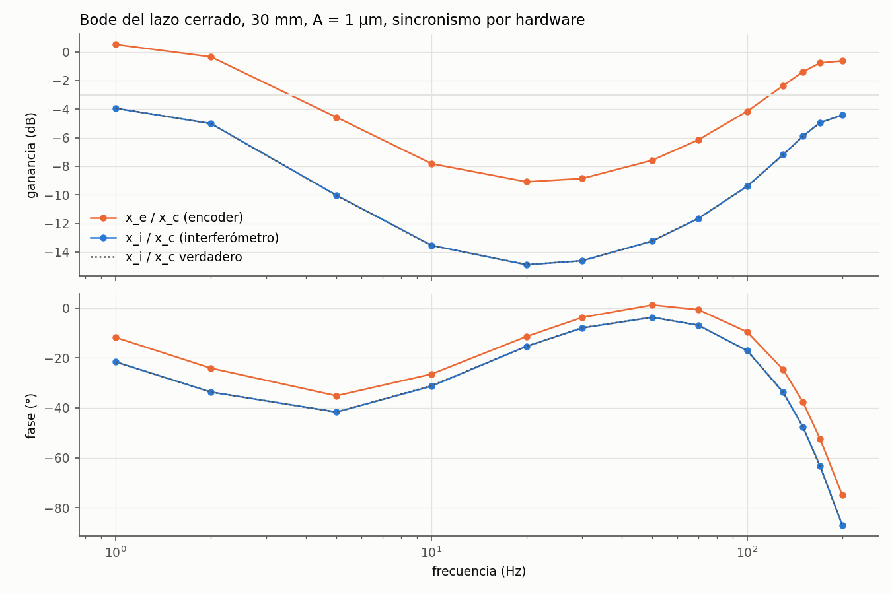
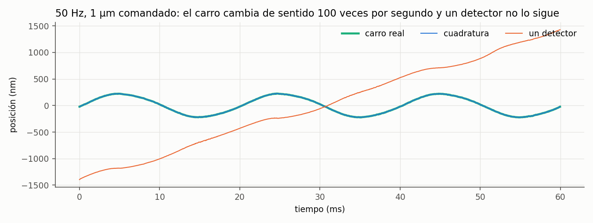

# Prueba 4 simulada: respuesta en frecuencia con un Michelson

**Fecha:** 18/11/2026. **Estado:** simulación; todavía no hay datos reales ni comando de senoide en el firmware.
**Scripts:** `simulaciones/prueba4_simulacion.py` genera los datos; `tools/prueba4_analisis.py` los analiza (sirve para los datos reales) y usa la demodulación de `tools/prueba2_analisis.py`.

## 1. Qué se simuló

### El lazo, tal como está en el firmware

| Parte | Valor | Fuente |
|---|---|---|
| PI de posición | KP 60, KI 100, salida ±2π rad/s, integral ±π/2 | `hw_config.h`, `servo_controller.cpp` |
| PI de velocidad | KP 0,12, KI 54, salida ±0,45π (81°) | `hw_config.h` |
| Filtro de la velocidad | 4 ms | `VEL_LOWPASS_TC` |
| Anticipación de velocidad | activada | `VELOCITY_FEEDFORWARD` |
| Tasas | perfil a 2 kHz, servo a 16 kHz, telemetría a 1 kHz | firmware y documentos |
| Torque | T0·sen(adelanto), con retardo de un ciclo y L/R = 1,12 ms | 37 mH / 33 Ω |

### La mecánica

Motor y rueda de imanes, acople, husillo, tuerca y carro.

| Parámetro | Valor | Fuente |
|---|---|---|
| Inercia del motor + rueda | 6·10⁻⁶ kg·m² | supuesto |
| Husillo + acople | 1·10⁻⁶ kg·m² | supuesto |
| Carro | 1 kg | supuesto |
| Rigidez torsional del acople | 30 N·m/rad (acople helicoidal chico) | supuesto |
| Rigidez axial | husillo de 6 mm de raíz en serie con la tuerca: 21,9 N/µm a 30 mm y 12,3 N/µm a 230 mm | supuesto |
| Amortiguamiento por fuerza contraelectromotriz | Kt²/R = 6,4·10⁻³ N·m·s/rad | medido (Kt 0,46, R 33 Ω) |
| Rozamiento | 20 mN·m | medido (14–30) |
| Fricción antes de deslizar | modelo de Dahl, rigidez 30 N·m/rad: el carro desliza recién después de ~0,5 µm | supuesto |

### El comando

Una marca de 50 µm, después 13 senoides (1, 2, 5, 10, 20, 30, 50, 70, 100, 130, 150, 170 y 200 Hz), después otra marca. Cada senoide tiene:
- 0,2 s de entrada suave;
- 0,3 s de asentamiento;
- una ventana de medición con un número entero de ciclos (al menos 5 ciclos y 0,5 s);
- 0,2 s de salida suave.

Todo el barrido dura **25,6 s**.

### Las mediciones

- **Michelson en cuadratura** a 25 kS/s, con el reloj del INTI.
- **Telemetría del encoder** (x_c, x_e) a 1 kS/s, con el reloj del RP2040. El reloj del RP2040 corre 30 ppm distinto y arranca 137 ms después.

### Corridas

| | Posición | Amplitud | Rampa | Para ver |
|---|---|---|---|---|
| A | 30 mm | 1 µm | — | caso principal |
| B | 30 mm | 100 nm | — | linealidad |
| C | 230 mm | 1 µm | — | husillo más largo |
| D | 30 mm | 1 µm | +2 mm/s | carro deslizando |
| E | 230 mm | 1 µm | −2 mm/s | husillo largo, deslizando |

### Lo que no reproduce

**El modelo no reproduce la oscilación de 214 Hz** que aparece en la máquina con `VEL_KP` ≥ 0,16. Probé combinaciones razonables de inercias, acople, fricción y torque, y ninguna da a la vez estabilidad con 0,12 e inestabilidad a 214 Hz con 0,16–0,2. Hay algo de la máquina real que no está modelado. Esa es una razón más para medir el Bode.

**Las curvas de la §3 dependen de dos valores que no conocemos:** la rigidez del acople y la de la fricción antes de deslizar. Lo que no depende de ellos es el método (§2), los requisitos (§4) y el diseño de la prueba (§5).

## 2. El análisis recupera la respuesta verdadera

Corrida A, sincronismo por hardware, x_i/x_c:

| f (Hz) | Ganancia verdadera (dB) | Estimada | Fase verdadera (°) | Estimada |
|---|---|---|---|---|
| 1 | −3,94 | −3,94 | −21,6 | −21,6 |
| 5 | −10,03 | −10,03 | −41,7 | −41,7 |
| 20 | −14,87 | −14,89 | −15,4 | −15,3 |
| 50 | −13,24 | −13,24 | −3,7 | −3,7 |
| 100 | −9,40 | −9,39 | −17,1 | −17,1 |
| 150 | −5,90 | −5,90 | −47,6 | −47,6 |
| 200 | −4,43 | −4,42 | −87,0 | −87,0 |

- **Error:** menos de 0,03 dB en ganancia y 0,2° en fase en todo el barrido.
- **Referencia "verdadera":** usa el x_c tal como lo registra la telemetría. El perfil a 2 kHz retiene cada valor 0,5 ms, lo que equivale a unos 0,22 ms de retardo, o −16° a 200 Hz. **Ese retardo es parte de lo que se mide en la máquina real.** Si se quiere separar, hay que restarlo.

## 3. Lo que muestra la simulación

### 3.1 Con 1 µm, la fricción decide todo

Con el carro quieto, una senoide de 1 µm apenas supera el rango en que la fricción todavía no desliza (~0,5 µm). En ese régimen:

- **El carro se mueve 0,5–0,65 veces lo que dice el encoder** (|G_m| ≈ 0,51–0,65). El acople se tuerce contra la fricción y el encoder, que está del lado del motor, no lo ve.
- **El lazo casi no sigue la orden:** ancho de banda de unos 3 Hz, mínimo de −15 dB a 20 Hz y subida hacia 200 Hz. Hasta el encoder cae a −9 dB a 20 Hz.
- **Distorsión armónica de x_i entre 2 y 11 %:** el movimiento no es lineal.

Sobre una rampa de 2 mm/s (corrida D) el carro desliza siempre y la respuesta es otra:

- 0 dB hasta 20 Hz;
- **un pico de +12 dB a 70 Hz** (el modo del lazo de velocidad);
- |G_m| ≈ 1 a baja frecuencia;
- distorsión menor que 2 %.

**Consecuencia:** el Bode con el carro quieto y el Bode en movimiento son dos sistemas distintos. Para elegir `VEL_KP` y `POS_KP` hay que medir los dos. El pico de 70 Hz en movimiento sería relevante para la prueba 2: a 2 mm/s el paso del motor cae en 80 Hz, cerca de ese pico.

### 3.2 La amplitud de 100 nm mide otro régimen

Con 100 nm la fricción no llega a deslizar (corrida B):

| | 1 µm (A) | 100 nm (B) |
|---|---|---|
| \|G_m\| | 0,51–0,65 | 0,48–0,55 |
| Fase de G_m | hasta −10° (rozamiento con histéresis) | menos de 1° (resorte puro) |
| Distorsión armónica | 2–11 % | < 1 % por encima de 30 Hz; hasta 7 % a 1 Hz |

Comparar las dos amplitudes es la prueba de linealidad que pedía el documento. Si coinciden, el modelo lineal sirve. Si no, la fricción manda.

### 3.3 La transmisión al carro deja ver la resonancia aunque no se llegue a ella

El modo del husillo + carro con el motor quieto está en 558 Hz a 30 mm y en 477 Hz a 230 mm, por encima de los 200 Hz del barrido. Aun así, |x_i/x_e| ya sube 16–24 % a 200 Hz. Ajustando |G_m| ≈ g₀/|1 − (f/f_r)²| en las corridas que deslizan:

| Corrida | f_r ajustada | Modo real | Error |
|---|---|---|---|
| D, 30 mm | 541 Hz | 558 Hz | −3 % |
| E, 230 mm | 458 Hz | 477 Hz | −4 % |

En las corridas sin rampa el ajuste no sirve (428 y 389 Hz), porque la fricción también curva |G_m|.

**Consecuencia:** la rigidez del husillo y su variación con la posición se miden con el carro deslizando, en dos puntos del recorrido.

### 3.4 Sin sincronismo por hardware, la fase no sirve

| Sincronismo | Desfase estimado | Deriva estimada | Error de fase a 20 Hz | a 100 Hz | a 200 Hz |
|---|---|---|---|---|---|
| Por hardware | 137,000 ms | 30,0 ppm | +0,05° | +0,02° | 0,00° |
| Dos marcas de 50 µm | 138,745 ms | 29,8 ppm | +12,6° | +62,9° | +125,9° |
| Una marca | 138,727 ms | 0 | +15,5° | +82,6° | +175,4° |
| Ninguno | 0 | 0 | +97° | +128° | −93° |

Las marcas estiman bien la deriva entre relojes, pero el desfase sale corrido en 1,7 ms. No es un error de cálculo, es física: mientras se mueve, el carro va atrasado respecto del motor una cantidad fija (el acople torcido por el rozamiento, ~0,5 µm). Visto en el tiempo, ese atraso es indistinguible de un desfase de relojes. **Ningún método que alinee x_i con x_e usando los datos de posición puede separar el atraso mecánico del desfase de relojes.**

**Qué hacer:**
- **La ganancia no necesita sincronismo,** y G_e (encoder contra comando) tampoco, porque usa un solo reloj.
- **Para la fase de x_i** hace falta una señal de tiempo que no pase por la mecánica:
  - un pulso de disparo, o
  - **mejor todavía, si la adquisición del INTI tiene un canal libre** (osciloscopio o placa de adquisición), grabar en ese canal una salida digital del RP2040 que cambie con cada segmento. Así cada senoide queda marcada en los dos relojes.

### 3.5 Un solo detector no sirve para esta prueba

A diferencia de la prueba 2, acá el carro invierte el sentido dos veces por ciclo. Un detector solo da la intensidad, que es igual yendo y viniendo, así que no puede saber para qué lado va el carro. En 50 Hz el error fue de 870 nm RMS, contra 0,2 nm con cuadratura.

## 4. Requisitos para la adquisición

| Qué | Valor | Por qué |
|---|---|---|
| Detectores | **cuadratura, obligatoria** | el carro invierte el sentido |
| Muestreo | ≥ 10 kS/s quieto; 25 kS/s como mínimo con rampa de 2 mm/s, mejor 50 kS/s | velocidad pico 2π·200 Hz·1 µm = 1,3 mm/s, más la rampa: franjas de hasta 10 kHz |
| Duración | ~26 s por barrido de 13 frecuencias | 4 corridas útiles en ~2 minutos de captura |
| Memoria | ~650 k muestras por canal y por barrido a 25 kS/s | |
| Sincronismo | pulso o canal extra con una salida digital del RP2040 | §3.4 |
| Turbulencia del aire | con 100 nm de amplitud, 3 nm de ruido son el 3 % | conviene la amplitud de 100 nm cerca del interferómetro |

## 5. Diseño de la prueba 4

1. **Comando nuevo en el firmware:** `M60 A<µm> F<Hz> N<ciclos>`, o mejor uno que haga el barrido completo, con entrada y salida suaves y una salida digital que marque cada segmento.
2. **Antes de ir al INTI, medir G_e en el laboratorio.** Solo usa el encoder y un reloj. Ya muestra en qué régimen está la máquina: si el encoder a 1 µm cae a −9 dB en 20 Hz como en la simulación, la fricción manda.
3. **En el INTI, cuatro barridos de ~26 s cada uno:**

| Barrido | Para qué |
|---|---|
| 30 mm, 1 µm, quieto | respuesta en reposo |
| 30 mm, 100 nm, quieto | linealidad |
| 30 mm, 1 µm sobre rampa de +2 mm/s | respuesta deslizando; rigidez del husillo |
| 230 mm, 1 µm sobre rampa de −2 mm/s | rigidez del husillo en la otra punta |

4. **Condición para la rampa:** que la senoide nunca invierta el sentido, 2π·f·A < v. Con 1 µm y 200 Hz hacen falta más de 1,3 mm/s. Con 0,5 mm/s, por encima de 80 Hz el carro vuelve a frenar contra la fricción.
5. **Frecuencias de la senoide con rampa:** que no caigan sobre las de los errores espaciales (v/λ). A 2 mm/s, el encoder está en 12 Hz, los imanes en 24 Hz y el paso del motor en 80 Hz. Con ventanas de un número entero de ciclos no se mezclan, pero conviene no elegir justo esas frecuencias.

## 6. Pendientes

- **Comando de senoide en el firmware,** con salida digital de sincronismo.
- **Formato de la telemetría:** el análisis espera t, x_c y x_e en reloj del RP2040.
- **Barrido de G_e en el laboratorio,** para contrastar el modelo (sobre todo la rigidez del acople y de la fricción) antes de la visita.
